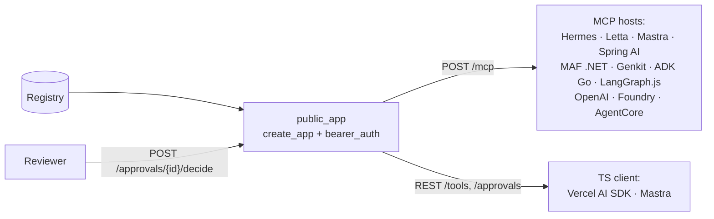

# Connect anywhere

:material-check-circle:{ .status-ok } Recipes · our side needs `pip install "agent-adapter[server]"`

One page per stack. Each page has three parts: the exact config on **their side**, our
server on **our side**, and a **checklist** for a public host. Every config key was checked
against that project's own docs on 2026-10-30; each page links them.



## Pick a page

| Stack | Language | Attaches through | Page |
|---|---|---|---|
| :brand-hermes: Hermes Agent | Python | MCP | [Hermes Agent](hermes.md) |
| :brand-letta: Letta | server (Python / TS SDK) | MCP | [Letta](letta.md) |
| :brand-mastra: Mastra | TypeScript | MCP or TS client | [Mastra](mastra.md) |
| :brand-spring: Spring AI | Java | MCP | [Spring AI](spring-ai.md) |
| :brand-microsoft: Microsoft Agent Framework | .NET | MCP | [MAF .NET](maf-dotnet.md) |
| :brand-firebase: Genkit | TypeScript | MCP | [Genkit](genkit.md) |
| :brand-go: ADK Go | Go | MCP | [ADK Go](adk-go.md) |
| :brand-langgraph: LangGraph.js | TypeScript | MCP | [LangGraph.js](langgraph-js.md) |
| :brand-vercel: Vercel AI SDK | TypeScript | TS client or MCP | [Vercel AI SDK](vercel-ai-sdk.md) |
| :brand-openai: OpenAI Responses `mcp` tool | hosted | public MCP | [OpenAI hosted MCP](openai-hosted-mcp.md) |
| :brand-azure: Azure AI Foundry Agent Service | hosted | public MCP | [Azure AI Foundry](azure-foundry.md) |
| :brand-bedrock: Bedrock AgentCore Gateway | hosted | public MCP | [Bedrock AgentCore](bedrock-agentcore.md) |

Already covered by an integration, no recipe needed: Marvin (through
[Pydantic AI](../integrations/pydantic-ai.md)), txtai agents (through
[smolagents](../integrations/smolagents.md)) and deepagents (through
[LangGraph](../integrations/langgraph.md)). There is no Vercel AI SDK for Python.

## Our side, in one file

`examples/connect_server.py` holds every snippet these pages show. Run it as a script and
it replays a remote host offline. `--serve` runs the public app.

| Function | Use it for |
|---|---|
| `local_app()` | a framework on the same machine, in development: MCP only, no auth, loopback peers only |
| `public_app(tools, host, agent_token, reviewer_token)` | anything off the machine: REST and MCP behind one bearer check, `Host` pinned |
| `hosted` | the tools a hosted runtime may see: none that need approval |

```python
--8<-- "examples/connect_server.py:public"
```

Set `AA_PUBLIC_HOST` (such as `tools.example.com`), `AA_AGENT_TOKEN` and
`AA_REVIEWER_TOKEN` in the environment, then run `python examples/connect_server.py --serve`
(needs the `server` extra), behind a TLS proxy. Real deployments load
tokens from a secret store, or pass `bearer_auth` an async verifier instead of a table.

## How approval works from a remote host

A tool with `confirm=True` never runs on the host's say-so: a framework's own
approval never counts alone ([Security](../guides/security.md#framework-approvals)).

| Step | What happens |
|---|---|
| 1 | the host calls the tool over MCP; the server parks it and returns `isError: true`, text `approval required: <id>` |
| 2 | a reviewer decides it: `POST /approvals/{id}/decide` (202 `approved`, with a note) |
| 3 | the call runs only when the caller calls again with the pending result's `_meta` keys `agent-adapter/run_id` and `agent-adapter/call_id` |
| 4 | a host that drops those keys parks a new approval on every retry: nothing runs |

Our own `import_mcp` sends the keys back for you. Most hosts do not. So:

- give hosts that cannot resume the `hosted` registry (no confirm tools);
- route confirm tools through REST ([TS client](../cross-language/typescript-client.md) or
  [HTTP server](../cross-language/http-server.md)): there, `decide` runs the call;
- a host's own approval prompt (`require_approval`, `requireToolApproval`, `toolApproval`,
  `RequireConfirmation`) only **adds** a gate. It never counts as our approval.

## Public-host checklist (every page)

| Check | Why |
|---|---|
| use `public_app`, never `local_app`, off the machine | `local_app` has no auth; it refuses remote peers, and behind a proxy every peer looks local |
| one token per host, from a secret store | `bearer_auth` maps each token to a `Principal`; runs and approvals are scoped to it |
| reviewers get `APPROVER_SCOPE`; hosts do not | a host cannot approve its own calls |
| `allowed_hosts` and `transport_security` name your public host | other `Host` headers get 421 (DNS rebinding) |
| TLS, rate limits and request timeouts at a reverse proxy | out of scope for the server ([security model](../cross-language/http-server.md#security-model) row 12) |
| several workers share `approvals=` and `idempotency=` stores | [production settings](../cross-language/http-server.md#production-settings) |
| keep `client_approval` off | none of these hosts documents a person reviewing an MCP form |
