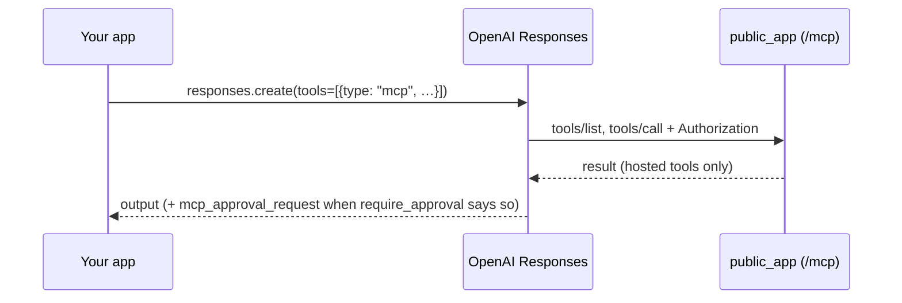

# Connect: OpenAI hosted MCP (Responses API)

:material-check-circle:{ .status-ok } Recipe · through our public [MCP server](../cross-language/mcp.md) · their docs checked 2026-10-30

With the Responses API `mcp` tool, OpenAI's servers call our server for you. So our server
must be reachable from the internet, with auth. Data leaves our server to OpenAI with each
tool result.



## Our side

```python
--8<-- "examples/connect_server.py:public"
--8<-- "examples/connect_server.py:hosted"
```

Serve `public_app(hosted, host, agent_token, reviewer_token)`.

## Their side

```python
response = client.responses.create(
    model=model,
    input="What is the shipping rate to the US?",
    tools=[
        {
            "type": "mcp",
            "server_label": "shop_tools",
            "server_description": "Shop lookups: shipping rates and invoices.",
            "server_url": "https://tools.example.com/mcp",
            "authorization": agent_token,  # not stored by OpenAI: send it on every request
            "allowed_tools": ["shipping_rate"],
            "require_approval": "always",
        }
    ],
)
```

| Key | Meaning |
|---|---|
| `type: "mcp"`, `server_label`, `server_url` | which server, under which name |
| `authorization` | the token OpenAI sends to us; resend it on each request |
| `allowed_tools` | the tools the model may see |
| `require_approval` | `"always"`, `"never"`, or `{"never": {"tool_names": [...]}}` |
| `mcp_approval_request` → `mcp_approval_response` | OpenAI's approval round trip: reply with `approval_request_id` and `approve`, chained by `previous_response_id` |

## Checklist

| Check | Why |
|---|---|
| serve `hosted` and list it in `allowed_tools` | OpenAI does not send our resume keys back; a confirm tool would never run |
| `require_approval` is OpenAI's gate | an `approve: true` there adds a step; it never approves our `confirm` tools ([framework approvals](../guides/security.md#framework-approvals)) |
| a token only for OpenAI, with no `APPROVER_SCOPE` | it is sent through a third party; rotate it on its own |
| everything on the [public-host checklist](index.md#public-host-checklist-every-page) | |

## Sources

- OpenAI remote MCP guide: <https://developers.openai.com/api/docs/guides/tools-remote-mcp>
