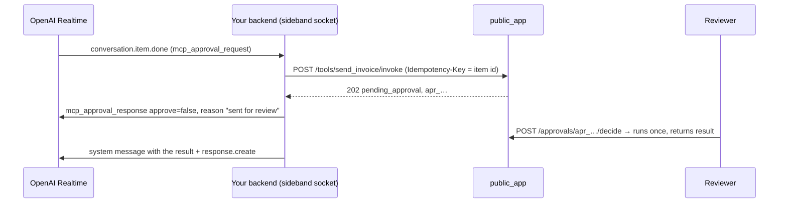

# Connect: OpenAI Realtime and ElevenLabs Agents

:material-check-circle:{ .status-ok } Recipe · through our public [MCP server](../cross-language/mcp.md) and [HTTP server](../cross-language/http-server.md) · their docs checked 2026-11-16

Both voice platforms call remote MCP servers from their own cloud, so our server must be
public, with auth. Read-only tools go over MCP. A tool with a side effect never runs on the
platform's say-so: it becomes one of our approvals, and a person decides it.



## Our side

```python
--8<-- "examples/connect_server.py:public"
--8<-- "examples/connect_server.py:hosted"
```

For OpenAI Realtime serve `public_app(registry, …)`: REST needs the confirm tools to park
them. For ElevenLabs, serve `public_app(hosted, …)`.

## Their side: OpenAI Realtime

Declare our server in `session.update` (or per turn in `response.create`):

```json
{
  "type": "mcp",
  "server_label": "shop_tools",
  "server_url": "https://tools.example.com/mcp",
  "headers": { "Authorization": "Bearer <AA_AGENT_TOKEN>" },
  "allowed_tools": ["shipping_rate", "send_invoice"],
  "require_approval": { "never": { "tool_names": ["shipping_rate"] } }
}
```

Read-only calls run at once and arrive as `mcp_call` items. For `send_invoice` OpenAI sends
an `mcp_approval_request` item instead (`id`, `name`, `arguments`, `server_label`). Your
backend, on the sideband socket, maps it to our approval:

```python
--8<-- "examples/connect_server.py:realtime"
```

| Step | Code |
|---|---|
| `conversation.item.done` with `item.type == "mcp_approval_request"` | `approval_id, reply = await park_realtime_approval(item, rest, session_id)`, send `reply` |
| the reviewer decides | your reviewer screen posts `/approvals/{approval_id}/decide`; the call runs once, here |
| back to the caller | send each event of `realtime_outcome(approval_id, decided)` on the socket |

`approve: false` keeps OpenAI from calling the tool itself. Had it said `true`, our server
would still park the call over MCP, as no resume keys come back: nothing runs either way.
The `Idempotency-Key` is the item id, so a replayed event parks no second approval. Use
`headers` or `authorization`, never both.

The other route needs no mapping: declare `send_invoice` as a Realtime function tool, call
`/tools/send_invoice/invoke` on `function_call`, and answer with `function_call_output` once
`decide` returns.

## Their side: ElevenLabs Agents

Turn on MCP for the workspace, then add a custom MCP server (dashboard, or the SDK):

```python
server = elevenlabs.conversational_ai.mcp_servers.create(
    config={
        "url": "https://tools.example.com/mcp",
        "name": "shop_tools",
        "description": "Shop lookups: shipping rates.",
        "approval_policy": "always_ask",
    }
)
```

Pick the streamable HTTP transport (ElevenLabs also speaks SSE, which our server does
not). In the dashboard, put the bearer token in **Secret Token** (sent as the
`Authorization` header) and pick an approval mode: Always Ask, Fine-Grained Tool Approval or No Approval.
Serve `hosted` here: ElevenLabs' approval is its own gate and never approves our `confirm`
tools. For a side effect, add a server (webhook) tool that posts to
`/tools/send_invoice/invoke`: the agent gets `pending_approval` and tells the caller it is
waiting for review, and the reviewer's `decide` runs it.

## Checklist

| Check | Why |
|---|---|
| a platform's approval adds a gate, never ours | a confirm tool runs only after our reviewer decides ([framework approvals](../guides/security.md#framework-approvals)) |
| one token per platform, with no `APPROVER_SCOPE` | it passes through a third party; the platform cannot approve its own calls |
| the backend, not the browser, holds the agent token | a token in a client bundle leaks |
| MCP is off for ElevenLabs workspaces in Zero Retention or HIPAA mode | use the webhook route there |
| everything on the [public-host checklist](index.md#public-host-checklist-every-page) | |

## Sources

- OpenAI Realtime with MCP: <https://developers.openai.com/api/docs/guides/realtime-mcp>
- ElevenLabs Agents MCP: <https://elevenlabs.io/docs/eleven-agents/customization/tools/mcp>
- ElevenLabs MCP security: <https://elevenlabs.io/docs/eleven-agents/customization/tools/mcp/security>
