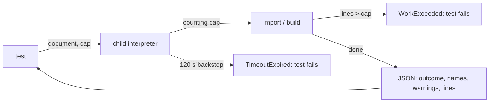

# Performance regression tests

A test that guards against exponential or quadratic work must not time the work: seconds
change with machine load, so a `< 2 s` assertion flakes. Count the work instead.

## How they count

`tests/work.py` counts the **lines of `agent_adapter` code run** inside a block. The count
is the same on every run, and it still grows with the bug: a quadratic name search runs
millions of lines where the linear one runs thousands.



- The workload runs in a **child interpreter**, so a regression fails at its cap instead
  of hanging the suite, and tracing never displaces the parent's coverage tracer.
- Python 3.12+ counts with `sys.monitoring` (code outside the package costs nothing);
  3.11 falls back to `sys.settrace`.
- The hard timeout is only a backstop for work the count cannot see (C code).

## Files

| File | What it does |
|---|---|
| `tests/work.py` | `counting(cap)`, `WorkExceeded`, `run_child(script)` |
| `tests/integrations/openapi_work.py` | `run_counted(document, tmp_path, cap=..., stage=...)`: an OpenAPI import or build in a child |
| `tests/test_work.py` | self-tests of the counter |

## Writing one

1. Run the workload on today's code and note `lines` from the result.
2. Set the cap to about **3x** that, as a per-unit constant (`LINES_PER_FIELD * n`), with
   a one-line comment giving the measured count.
3. Check the cap catches the bug: replay the old source (below) and see the test fail.

## Replaying old source

`run_child` imports `agent_adapter` from `$AA_IMPORT_ROOT` when it is set; the tests
themselves always come from the working tree.

```bash
mkdir -p ../scratch/old && git archive <commit> agent_adapter | tar -x -C ../scratch/old
AA_IMPORT_ROOT=../scratch/old pytest tests/integrations/test_openapi_contract.py -k linear_work
```
