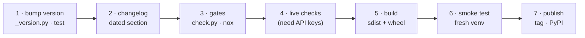

# Cutting a release

How to ship a new version of Agent Adapter to PyPI. A release is an sdist and a wheel,
built and uploaded by the `release` GitHub workflow when a version tag is pushed.



## 1. Bump the version

What counts as public API, and the semver rules: [Versioning](../guides/versioning.md).

| File | Change |
|---|---|
| `agent_adapter/_version.py` | `__version__ = "X.Y.Z"` (hatch reads it; `pyproject.toml` has `dynamic = ["version"]`) |
| `tests/test_package.py` | the asserted version |
| `clients/typescript/package.json` | only when the TypeScript client ships too; then refresh `package-lock.json` with `npm install --package-lock-only` |

Use [Semantic Versioning](https://semver.org/spec/v2.0.0.html): a breaking change to a
public name, an error `kind` or a rendered schema is a major bump.

## 2. Changelog

In `CHANGELOG.md`, rename `## [Unreleased]` to `## [X.Y.Z] - YYYY-MM-DD` and add an empty
`## [Unreleased]` above it. The docs site includes the file as-is
([Changelog](../changelog.md)).

## 3. Gates

Run every gate from the project root with the project venv. `scripts/check.py` runs them
in order and stops at the first failure:

| Gate | Command inside `check.py` | Pass rule |
|---|---|---|
| tests + coverage | `pytest --cov` | all pass, 0 warnings (warnings are errors), coverage ≥ 90 % |
| lint | `ruff check .` | clean |
| format | `ruff format --check .` | clean |
| types | `mypy` (strict, `packages = ["agent_adapter"]`) | no issues |
| docs | `mkdocs build --strict` | no warnings |

Then the nox sessions (`noxfile.py`). Keep virtualenvs off a full disk with
`--envdir <dir>` and `$env:PIP_CACHE_DIR = "<dir>"`.

| Session | What it proves |
|---|---|
| `core`, `core-floor` | the suite on the latest pydantic and on `pydantic==2.12.*` |
| `lint`, `typecheck`, `docs` | the gates above, in clean environments |
| `models` | provider ports, Redis cache and OTel sink with their SDKs |
| `contract-<target>` (21) | each integration against its real framework (`-m contract`) |
| `contract-all-compatible` | the `all` extra installs together, `pip check` is clean, every contract test passes |
| `plugin` | a third-party entry-point integration is discovered |
| `server` | HTTP server, WSGI app and MCP HTTP app |
| `ts` | the TypeScript client's test suite against a live local server (Node ≥ 22.18; offline) |
| `ts-build` | `npm ci`, `tsc`, prettier, `tsdown`, `publint`, `attw` (online: needs the npm registry) |
| `coverage` | combines the sessions' data files; fails under 90 % |

Run each Python session for 3.11, 3.12 and 3.13 (`nox -s core-3.11`, ...). A session
that crashes natively is re-run once and both results are reported; a flaky test is
fixed by counting work (`tests/work.py`), never by loosening a timeout.

## 4. Live-provider checks

The suite is offline. Run these by hand with real keys before each release and record the
result in the changelog (for 1.0.0 the maintainer ran them):

| Check | Why |
|---|---|
| OpenAI usage: `input = prompt − cached − cache_write`, writes billed once at the write rate | cost accuracy on write-priced models |
| Anthropic structured output: whether the API requires `additionalProperties: false` | requests with an output schema may be refused |
| Gemini: `google-genai` sends `parameters_json_schema` and `thinking_config` keys in snake_case | proto JSON should accept them; unverified on the wire |
| Anthropic and Voyage prices | the default table prices the current Claude models; older Claude ids are caps-only and there is no Voyage row; add prices with `Prices.load` |

## 5. Build

The workflow builds for you; build locally first to catch problems early. `build` and
`twine` are not dev dependencies: install them in a throwaway venv.

```powershell
$venv = "<release-venv>"; $rel = "<release-folder>\X.Y.Z"; $py = "$venv\Scripts\python.exe"
py -3.12 -m venv $venv
& $py -m pip install build twine
& $py -m build --sdist --wheel --outdir $rel .
& $py -m twine check --strict "$rel\*"
```

The wheel holds only `agent_adapter/` (`[tool.hatch.build.targets.wheel]`). The sdist
is allow-listed (`[tool.hatch.build.targets.sdist] only-include`): `agent_adapter/`,
`README.md`, `PYPI.md`, `CHANGELOG.md`, `LICENSE` and `NOTICE` only.

`PYPI.md` is the long description PyPI shows; `README.md` stays the GitHub page. PyPI
cannot show images, mermaid or links into the repository, so `PYPI.md` has none (a test
checks it and runs its examples). A published description never changes: edit `PYPI.md`
before tagging.

## 6. Smoke test

Install the wheel into a fresh venv and check the version and the entry points:

```powershell
& $py -m pip install "$rel\agent_adapter-X.Y.Z-py3-none-any.whl"
& $py -c "import agent_adapter; print(agent_adapter.__version__)"
& $py -c "from agent_adapter.integrations.discovery import available_integrations as a; print(len(a()))"
& $py -m pip check
```

Expect the new version, `25` integrations and no broken requirements.

## 7. Publish

Merge to `main`, then push a tag that matches `_version.py`:

```bash
git tag vX.Y.Z
git push origin vX.Y.Z
```

`.github/workflows/release.yml` checks the tag against `__version__`, builds both
artefacts, runs `twine check --strict` and uploads them with PyPI trusted publishing: no
token is stored anywhere. Only maintainers can push tags, so the tag is the approval. PyPI
never accepts the same version twice, so a bad release is fixed with a new patch version.

One-time setup, by a PyPI owner of `agent-adapter`: on PyPI, add a trusted publisher with
owner `VeloceAI`, repository `agent-adapter`, workflow `release.yml` and no environment.
For a project that does not exist yet, add it as a pending publisher.

## The TypeScript client

`clients/typescript/package.json` is `"private": true` (licence `Apache-2.0`), so
`npm publish` refuses it. Where it is published (npm, a git dependency, or not at all) is
not chosen yet ([Roadmap](../roadmap.md)). Until then, ship
it as a tarball: run `ts-build`, then `npm pack --pack-destination $rel` in
`clients/typescript`. Flip `private` only once a registry is chosen.

## Checklist

- [ ] Version bumped in `_version.py` and `tests/test_package.py` (and the TS client, if shipped)
- [ ] Changelog section dated
- [ ] `scripts/check.py` green; every nox session green on 3.11, 3.12 and 3.13
- [ ] Live-provider checks run, or listed as unverified in the changelog
- [ ] sdist and wheel built, `twine check` passed, wheel smoke-tested
- [ ] Tag `vX.Y.Z` pushed; the `release` workflow uploaded to PyPI
