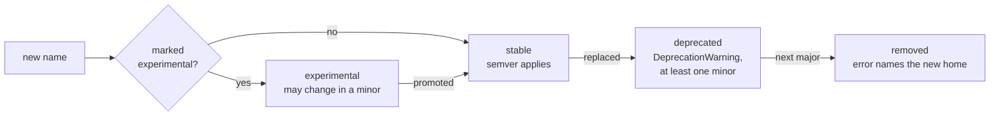

# API stability policy

The rules every change to Agent Adapter follows in 1.x: what callers may rely on, what may
change, and how something is retired. Users get the short version in
[Versioning and compatibility](../guides/versioning.md); this page is for contributors and
reviewers, and wins where the two disagree.

## What is public

A thing is public when users can reach it without a leading underscore and the docs show
it. Public things follow semver.

| Surface | Public part | Pinned by |
|---|---|---|
| Top-level names | `agent_adapter.__all__` (about 55 names) | `tests/test_public_api.py`, `tests/test_exports.py` |
| Sub-packages | each documented package's `__all__`: `errors`, `exec`, `exec.checkpoints`, `approval`, `hooks`, `hooks.builtin.guards`, `hooks.builtin.budgets`, `cost`, `cache`, `flow`, `tracing`, `models`, `embeddings`, `memory`, `retrieval`, `sandbox`, `chat`, `evals`, `policy`, `audit`, `viewer`, `server`, `optimiser`, `runtime`, `integrations.<name>` | the [reference](../reference.md) pages and their test |
| Errors | class names, `kind` ids, `retryable` flags; HTTP problem types `urn:agent-adapter:error:<kind>` | the error catalogue test |
| CLI | command names (`init`, `doctor`, `guide`, `ui`, `eval`, `migrate`, `policy check`, `audit verify`, `audit export`), their flags, exit codes (0 ok, 1 gate failed, 2 usage or config error) | `tests/cli/`, `tests/evals/test_cli_eval.py` |
| HTTP API | routes, methods, JSON bodies, status codes and the OpenAPI document of the tool server | `tests/server/` |
| Events | `EventType` names and their `REQUIRED_DATA` keys | `tests/tracing/` |
| File formats | eval case files (JSONL, JSON, CSV: `id`, `input`, `expected`, `tags`); eval report JSON (`--baseline` must read last release's); price tables (`Prices.load`); policy files (`load_policy`); recorded run files (`"v"` header); SQLite store schemas (approvals, checkpoints, budgets, memory) | round-trip tests in each package |
| Extras | the names after `pip install "agent-adapter[...]"` | `tests/test_packaging_metadata.py` |

## What is private

| Private: may change in any release | Example |
|---|---|
| a module or name starting with `_` | `agent_adapter.exec._call_steps`, `viewer._evals` |
| `agent_adapter.core.*` (use the re-exports) | `core.errors.log_failure` |
| a name imported into a module but not in its `__all__` | |
| log message text and log levels | assert on `kind` or on events, never on text |
| the viewer page's HTML, CSS, JS and its `/api/` routes | the page and the server ship together |
| OTel GenAI attribute names | they follow the upstream conventions, still in Development |
| the numbers in the default price table | prices change; each entry carries its version |
| generated files (`AGENTS.md`, `llms-full.txt`, gallery pages) | regenerated each release |

## Semver rules for 1.x

| Release | May | May not |
|---|---|---|
| patch `1.x.y` | fix bugs; tighten a check that let unsafe input through; update prices; add a doc | add, remove or rename a public name |
| minor `1.x` | add names, keyword-only arguments with defaults, extras, events, event data keys, error kinds, CLI flags, HTTP routes; deprecate; change experimental names | remove or rename a stable name, a `kind`, an event, a flag or a route; make an optional argument required; change a default so existing callers break |
| major `2.0` | remove what was deprecated; change behaviour | remove anything that was never deprecated |

- **Security fixes** may tighten behaviour in any release, even if code that relied on the
  unsafe behaviour breaks. The changelog says so under **Security**.
- **Safe defaults** never loosen in a minor. A new feature that could widen access starts
  off, behind an explicit option.
- **File formats** stay readable for one major: 1.x reads every 1.x file. A store with a
  newer schema refuses to open rather than guess (the SQLite stores check their
  `schema` row). A new schema ships with a migration step and a changelog note.
- **Events** may gain data keys in a minor; consumers must ignore keys they do not know.

## Deprecation process

1. Add the replacement first. Keep the old name working.
2. The old name emits `DeprecationWarning` (`stacklevel=2`) naming the replacement and the
   release that removes it. Test that it warns and still works.
3. Add a changelog bullet under **Deprecated** in `CHANGELOG.md` and `docs/changelog.md`.
4. Update every example, docs page and the agent guide to the new name in the same change.
5. Keep it for at least one minor release; remove it in the next major only.
6. After removal the old name raises an error that names the new home, as moved names do.

The test suite runs with warnings as errors, so the repo itself never calls a deprecated
name.

## Experimental names

Use an experimental marker when a design needs real use before it is frozen.

- The docstring's one line starts with `Experimental:`.
- The docs page carries an `!!! warning "Experimental"` box under its title saying what may
  change.
- The changelog bullet says **experimental**.
- An experimental name may change or go in a minor release, with a changelog bullet and no
  deprecation period. It never changes in a patch.
- Promote it by removing the three markers in a minor release; from then on semver applies.
- Never ship a safety control (approval, auth, budgets, guards, isolation) as
  experimental: those are stable or not shipped.

To list the experimental names of a release, search the package for `Experimental:`.

## Checklist for a reviewer

- [ ] New public names are in their package's `__all__` and on its reference page;
  top-level names are pinned in `tests/test_public_api.py`.
- [ ] No public name, `kind`, event, flag, route or file field was removed or renamed
  without a deprecation.
- [ ] New arguments are keyword-only with a default.
- [ ] Defaults stay safe; anything wider is opt-in.
- [ ] The changelog has the bullet: **Added**, **Changed**, **Deprecated**, **Removed**,
  **Fixed** or **Security**.

Related: [Release](release.md), [Writing an integration](writing-an-integration.md).
