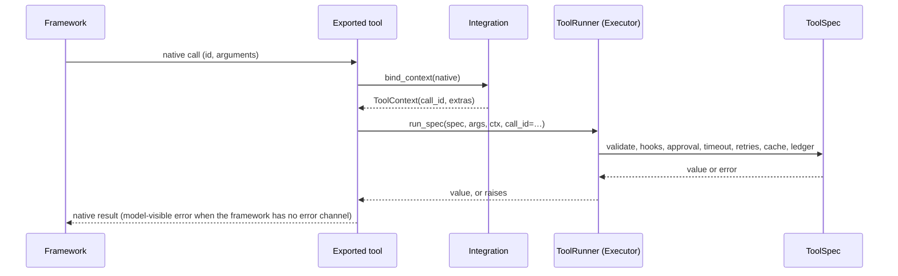

# Writing an integration

:material-check-circle:{ .status-ok } Available · `agent_adapter.integrations.base` · `.discovery`

An integration turns registry tools into one framework's native tools. You can ship it in
your own package: register it under the `agent_adapter.integrations` entry-point group and
the adapter finds it, with no change to the adapter.



## The protocol

| Member | Meaning |
|---|---|
| `name` | Canonical target name. Must equal the entry-point name |
| `requires` | Import names that must be importable (`("google.genai",)`) |
| `extra` | Pip extra named in the `MissingDependency` message |
| `export_tool(spec, *, executor=None)` | The framework's native tool for one `ToolSpec` |
| `bind_context(native)` | A `ToolContext` for one native call; carries the native call id |
| `bind_approval(port)` | A native approval gate, or `None` when the executor's port decides |
| `compile_flow(flow, *, executor=None, **options)` | Optional (`FlowCompiler`): a flow as the framework's graph |

`IntegrationBase` gives you the rest: `export_tools(registry)` (honours `targets`),
`bind_context` (reads `call_id_fields` from the native call), `bind_approval` (`None`),
`require()`, and `_run_bound(native, spec, args, runner)` for frameworks without a
tool-error channel (bind → `run_spec(..., call_id=ctx.call_id)` → model-visible errors).

## 1. Write the integration

The demo plugin below drives a tiny framework whose tools are async callables:

```python
--8<-- "tests/fixtures/demo_integration/demo_integration/__init__.py:integration"
```

Rules every exported tool follows:

- Run through the runner (`_run_bound` does): `runner.run_spec(spec, args, ctx, call_id=…)`. Never call
  `spec.invoke` directly, or hooks, approval, timeouts and the ledger are skipped.
  Default `executor=None` to `exec.defaults.runner_for(executor)`, as the built-ins and the demo do.
- Use a context from `bind_context`, so `ctx.call_id` is the framework's call id.
- Export `registry.for_target(name)` only (`IntegrationBase.export_tools` does this).
- Never catch `BaseException`: `asyncio.CancelledError` and LangGraph's `GraphBubbleUp`
  must pass through.

## 2. Report errors the framework's way

| Framework has… | `ToolArgsInvalid`, `ToolError`, `ApprovalDenied`, `GuardrailBlocked`, `RunLimitExceeded` | Every other exception |
|---|---|---|
| a native tool-error channel (LangChain `ToolException`, MCP `is_error`, …) | that channel | propagates |
| none | return `model_visible_error(exc)` (`MODEL_VISIBLE_ERRORS` lists the classes) | propagates |

`model_visible_error(exc)` is `{"error": {"kind": …, "message": …}}`; a foreign exception
shows only its class name, never its text.

## 3. Approval

| Framework | Do |
|---|---|
| Has its own approval gate | After the gate approves, put the decision in `ctx.approval`; the executor then skips its port |
| Has none | Return `None` from `bind_approval`; the executor asks its `ApprovalPort` |

## 4. Register the entry point

In your package's `pyproject.toml`:

```toml
--8<-- "tests/fixtures/demo_integration/pyproject.toml:entry-points"
```

The value is a module attribute (an instance) or a class (instantiated with no arguments).

```python
--8<-- "examples/discover_integrations.py:discover"
```

Discovery never fails because of one plugin. It logs a `WARNING` and skips an entry that:

| Problem | Example |
|---|---|
| Module or attribute missing | the plugin is half-installed |
| Import or constructor raises | a bug in the plugin |
| Not an `Integration` | wrong object registered |
| Bad attribute types, or `name` ≠ entry-point name | `requires` is a list |
| Name already taken | two plugins claim `demo` (the first wins) |

## 5. Pass the contract kit

`tests/integrations/kit.py` runs eight checks through your framework's own call path. It
is test code, not part of the wheel: a third-party package copies (vendors)
`tests/integrations/kit.py`, `tests/integrations/_kit_support.py` and
`tests/fakes/{hooks,approval}.py` into its own `tests/` package. Write a harness and
install the fixture and tests `contract_tests` returns:

```python
--8<-- "tests/integrations/demo_support.py:harness"
--8<-- "tests/integrations/test_kit_selftest.py:install"
```

| Check | Asserts |
|---|---|
| C1 | name, description and the target's schema are exported |
| C2 | the happy path returns what `spec.invoke` returns |
| C3 | invalid args give the framework's error, never a raw `pydantic.ValidationError` |
| C4 | executor policy applies: hooks see before/after; a timeout is `tool-timeout` |
| C5 | the native call id reaches `ctx.call_id` (set `native_call_ids = False` if there is none) |
| C6 | `confirm=True`: deny skips the tool, approve runs it, edits apply when supported |
| C7 | `asyncio.CancelledError` propagates |
| C8 | `get_integration(name)` finds the integration through its entry point |

Optional harness members (read with `getattr`; see the `Harness` docstring):

| Member | Use |
|---|---|
| `native_call_ids = False` | the framework has no call id (C5) |
| `cancels_tool = False` | sync-only bridge: C7 checks the awaiter is cancelled, not the tool thread |
| `approval_port()`, `native_uses_port = True`, `port_asks` | a native gate built on an `ApprovalPort` (C6); `port_asks` pins the number of asks |
| `export_all(registry, executor)` | the module's `*_tools(registry)`; C1 checks `targets` |
| `__aenter__` / `__aexit__` | one session (server, client) per test module |

`contract_tests()` returns the harness fixture first: when applying marks over its items,
skip that first element (`fixture, *tests = contract_tests(...)`). By default the kit runs
against its `FakeRunner`; pass
`contract_tests(MyHarness, runner_factory=Executor)` to run through the real executor.
A built-in integration's test file is `tests/integrations/test_<name>_contract.py`, starts
with `pytest.importorskip("<root>")` and sets `pytestmark = pytest.mark.contract`.

## Files

| File | Role |
|---|---|
| `agent_adapter/integrations/base.py` | `ToolRunner`, `Integration`, `FlowCompiler`, `IntegrationBase`, `model_visible_error` |
| `agent_adapter/integrations/discovery.py` | `GROUP`, `available_integrations`, `get_integration` |
| `tests/integrations/kit.py`, `_kit_support.py` | `Harness`, `contract_tests`, `harness_session`; `FakeRunner`, `Probe` |
| `tests/fixtures/demo_integration/` | the installable demo plugin (`nox -s plugin`) |
