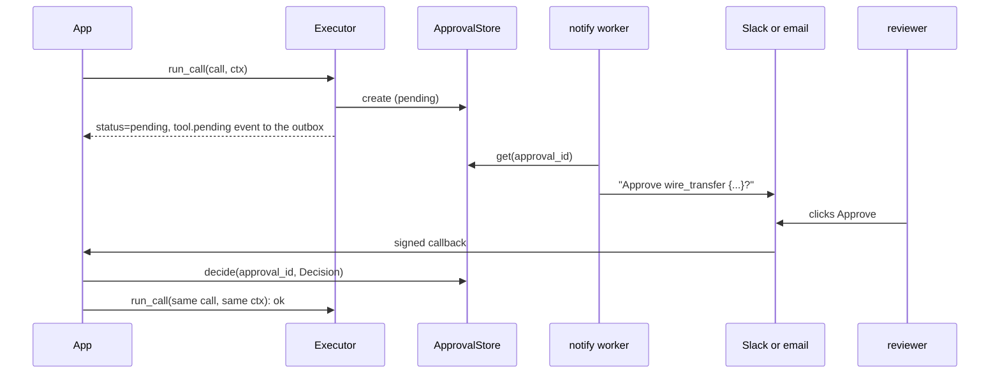

# Approval over Slack or email

A wire transfer needs a person's yes. Post the request to a chat channel (or send a
mail). The reviewer clicks a button. The call then runs once, as approved.



## Notify

```python
--8<-- "examples/cookbook_approval_notify.py:notify"
```

An event sink runs inside the call: keep it quick and never raise. Do the slow sending in
a worker. The `tool.pending` event carries the approval id, never the arguments; the
worker reads them from the store.

## The button callback

```python
--8<-- "examples/cookbook_approval_notify.py:webhook"
```

| Check | Why |
|---|---|
| Verify the chat app's signature (Slack: the signing secret; mail: a signed one-time link) | anyone can POST to your URL |
| Map the chat user to a known reviewer | a channel member is not a reviewer |
| Four-eyes: refuse when the reviewer is the invoker | keep the invoker with the approval id in your own table, and compare |
| Let the store pick the winner | the first `decide` wins; a second raises `ApprovalAlreadyDecided` |

## Pause, decide, resume

```python
--8<-- "examples/cookbook_approval_notify.py:flow"
```

```text
pending Approve wire_transfer {"account": "AC-1", "amount": 900.0}?
403 bad signature
200 recorded
ok sent 900.0 to AC-1
```

## Pitfalls

| Pitfall | Do instead |
|---|---|
| Resuming with a new run id or call id | it opens a new review; store both with the approval id |
| `MemoryApprovalStore` with several workers | use `SQLiteApprovalStore`, `RedisApprovalStore`, `SQLAlchemyApprovalStore` or `DynamoDBApprovalStore` ([Approval stores](../concepts/approval-stores.md), [Database stores](../concepts/approval-stores-db.md)) |
| Running the tool from the callback | only record the decision; the resume runs the call through the executor |
| You already run the HTTP server | it has `GET /approvals` and `POST /approvals/{id}/decide` with owner checks ([HTTP server](../cross-language/http-server.md)) |

## Files

| File | Does |
|---|---|
| `examples/cookbook_approval_notify.py` | the outbox sink, the notify worker, a signed callback, the resume |
| `tests/docs/test_cookbook.py` | runs it offline and checks the output |
