# Cache model answers across workers

A FAQ bot gets the same question all day. Pay for it once, and share the answer between
the web workers and the batch job.

```mermaid
flowchart LR
  W1["web worker<br/>executor.model(port, cache_ttl)"] --> K["key: provider, model, request"]
  W2["batch worker"] --> K
  K --> R[("Redis<br/>prefix llm:")]
  R -- hit --> H["cached=True, $0"]
  R -- miss --> P["paid call, then store"]
```



## Workers

```python
--8<-- "examples/cookbook_llm_cache.py:workers"
```

`RedisCache` takes a URL or a `client_factory`; here the factory returns `fakeredis`, so
the example runs offline. A Redis error is logged at `WARNING` and counts as a miss.

## Ask

```python
--8<-- "examples/cookbook_llm_cache.py:ask"
```

```text
[False, True, True, False] 2
```

| Part of the request | In the key? |
|---|---|
| provider, model, messages, tools, options | yes |
| `stage`, `stream`, `metadata`, `response_cache` | no |

## Pitfalls

| Pitfall | Do instead |
|---|---|
| Answers that depend on who asks (hidden user data, tools with side effects) | put the user in the request, or opt out with `response_cache=False` |
| No `cache_ttl` | entries never expire: set one shorter than your content's lifetime |
| Expecting a stream to be cached | streams are never stored |
| Confusing it with the provider's prefix cache | that is a discount on repeated prompt prefixes ([Cache](../concepts/cache.md#prompt-layout)) |

## Files

| File | Does |
|---|---|
| `examples/cookbook_llm_cache.py` | two workers sharing one Redis, four requests |
| `tests/docs/test_cookbook.py` | runs it offline and checks the output |
