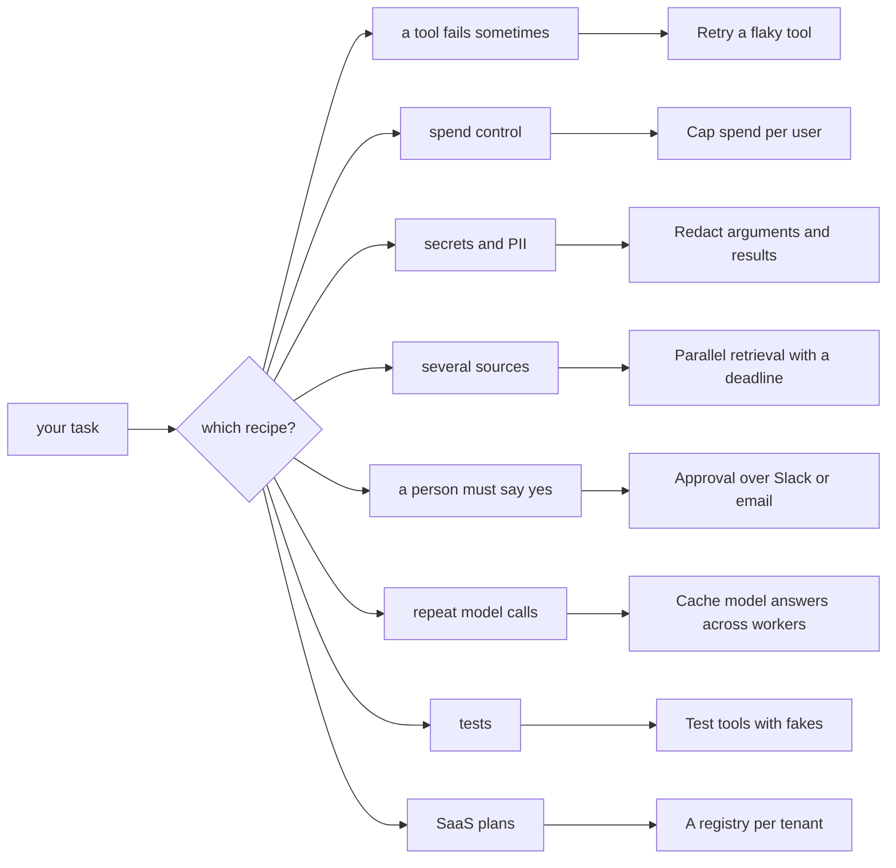

# Cookbook

Short recipes for tasks people ask about. Each one is a problem, one tested example, a
diagram and the pitfalls. The how-to guides explain a feature; a recipe solves one task.

| Recipe | Problem it solves | Main pieces |
|---|---|---|
| [Retry a flaky tool](retry-flaky-tool.md) | a network call fails now and then | `retries=`, `timeout=`, `Backoff`, a retryable `ToolError` |
| [Cap spend per user](spend-per-user.md) | one user must not burn the month's budget | `BudgetHook(scope="global")`, one `Ledger` per user and day |
| [Redact arguments and results](redact.md) | keys, emails and card numbers must not reach logs or the model | `LoggingHook(redact=)`, `redact()`, an `after_tool` hook |
| [Parallel retrieval with a deadline](parallel-deadline.md) | answer within N seconds, whatever is slow | `run_many`, `as_completed`, `asyncio.timeout` |
| [Approval over Slack or email](approval-notify.md) | a reviewer decides in a chat app or mail | `DeferredApproval`, the `tool.pending` event, a signed callback |
| [Cache model answers across workers](cache-llm.md) | the same question is paid for again and again | `executor.model(port, cache_ttl=)`, `RedisCache` |
| [Test tools with fakes](test-with-fakes.md) | a tool calls a real service | clients in `ctx.extras`, a fake client, injected `sleep` |
| [A registry per tenant](tenant-registry.md) | each plan sees a different tool set | `Registry.subset(tags=)`, `run_call(..., registry=)` |

Every recipe's code is a file under `examples/cookbook_*.py`.
`tests/docs/test_cookbook.py` runs each one offline and checks what it prints.
