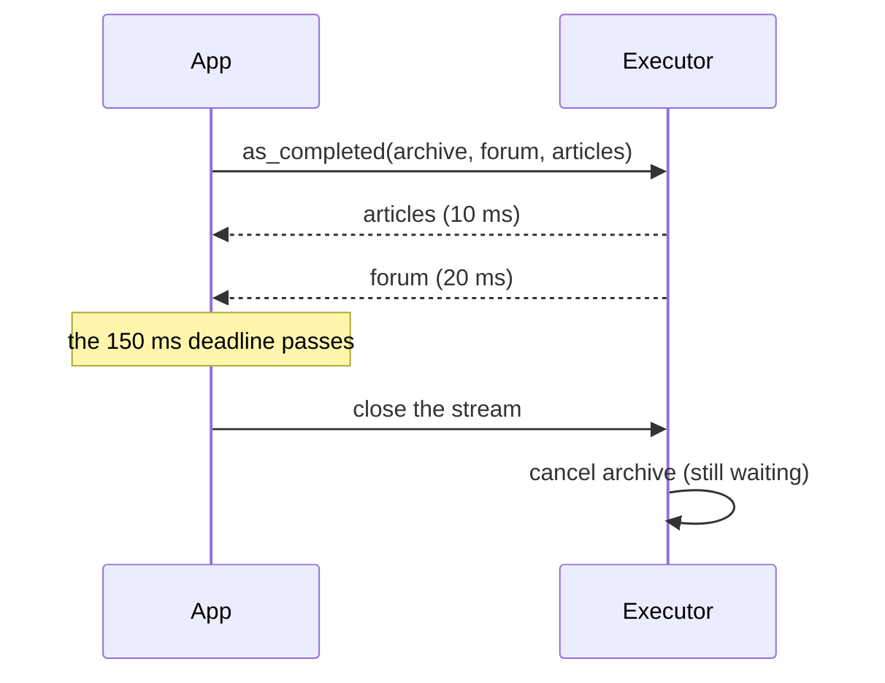

# Parallel retrieval with a deadline

Ask three retrievers at once. One backend hangs. Answer with what arrived in time.



## The retrievers

```python
--8<-- "examples/cookbook_parallel_timeout.py:tools"
```

`timeout=` bounds each call. `parallel_safe=True` lets the calls run at the same time.

## Wait for all, each with its own timeout

```python
--8<-- "examples/cookbook_parallel_timeout.py:all"
```

```text
[('articles', 'ok', ''), ('forum', 'ok', ''), ('archive', 'error', 'tool-timeout')]
```

The batch takes as long as the slowest timeout (here 0.3 s). No call raises.

## Stop at a deadline for the whole batch

```python
--8<-- "examples/cookbook_parallel_timeout.py:deadline"
```

```text
['returns: article', 'returns: post']
```

`asyncio.timeout` ends the loop; `aclosing` then cancels the calls still running.

| Need | Use |
|---|---|
| every result, each call bounded | `run_many` and a tool `timeout` |
| an answer by a time, partial is fine | `as_completed` inside `asyncio.timeout` |
| the first good answer | `as_completed`, then `return` ([Parallel retrieval](../how-to/parallel-retrieval.md)) |
| non-tool work (embeddings, LLM calls) | `executor.parallel(*work, timeout=)` |

## Pitfalls

| Pitfall | Do instead |
|---|---|
| `as_completed` without `aclosing` | a `break` leaves calls running until the iterator is closed |
| A deadline shorter than every source | you get nothing: keep one fast source |
| A rate-limited backend | cap it with `RunLimits(per_kind={"search": 2})` |

## Files

| File | Does |
|---|---|
| `examples/cookbook_parallel_timeout.py` | three retrievers, wait-for-all, a batch deadline |
| `tests/docs/test_cookbook.py` | runs it offline and checks the output |
