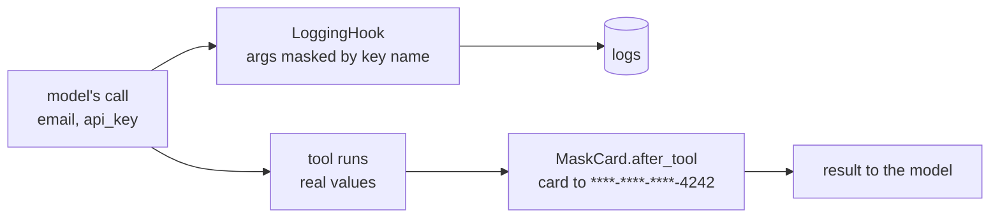

# Redact arguments and results

Keep API keys and emails out of your logs. Mask card numbers before the model sees them.



## The tool

```python
--8<-- "examples/cookbook_redact.py:tools"
```

## A result-masking hook

```python
--8<-- "examples/cookbook_redact.py:hook"
```

`after_tool` may return a new `ToolResult`; returning `None` keeps the old one.

## Wire it

```python
--8<-- "examples/cookbook_redact.py:executor"
```

```python
--8<-- "examples/cookbook_redact.py:run"
```

```text
{'email': 'a@example.com', 'card': '****-****-****-4242', 'note': 'card ****-****-****-4242 on file'}
tool.start {"tool": "lookup_customer", "run_id": "run_...", "call_id": "call_...", "kind": "tool", "args": {"email": "***", "api_key": "***"}}
{'Authorization': '***', 'query': 'returns'}
```

## What is already safe

| Surface | Default |
|---|---|
| `LoggingHook` | masks keys containing `key`, `token`, `secret`, `password`, `authorization`, `cookie`; never logs result values or message content; withholds all arguments of `confirm` tools |
| `LoggingSink`, `OTelSink` | leave out arguments, results and messages unless `capture_content=True` |
| Error messages | `ToolArgsInvalid` and `ErrorInfo` never hold input values; a crash's text is logged at `DEBUG` only |

## Pitfalls

| Pitfall | Do instead |
|---|---|
| Key matching is by name | a secret under `query` is not masked: mask values in your own hook, as `MaskCard` does |
| The tool cache stores the raw result | it is saved before `after_tool` hooks run: never cache such tools under `cache_scope="global"` |
| Masking in `after_tool` hides data from your own code too | callers of `run` get the masked value; keep raw data in the tool's own store if you need it |

## Files

| File | Does |
|---|---|
| `examples/cookbook_redact.py` | the tool, `MaskCard`, `LoggingHook` with extra patterns, `redact()` |
| `tests/docs/test_cookbook.py` | runs it offline and checks the output |
