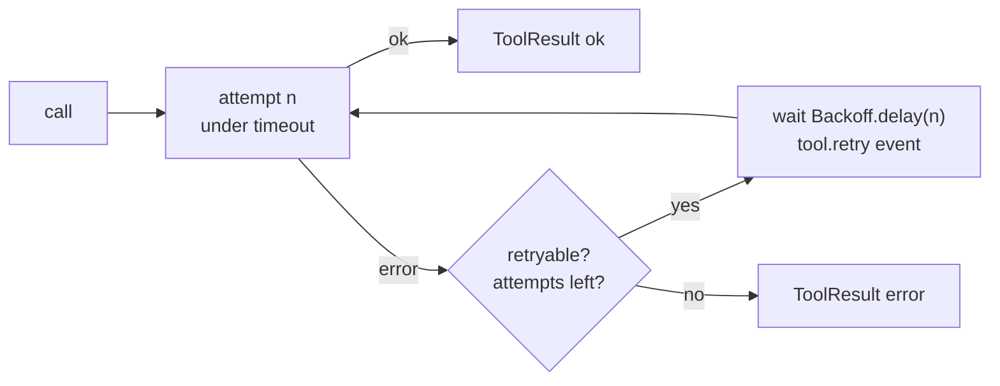

# Retry a flaky tool

A billing API drops connections now and then. Retry those failures with backoff. Do not
retry bad input: the model must fix it instead.



## The tool

```python
--8<-- "examples/cookbook_retry.py:tools"
```

| Raised | Retried? | Why |
|---|---|---|
| a foreign exception (`ConnectionError`, `httpx.ReadError`, ...) | yes | the adapter cannot know it is permanent |
| `ToolTimeout` (the `timeout=` expired) | yes | `retryable = True` |
| `ToolError` | no | the message goes to the model, which can change its arguments |
| your `ToolError` subclass with `retryable = True` | yes | "try later" from an upstream |
| `ToolArgsInvalid`, approval, budget and guard errors | no | another attempt gives the same answer |

## The executor

```python
--8<-- "examples/cookbook_retry.py:executor"
```

The delay after attempt `n` is `min(max_s, base_s × multiplier^(n-1)) × (1 + rng() × jitter)`.
The defaults are `Backoff(base_s=0.5, max_s=30, multiplier=2, jitter=0.25)`.

## Run it

```python
--8<-- "examples/cookbook_retry.py:run"
```

```text
ok 4 [0.5, 1.0, 2.0]
tool-error 1
tool-failed 4 False
```

When every attempt fails with a foreign exception, the result is `tool-failed`. Its
message names the tool and the attempts, never the exception text (that is logged at
`DEBUG` only).

## Pitfalls

| Pitfall | Do instead |
|---|---|
| Retrying a tool with side effects (a payment, an email) | retry only idempotent tools, or pass an idempotency key to the upstream |
| No `timeout=` on a network tool | one hung call holds the run forever; a timeout also makes the hang retryable |
| Catching the exception inside the tool and returning `None` | raise it: the executor retries it, logs it and reports it |
| Real sleeps in tests | inject `sleep=` and `rng=` into `Executor` |

## Files

| File | Does |
|---|---|
| `examples/cookbook_retry.py` | the tool, a retryable `ToolError`, the backoff and three runs |
| `tests/docs/test_cookbook.py` | runs it offline and checks the output |
