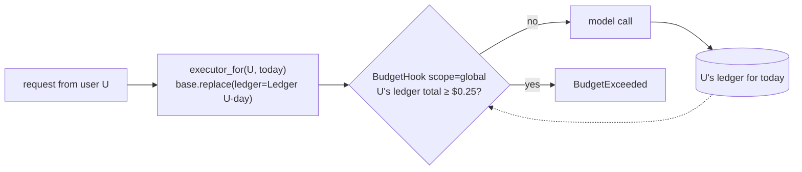

# Cap spend per user

Each user may spend $0.25 a day on model calls. When they reach it, stop their calls,
not everyone's.



## One executor view per user and day

```python
--8<-- "examples/cookbook_user_budget.py:per_user"
```

`BudgetHook` reads the ledger of the call's context. `scope="global"` sums everything
that ledger holds, and here that ledger holds one user's day. `replace()` keeps the hooks
and shares the run guards with `base`.

## Spend

```python
--8<-- "examples/cookbook_user_budget.py:spend"
```

```text
asha ok 0.1
asha ok 0.2
asha ok 0.3
asha stopped global 0.3
ravi ok 0.1
```

The hook checks **before** each call, so the third call (started at $0.20) runs and
ends at $0.30. Set the cap one call below the hard limit if it must never be crossed.

## Pitfalls

| Pitfall | Do instead |
|---|---|
| Several processes | the in-memory `Ledger` counts one process. Add a `CallbackSink` that adds each `entry.cost_usd` to a per-user row in your database, and a small `Hook` whose `before_llm` / `before_tool` reads that row |
| `views` grows forever | drop yesterday's keys, or use an LRU dict |
| Unknown prices | an unpriced model costs `None`, counted as $0: load your prices with `Prices.load(...)` or `Prices.default().merged(...)` |
| A per-conversation cap | that is `BudgetHook(..., scope="thread")` with `thread_id`, no extra ledger ([Budgets](../how-to/budgets.md)) |

## Files

| File | Does |
|---|---|
| `examples/cookbook_user_budget.py` | per-user ledgers, the hook, four calls by one user and one by another |
| `tests/docs/test_cookbook.py` | runs it offline and checks the output |
