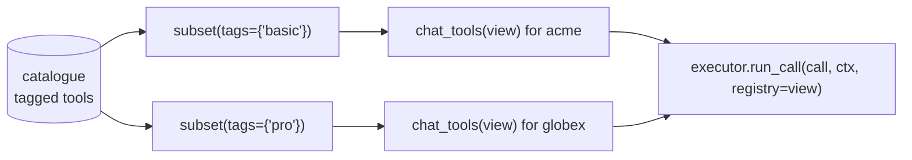

# A registry per tenant

Tenants on the basic plan get search only. Pro tenants get every tool. One catalogue,
one executor.



## Tag the tools

```python
--8<-- "examples/cookbook_tenants.py:tools"
```

## Build the views once

```python
--8<-- "examples/cookbook_tenants.py:views"
```

`subset` returns a new `Registry` holding the same specs. Build views at start-up, not
per request.

## Show and run per tenant

```python
--8<-- "examples/cookbook_tenants.py:run"
```

```text
acme ['search_docs']
globex ['search_docs', 'export_report', 'delete_workspace']
ok acme: results for refunds
error tool-not-found
```

Passing `registry=` to `run_call` (or `run_many`) is what enforces the plan. Hiding a
tool from the model is not enough: a model can name any tool.

| Also scope by tenant | How |
|---|---|
| caches | a `thread_id` per tenant conversation; never `cache_scope="global"` for tenant data |
| spend | [Cap spend per user](spend-per-user.md), keyed by tenant |
| exports to frameworks or MCP | pass the view, for example `structured_tools(view, executor=executor)` |
| tools per surface | `targets=` on a tool, and `registry.for_target("mcp")` |

## Pitfalls

| Pitfall | Do instead |
|---|---|
| `executor.run_call(call, ctx)` without `registry=` | it uses the executor's full catalogue |
| The tenant id from the model's arguments | take it from your session and put it in `ctx.extras` |

## Files

| File | Does |
|---|---|
| `examples/cookbook_tenants.py` | a tagged catalogue, plan views, per-tenant render and run |
| `tests/docs/test_cookbook.py` | runs it offline and checks the output |
