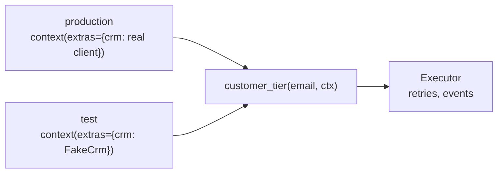

# Test tools with fakes

A tool calls a CRM. In tests, give it a fake CRM instead, without patching imports.



## The tool

```python
--8<-- "examples/cookbook_fakes.py:tool"
```

`ctx` is hidden from the model's schema. `ctx.extras` reaches the tool unchanged (keys
starting with `aa.` are reserved).

## The fake

```python
--8<-- "examples/cookbook_fakes.py:fake"
```

## The tests

```python
--8<-- "examples/cookbook_fakes.py:tests"
```

```text
test_tier_survives_one_outage ok
test_unknown_customer_tells_the_model_what_to_do ok
```

| Fake | Replaces |
|---|---|
| a client in `ctx.extras` | the network service |
| `Executor(sleep=..., rng=..., clock=...)` | backoff waits, jitter, time |
| `EventLog()` | your tracing backend |
| `CallableModel(fn)` | a model ([Testing tools](../how-to/testing-tools.md)) |

## Pitfalls

| Pitfall | Do instead |
|---|---|
| A module-global client | tests must patch it, and it breaks across event loops: inject it, or keep it in a `LoopLocal` |
| `spec.invoke` in tests of policy | it skips retries, approval and hooks: run through an `Executor` |
| Asserting on the text of crashes | assert on `error.kind`; crash text is never in the result |

## Files

| File | Does |
|---|---|
| `examples/cookbook_fakes.py` | the tool, a fake CRM and two tests |
| `tests/docs/test_cookbook.py` | runs it offline and checks the output |
