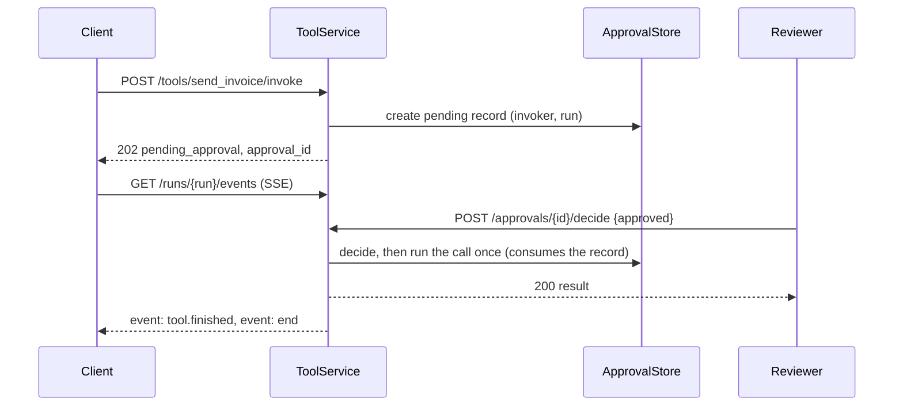

# HTTP tool server

:material-check-circle:{ .status-ok } Available · `pip install "agent-adapter[server]"`

REST + SSE over one `Registry`, for what MCP cannot carry: approval decided in Python (with
edited arguments), run events, cost per run, provider-shaped catalogues. Errors: RFC 9457.

## Serve

```python
--8<-- "examples/serve_tools.py:auth"
--8<-- "examples/serve_tools.py:app"
```

`create_app` mounts MCP at `/mcp` (the `server` extra installs `mcp`); `mcp=False` (CLI `--no-mcp`) serves REST only.
`serve(make_app())` runs uvicorn on `127.0.0.1:8000`. From a shell:
`AGENT_ADAPTER_TOKENS='{"<token>": {"id": "dev"}}' python -m agent_adapter.server
--registry mypkg.tools:registry [--host] [--port] [--allow-anonymous] [--no-mcp]`.

| File | Does |
|---|---|
| `server/service.py` | `ToolService`: routing and every route, no web framework |
| `server/auth.py` | `Principal`, `RequestInfo`, `bearer_auth`, default rules, `is_invoker`, `set_log_key` |
| `server/problems.py` | `Problem`, `problem_for` (error kind → status) |
| `server/events.py` | `EventStream`, `MemoryEventStream` (SSE source) |
| `server/idempotency.py` | `IdempotencyStore`, `MemoryIdempotencyStore`, `RedisIdempotencyStore` |
| `server/openapi.py` · `_openapi30.py` | `openapi_document`; its 3.0.3 rendering (no unions) |
| `server/asgi.py` · `wsgi.py` · `__main__.py` | Starlette app + MCP mount, a2wsgi, CLI |

## Routes

| Method · path | 2xx |
|---|---|
| `GET /healthz` (no auth) | `{"status": "ok", "version"}` |
| `GET /readyz` (no auth) | 200 `{"status": "ready", "version"}`; 503 problem while starting or draining |
| `GET /tools?shape=neutral\|openai\|anthropic\|gemini&tags=&kinds=` | catalogue + `ETag` |
| `GET /tools/{name}?shape=` | one descriptor |
| `POST /tools/{name}/invoke` `{arguments, run_id?, thread_id?}` | 200 `{status: "ok", run_id, call_id, result, cached, attempts}`, 202 `pending_approval` + `Location` |
| `GET /approvals?run_id=&status=` · `GET /approvals/{id}` | approvals |
| `POST /approvals/{id}/decide` `{approved, edited_arguments?, reason?}` | 200 result or `denied` |
| `GET /runs/{run_id}/events?close_on=` | `text/event-stream`, replay with `Last-Event-ID` |
| `GET /runs/{run_id}/cost` | ledger summary (404 without a ledger) |
| `GET /openapi.json` · `GET /openapi-3.0.json` | [OpenAPI](openapi.md) 3.1 · 3.0.3, filtered to the caller's tools |

## OpenAPI 3.0.3 (Go, Rust, API gateways)

```python
--8<-- "examples/openapi_gateway.py:dialects"
```

| `dialect` | Gives |
|---|---|
| `"3.0"` | every route, bearer scheme kept, no `oneOf`/`anyOf`/`allOf`: `X \| None` → `nullable`, a tagged union → one object (the tag becomes an `enum`; no `discriminator`), mixed types → any value. For oapi-codegen, progenitor |
| `"3.0-gateway"` | the same, but `/tools/*/invoke` only, no `security`, error responses without bodies; needs `server_url`. For [AgentCore](../connect/bedrock-agentcore.md) |

Invoke headers: `Idempotency-Key` (a repeat replays the first response, `Idempotent-Replayed: true`), `X-Run-Id`, `X-Thread-Id` (body ids win).

## Approval round trip



Deciding re-checks `authorize`: the decider must be allowed any edited arguments, and the
invoker (rebuilt with its stored id and scopes; claims are never stored, so tools see none
after an approval) must still be allowed the final ones. Otherwise 403 and nothing is
recorded. Edits are validated first (422 leaves the record pending). An approval parked by
`/mcp`, or by a call nested inside a tool, is only decided here (202 `approved` with a
`note`): it runs when its caller re-runs it with the same call id (an MCP client resuming,
or an outer tool re-running a nested call with a fixed `call_id`); otherwise it stays
approved and unused. Records that name no invoker cannot be approved to run.

A record whose tool this server does not register (another surface parked it in a shared
store) cannot be validated or passed to `authorize`. So it takes no `edited_arguments`
(400), and approving needs an invoker on the record (403). It is approved only as asked.
A deny needs neither. In every case a refusal records nothing.

## Security rules

| Rule | Why |
|---|---|
| no `authenticate` and `allow_anonymous=False` → `ConfigError` | fail fast; never open by accident |
| the first principal to invoke into a `run_id` owns it; others get 403 on invoke, events and cost | no run injection or snooping |
| the executor sees `run_`/`thr_` ids derived from (owner, your key) | a forgotten owner entry or another worker never merges two principals' runs, guards or run-scoped caches |
| `call_id` = derived from (principal, `Idempotency-Key`) | nobody can reach another principal's call or pending approval |
| approvals: the invoker or `APPROVER_SCOPE` sees them; others get 404 (a `?run_id=` listing of another's run: 403) | no existence oracle |
| deciding: `authorize_decision(principal, record)` (default invoker or approver), then `authorize` on the edits and for the invoker; a tool not registered here: no edits (400), approve only with an invoker (403) | approving never widens what a call may do |
| a replayed key with another tool, arguments, run or thread → 400; in flight → 409 | an approval or result never covers another request |
| `authorize` / hooks must return `True`; a raising hook → 500 | fails closed |
| POST bodies must be `application/json` (415); `Host` must be allowed (421) | no cross-site form posts or DNS rebinding |
| anonymous app on a non-local bind host → `ConfigError`, unless `allow_anonymous_public=True`; without that flag, a non-loopback peer gets 403 `non-local-client` | the `Host` check stops browsers (DNS rebinding), not remote clients |
| one `Authorization` / `Idempotency-Key` header (400); slow bodies → 408 | no ambiguous credentials, no slow-loris reads |
| at most 16 open event streams per principal, 1024 in total (429 + `Retry-After`) | one caller cannot exhaust the server |
| anonymous mode: anonymous callers share one identity (marked `anonymous` on approvals), never an authenticated run | a `WARNING` at start-up |
| problems: `ErrorInfo.message` (class only for unknown errors); logs: routes, not paths, and HMAC principal refs | no secrets or PII leak |

```python
--8<-- "examples/serve_tools.py:four_eyes"
```

## Security model

Overview: [Security guide](../guides/security.md). The decisions and residual risks that
need a human security review before release, in one place:

| # | Decision or residual risk | Status |
|---|---|---|
| 1 | The executor sees `run_` / `thr_` ids derived from (principal, client key); clients see their own key | design choice |
| 2 | Anonymous callers share one identity; only `Principal("")` is marked `anonymous` on approvals; it never joins an authenticated run | design choice |
| 3 | Records parked by `/mcp` or by a nested call are only decided over HTTP (202 `approved` + `note`); they run only when their caller re-runs the call with the same call id | functional limit, fails closed |
| 4 | A keyed call can run twice on a retry once its lease ends with no outcome kept: a tool without a `timeout` that outlasts `idempotency_lease_s` (the late `complete` is refused), or a store error in `complete`. Both log a `WARNING` and the first response stands. A failed `release` holds the key (409) until the lease ends; a failed `update` after a decision keeps replaying the 202. A plain shared `CachePort` is best effort | residual: give keyed tools a timeout, use `RedisIdempotencyStore` |
| 5 | Another principal can claim a guessed `run_id` first (you get 403) | denial of service, not a leak: omit `run_id` or make it unguessable |
| 6 | After an approval the tool sees the invoker's id and scopes, never its claims; `authorize` re-runs for the decider (edits) and the invoker (final arguments); no invoker → cannot run; a tool not registered here takes no edits | design choice |
| 7 | The default `authorize_decision` lets the invoker approve its own call (it cannot widen it) | default: four-eyes hosts pass a rule (above) |
| 8 | `/mcp`: `tools/list` is filtered by `authorize`; MCP approvals show the scoped run id; DNS-rebinding settings come from `mcp_options` (transport keys only) | design choice |
| 9 | A public, authenticated bind without `allowed_hosts` accepts any `Host` (`WARNING`): browsers do not send bearer tokens on their own | residual: authenticators that trust IPs or networks must set `allowed_hosts` |
| 10 | Logs carry routes, HMAC principal refs and server ids; a failing tool's exception is logged by type at `ERROR`, its text and traceback only at `DEBUG` | fixed (executor log hygiene) |
| 11 | Listings without `run_id` scan the newest 1 000 records: a non-approver may miss older ones | functional limit |
| 12 | General rate limiting, CORS and TLS are out of scope (POSTs are JSON-only) | use a reverse proxy |
| 13 | Bearer tokens are looked up by SHA-256 digest in a dict, not compared in constant time per token | residual |
| 14 | An anonymous app without `allow_anonymous_public=True` serves loopback peers only: any other peer (ASGI `scope["client"]`, WSGI `REMOTE_ADDR`) gets a 403 `non-local-client` problem and a `WARNING` with its IP. No peer address (unix socket, in-process) and Starlette's `testclient` count as local | fixed; residual: behind a reverse proxy or a unix socket every caller looks local, so an anonymous app must never sit behind one that remote clients reach |

## Production settings

| Need | Do |
|---|---|
| several workers | share `approvals=` (a database store) and `idempotency=RedisIdempotencyStore(lambda: Redis.from_url(url))` (one lease per key: a request runs once on any worker; a store error on the claim → 503, nothing runs; after the run see Security model row 4); a plain `CachePort` is best effort (`WARNING`) |
| a public host | `allowed_hosts=["tools.example.com"]` (`"*"` turns the check off). Default: local names; a public bind host (`serve(app, host=…)` or `create_app(host=…)`) with an authenticator accepts any host and logs a `WARNING`. An authenticator that trusts client IPs or networks must set `allowed_hosts` |
| anonymous on a public host | refused (`ConfigError`) unless `create_app(…, allow_anonymous_public=True)`: anyone who reaches the port can call every tool. `Host` still defaults to local names, so set `allowed_hosts`. The check sees the bind host only through `create_app(host=…)`, `mcp_options["host"]` or `serve(host=…)`: under another server (gunicorn, the uvicorn CLI) pass `host=` |
| `/mcp` on a public host | `create_app(host=…, mcp_options={"transport_security": …})` (only `host`, `transport_security`, `name`, `instructions`, `version`); `host=` also becomes MCP's host, so a public mount without `transport_security` is a `ConfigError`. `serve(host=…)` re-derives only the REST rule: MCP settings are fixed at construction, so pass `host` to `create_app` |
| run ids | omit `run_id` (the server mints one) or use an unguessable one: another principal can claim a guessed id first (403 for you, never a leak) |
| limits | `service.max_body_bytes` (1 MiB → 413), `body_timeout_s` (30 s → 408), `max_streams_per_principal`, `max_streams`, `idempotency_lease_s` (300 s; a tool with a `timeout` gets `timeout × (retries + 1) + 30 s` if longer. A tool without a timeout that outruns the lease can run twice on a retry: give keyed tools a timeout) |
| a reverse proxy | still recommended for TLS, request timeouts and rate limits, with authentication on; never in front of an anonymous app (the proxy makes every caller look local) |
| correlated logs | `set_log_key(secret)` on every worker (principal refs are HMACs) |
| WSGI (Django, Flask) | `create_wsgi_app(registry, **options)`; SSE is buffered there, use ASGI for events; the returned app has `close()` (or use it as a `with` block) to end its lifespan, e.g. in tests or at worker shutdown. Drain the server first (its worker-exit hook): `close()` cancels requests still in flight (503 problem, or aborted mid-response), waits at most 30 s for open responses, and later requests get a 503 problem |
| a prefix | `create_app(registry, prefix="/tools-api")` (also prefixes `Location`) |

Per-process state: the owner table (ids are scoped by owner), stream counts, `MemoryEventStream`. CLI: `--allowed-host` (repeatable); anonymous access on a non-local `--host` needs `--allow-anonymous-public` (it sets `allow_anonymous_public=True`).
