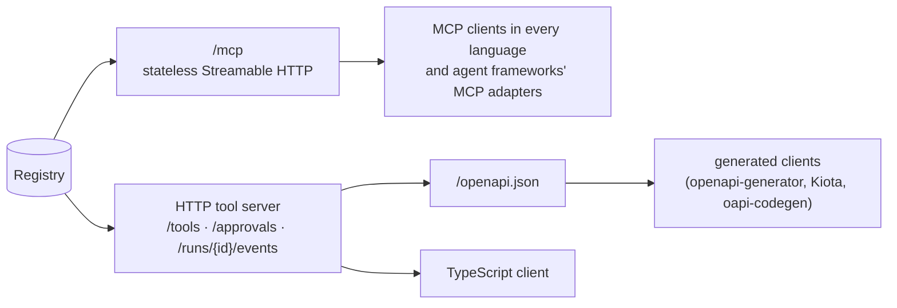

# Cross-language

Your tools stay Python functions in one `Registry`. Other languages reach them over HTTP;
the executor's policies (hooks, approval, limits, cache, ledger, events) run on every call.

## Pick a surface

| Surface | Use it when | Page |
|---|---|---|
| MCP | the caller is an agent framework or has an MCP SDK (most do) | [MCP](mcp.md) |
| HTTP tool server | approval must be decided in Python (with edits), you need run events as SSE, cost per run, or provider-shaped catalogues | [HTTP server](http-server.md) |
| OpenAPI | the caller generates a typed client from a spec | [OpenAPI](openapi.md) |
| TypeScript client | a TS / JS app calls the HTTP server | [TypeScript client](typescript-client.md) |

One app serves both: `create_app(registry)` mounts MCP at `/mcp` next to the HTTP routes,
behind the same authenticator. That default needs both the `server` and `mcp` extras.

## Install

| Extra | Gives |
|---|---|
| `agent-adapter[mcp]` | `streamable_http_app`, `mcp_server`, the importer |
| `agent-adapter[server]` | `create_app`, `serve` (Starlette + uvicorn); includes `mcp` for the default `/mcp` mount |
| `agent-adapter[server-wsgi]` | `create_wsgi_app` (adds `a2wsgi`) |

Install with `pip install "agent-adapter[server]"` (the extras you need).

`ToolService` itself needs no extra: it is the server's behaviour with no web framework, so
you can mount it in any framework you already run.
