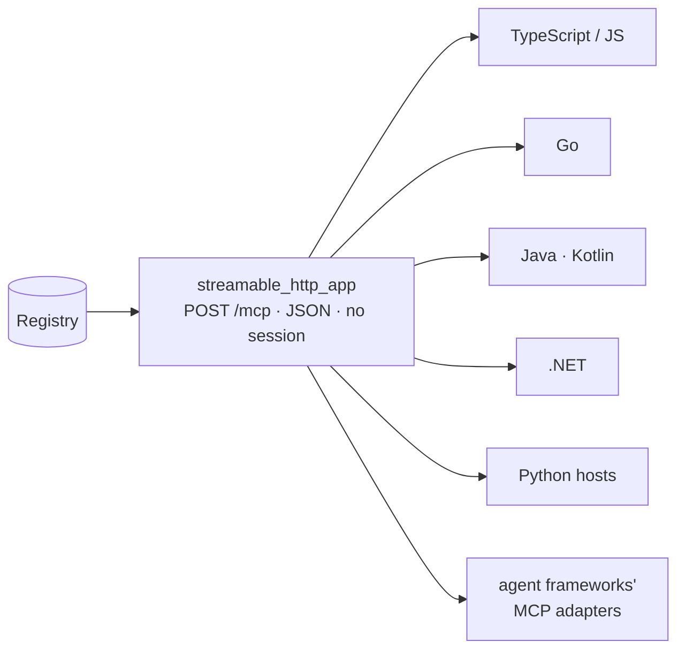

# Cross-language: MCP

:material-check-circle:{ .status-ok } Available · `pip install "agent-adapter[mcp]"`

MCP over **stateless Streamable HTTP** is the universal export. Every language has an
official MCP client, and most agent frameworks load MCP tools in one line. Your tools stay
Python functions; the executor's policies (hooks, approval, limits, cache, ledger) still
run on every call.



## Serve

```python
--8<-- "examples/mcp_http.py:app"
```

| Choice | Default | Why |
|---|---|---|
| `stateless=True` | no `Mcp-Session-Id` | every request stands alone: any worker can answer, load balancers need no stickiness |
| `json_response=True` | `application/json` | one response per request, no SSE stream to hold open |
| `path="/mcp"` | | where the endpoint lives inside the app |
| `executor=` | the default executor | the policies every call runs under |

Mount it in another ASGI app (Starlette, FastAPI) and run its lifespan there:
`app.router.lifespan_context(app)` starts the MCP session manager. The [HTTP tool server](http-server.md)
(`agent_adapter.server.create_app`) mounts it at `/mcp` behind its own authenticator.

## Production settings

`**http_options` go to the MCP SDK's `Server.streamable_http_app`.

| Need | Pass |
|---|---|
| a public host name | `host=…` with `transport_security=TransportSecuritySettings(allowed_hosts=[…], allowed_origins=[…])` and auth (next row); without `transport_security` (DNS-rebinding protection) it is always a `ConfigError`; without auth it is one too, unless `allow_anonymous=True` |
| bearer tokens | `auth=AuthSettings(…, resource_server_url=…, validate_token_resource=True)` and `token_verifier=…`, always together |
| client approval behind several workers | `client_approval=True, request_state_keys=[secret], name="<unique>", approval_store=<shared store>` (the same secret and store everywhere; without a store it is a `ConfigError`) |
| your own notion of "who" | `principal=lambda ctx: …` returning a str; it is not auth, and a `None` is refused unless `allow_anonymous=True` |

`streamable_http_app` sets `streamable_http_path`, `json_response` and `stateless_http`
itself; passing them in `http_options` is a `ConfigError`.

## Security

| Rule | Why |
|---|---|
| without auth, any client that can reach the port can call every tool | auth is `auth=AuthSettings(…)` with `token_verifier=…`; without it a local host logs a `WARNING` at build and refuses non-loopback peers (403 `non-local-client`) |
| a custom `principal=` is not auth | the rules above still apply; a request it names no caller for is refused (`authentication required`) unless `allow_anonymous=True` |
| a non-local `host` with no auth is a `ConfigError` | unless `allow_anonymous=True` (a `WARNING` at build); the same fail-fast rule as the [HTTP server](http-server.md) |
| `auth=` and `token_verifier=` go together | either alone checks no token, so it is a `ConfigError` |
| `client_approval=True` makes the remote MCP client the approver | the executor's approval port is not asked for `confirm` tools; an agentic host may accept the form by itself, so use it only where a person really reviews it |
| run and call ids are derived from the principal and the client's key | a client can never name another client's run, call or approval |
| the default principal is the bearer token (client id, issuer, subject) | `principal=` replaces it; a raising hook refuses the request |
| anonymous requests: client keys and `X-Run-Id` are ignored | unless `allow_anonymous=True` (a `WARNING` at build: anonymous clients can share runs) |
| a call key counts only to resume a pending approval | reusing a key never re-runs a `once_per_run` tool or dodges `max_calls` |
| resumes are checked in the `DeferredApproval` store | a resume works on any worker sharing the `ApprovalStore`; with other ports resume keys live in one process, and a resume on another worker asks again |
| every resume and client-approval state is single use | a replay never re-runs a tool, on any worker sharing the `approval_store`, which records the client's decision too |

Pass the `host` you bind to. A local app without auth refuses non-loopback peers, but it
cannot see past a proxy. Never put an anonymous app behind a reverse proxy or a unix socket
(`uvicorn --uds`, gunicorn) that remote clients can reach: every request then looks local.
Without auth every request is anonymous, and no approval can be resumed.

## Connect

One call in each ecosystem; point it at `https://<host>/mcp`.

| Client | Connect |
|---|---|
| TypeScript SDK | `new Client(…).connect(new StreamableHTTPClientTransport(new URL(url)))` |
| Vercel AI SDK | `createMCPClient({ transport })`, then `tools: await mcp.tools()` |
| LangChain.js / LangGraph.js | `new MCPAdapter({ servers: { tools: { url, headers } } })`, then `await adapter.listTools()` (`@langchain/mcp-adapters` 2.0) |
| OpenAI Agents JS | `new MCPServerStreamableHttp({ url, name })` |
| Go SDK | `mcp.NewClient(…).Connect(ctx, &mcp.StreamableClientTransport{Endpoint: url})` |
| Java SDK | `McpClient.sync(HttpClientStreamableHttpTransport.builder(url).build())` |
| .NET SDK | `McpClient.CreateAsync(new HttpClientTransport(…))` |
| Python | `mcp_client(url, headers=…)` or `auth=oauth_client(…)`, then `import_mcp(registry, client)` |

Per-stack recipes with exact config: [Connect anywhere](../connect/index.md).

## What MCP does not carry

| Need | Use |
|---|---|
| approval decided in Python, with edited arguments | `DeferredApproval` in the executor; MCP returns `approval required: <id>`; decide it in the store or with the [HTTP server](http-server.md) |
| a host that drops `_meta` resume keys | `tasks=TaskOptions()`: a 2026-07-28 host with the tasks extension polls the pending call by task id ([MCP tasks and OAuth](../integrations/mcp-tasks.md)); other hosts cannot resume a `confirm` tool |
| the user of the MCP client approves | `client_approval=True` (2026-07-28 clients with form elicitation); the remote client is then the approver, and the executor's port is not asked |
| cost per run, run events (SSE), provider-shaped catalogues | the [HTTP tool server](http-server.md) |

See [MCP](../integrations/mcp.md) for the tool mapping, errors, ids and the importer.
