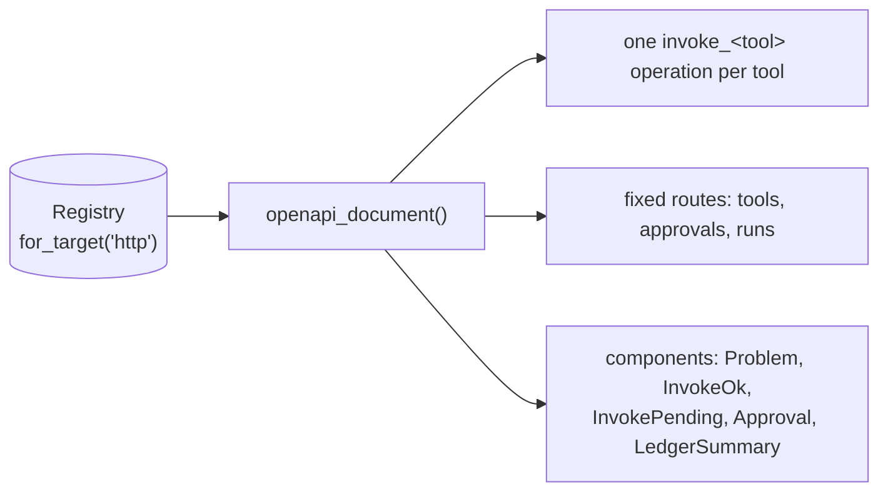

# OpenAPI

:material-check-circle:{ .status-ok } Available · `GET /openapi.json` on the [HTTP server](http-server.md)

The server publishes an **OpenAPI 3.1** document generated from the registry, so other
languages can generate typed clients. It never drifts: it is built from the same
`ToolSpec`s on every request.

## What is in it

| Part | Content |
|---|---|
| `paths["/tools/<name>/invoke"]` | `operationId: invoke_<name>`; request `{arguments: <tool input schema>, run_id?, thread_id?}`; 200 `InvokeOk` with `result: <tool result schema>`; 202 `InvokePending`; problems |
| fixed paths | `listTools`, `getTool`, `listApprovals`, `getApproval`, `decideApproval`, `runEvents`, `runCost`, `healthz`, `readyz`, the two document routes |
| `components.schemas` | payloads of the [routes](http-server.md#routes); nested tool models moved here as `<tool>__<Model>` (refs rewritten) |
| `components.responses.Problem` | RFC 9457 `application/problem+json` |
| security | `bearerAuth` (HTTP bearer) everywhere except `/healthz` and `/readyz` |

`GET /openapi.json` lists only the tools the caller's `authorize` hook allows. Build the
full document in Python with `openapi_document(registry, title=…, version=…,
server_url=…)` or `ToolService.openapi(server_url=…)`.

Go and Rust generators (oapi-codegen, progenitor) and API gateways want OpenAPI 3.0.3 without
`oneOf`/`anyOf`: use `GET /openapi-3.0.json` or `dialect="3.0"` / `"3.0-gateway"`
([OpenAPI 3.0.3](http-server.md#openapi-303-go-rust-api-gateways)).

## Generate a client

| Language | Tool |
|---|---|
| TypeScript | `openapi-typescript` (types) + `openapi-fetch`, or the [TypeScript client](typescript-client.md) |
| Go · Rust | `oapi-codegen` · `progenitor`, from `/openapi-3.0.json` |
| Java / Kotlin / C# | `openapi-generator`, Kiota |
| Python | download `/openapi.json`, then `import_openapi(registry, document, base_url=...)` (a mapping, text or file path; URLs are refused): the [OpenAPI importer](../integrations/openapi.md) turns each operation back into a tool |

Approval, idempotency and run ownership are server rules, not client features: a
generated client gets them by sending `Authorization`, `Idempotency-Key` and `X-Run-Id`.
