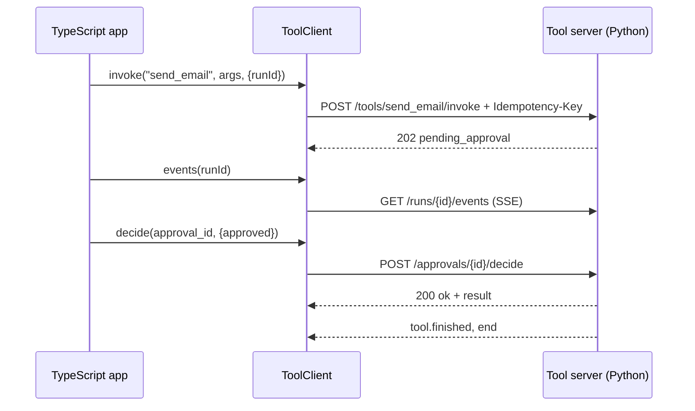

# Cross-language: TypeScript client

:material-check-circle:{ .status-ok } Available · `@agent-adapter/client` in `clients/typescript/`

A zero-dependency client for the HTTP tool server. Use it when a TypeScript backend calls
your Python tools and the approval, the cost ledger or the run events must stay in Python.
For plain tool calls, any MCP client works too ([MCP](mcp.md)).



Node ≥ 20 (or Deno, Bun, browsers), ESM and CJS. Every snippet below imports from
`@agent-adapter/client`. The package is `private` until its publishing target is decided;
use it from this repository meanwhile. In a browser, the server must allow CORS for your origin,
including the `Authorization`, `Idempotency-Key` and `Last-Event-ID` preflight headers.

## Connect and list

```ts
--8<-- "clients/typescript/examples/quickstart.ts:connect"
```

`listTools({ shape })` returns provider-ready declarations (`openai`, `anthropic`, `gemini`)
in each descriptor's `provider` field.

## Invoke

```ts
--8<-- "clients/typescript/examples/quickstart.ts:invoke"
```

| Option | Sent as | Note |
|---|---|---|
| `runId`, `threadId` | body `run_id`, `thread_id` | the first principal to use a run owns it |
| `idempotencyKey` | `Idempotency-Key` | a random UUID when absent; the same on every retry of the call |
| `signal` | | aborting rejects with the signal's reason |

`invoke` and `decide` wait for the tool: for tools that run longer than `timeoutMs` (30 s), raise
`timeoutMs`; for long-running tools, also watch progress with `events()`.

## Approvals

```ts
--8<-- "clients/typescript/examples/quickstart.ts:approve"
```

`decide` returns the tool result when approved and `{ status: "denied", reason }` when not.
By default only the run's owner or a principal with the `approvals:decide` scope may decide.

## Events

`events(runId, { closeOn, lastEventId, signal })` is an async generator over the run's
server-sent events. It ends at the server's `end` event. If the connection drops first
or goes silent for `idleTimeoutMs` (45 s: three missed keep-alives), it reconnects with
`Last-Event-ID` (up to `retry.maxRetries` times without a new event), then raises
`ToolTransportError`. Progress means a new event under a new id. Right after a reconnect, events
the server replays (same own id and content as one of the last 1024 yielded) are skipped, up to
the first new one; ids over 256 characters are never skipped. `break` closes the stream. Data that is not JSON, and lines or events larger than
`maxEventSize` (1 MiB), raise `EventStreamError`.

## Cost

```ts
--8<-- "clients/typescript/examples/quickstart.ts:cost"
```

## Framework adapters

```ts
--8<-- "clients/typescript/examples/quickstart.ts:vercel"
```

`toolDefinitions({ tags, runId })` gives `{ name, description, inputSchema, execute }` for other
frameworks (Mastra `createTool`, LangChain.js `tool`, OpenAI Agents JS `tool`). `execute`
returns the result, or `{ pending_approval: approval_id }` while a reviewer decides.

## Errors

| Class | Status · kind |
|---|---|
| `ToolNotFoundError`, `ApprovalNotFoundError`, `NotFoundError` | 404 |
| `ToolArgsInvalidError` (`.errors`) | 422 `tool-args-invalid` |
| `BadRequestError`, `ToolUsageError` | 400 |
| `UnauthorizedError` · `ForbiddenError` | 401 · 403 |
| `ApprovalDeniedError`, `GuardrailBlockedError` | 403 |
| `RunLimitExceededError`, `ApprovalAlreadyDecidedError` | 409 |
| `BudgetExceededError` (`.retryAfterMs`) | 429 |
| `ToolFailedError`, `ToolError`, `ModelError` (`model-*`) | 502 |
| `ToolTimeoutError` | 504 |
| `InternalServerError` | 500 |
| `ToolTransportError` (`reason`: `network` / `timeout`) | no response |
| `ToolProtocolError`, `EventStreamError` | response breaks the protocol |

All server errors extend `ToolServerError` with `.problem` (the RFC 9457 body), `.status` and
`.kind`. A non-problem error body becomes `type: "about:blank"`.

## Retries

| Request | Retried on (bounded, `Retry-After` honoured up to `maxDelayMs`) |
|---|---|
| `GET` routes | network errors, timeouts, 408, 429, 502, 503, 504 |
| `invoke`, `decide` | connection never made (`ECONNREFUSED`, DNS); 429 or 503 with `Retry-After` |

A POST is never retried after a timeout, a reset connection, 502 or 504: the tool may have
run. Pass `retry: false` to turn retries off.

## Security

| Rule | Why |
|---|---|
| the token lives in a private field and is never logged | `console.log(client)` and errors cannot leak it |
| `token` may be a function, called before every attempt | short-lived tokens refresh without a new client |
| `baseUrl` with credentials, a query or a fragment is a `TypeError` | secrets belong in `token` |
| use `https://` outside localhost | the bearer token travels in a header |
| a token with control characters is a `TypeError` that does not quote it | a malformed header cannot leak it |
| bodies over `maxResponseSize` (16 MiB) raise `ToolProtocolError` | a broken server cannot exhaust memory |

## Files

| File | Role |
|---|---|
| `src/client.ts` | `ToolClient`: one method per route |
| `src/http.ts` | auth header, timeouts, aborts, retry policy |
| `src/body.ts` | size-bounded body reading, problem parsing |
| `src/sse.ts` | event-stream parser with a bounded buffer |
| `src/replay.ts` | bounded record of yielded events, for replay skipping |
| `src/errors.ts` | error classes, `errorFromProblem` |
| `src/adapters.ts` | `toolDefinitions`, `asVercelTools` |
| `src/types.ts` | wire payloads and options |
| `test/live.test.ts` | runs against a live server when `AA_BASE_URL` is set |
