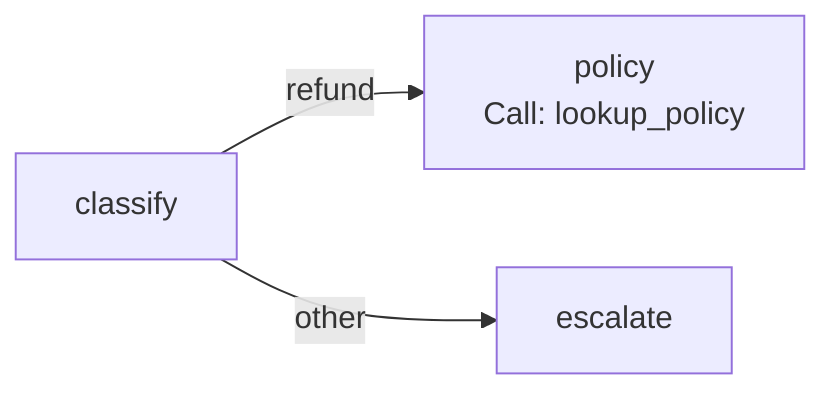

# Your first flow

Build a three-node flow that classifies a support ticket, then either looks up a policy
with a tool or escalates. Ten minutes. The whole program is `examples/first_flow.py`; the
test suite runs it.



## 1. The state

A flow passes one pydantic model from node to node. Each node returns the fields it
changes.

```python
--8<-- "examples/first_flow.py:state"
```

## 2. The nodes

A node is a plain function of the state (sync or async). It returns a mapping of updates,
or `None`.

```python
--8<-- "examples/first_flow.py:nodes"
```

## 3. The flow

```python
--8<-- "examples/first_flow.py:flow"
```

| Line | Effect |
|---|---|
| `Flow("support", state=Ticket)` | a flow over `Ticket`; names must be identifiers |
| `.node("classify", classify)` | a function node; the first node added is the start |
| `Call("lookup_policy", args=…, into="reply")` | runs a registered tool through the executor and writes its value to `reply` |
| `.route("classify", Route(fn, targets=[…]))` | `fn` returns the name of the next node |
| `.end("policy", "escalate")` | end nodes have no exit |

The flow is checked when it runs (or call `flow.validate()`): unknown nodes, unreachable
nodes, missing exits and unbounded loops are all reported together.

## 4. Run it

```python
--8<-- "examples/first_flow.py:run"
```

```bash
python examples/first_flow.py
```

```text
done | Our refund policy: full refund within 30 days.
{'classify': 1, 'policy': 1}
other | A person will contact you today.
```

`FlowRunner(executor)` runs every tool call through the executor, so the tool's policies
(timeouts, retries, approval, cache, ledger) apply. `run` is async; `run_sync` calls it
from plain code.

## Next

| To | Read |
|---|---|
| fan out over a list, join, loop with a cap, pause for approval | [Flows](../concepts/flows.md) |
| see how the runner fits with the executor | [Executor and flows](../architecture/executor-and-flows.md) |
| control tool calls inside nodes | [Executor](../concepts/executor.md) |
