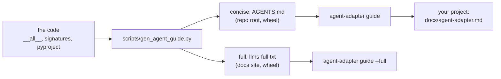

# For AI coding agents

One file teaches an AI coding agent (Claude Code, Cursor, Copilot) the SDK: what to
install, which function does each job, the safety rules and the common errors. It is
generated from the code, so it matches the version you installed.



## Two sizes

| Tier | Size | Has | Get it |
|---|---|---|---|
| Concise | about 26 KB (6.5k tokens) | install, import rules, safety rules, recipes, error fixes, CLI | `agent-adapter guide` |
| Full | about 125 KB (30k tokens) | the concise guide plus every public signature | `agent-adapter guide --full`, or [llms-full.txt](../llms-full.txt) on this site |

A file your agent loads on every session costs its size in tokens each time, so give it
the concise tier and let it fetch the full one when it needs a signature.

## Give it to your agent

Write the guide to its own file, then point your agent's instruction file at it. `--out`
never replaces a file that exists (your own `AGENTS.md` stays safe) unless you add `--force`.

```bash
agent-adapter guide --out docs/agent-adapter.md
```

| Agent | Then |
|---|---|
| Claude Code | add the line `@docs/agent-adapter.md` to your `CLAUDE.md` |
| Cursor, Codex and other `AGENTS.md` readers | add "Before using Agent Adapter, read docs/agent-adapter.md." to `AGENTS.md` |
| GitHub Copilot | add the same line to `.github/copilot-instructions.md` |
| Any chat | paste the output of `agent-adapter guide`, or give it the full-guide link |
| A short paste | `agent-adapter guide --section safety` (or `install`, `recipes`, `errors`, `cli`, `api`) |

No `AGENTS.md` yet? `agent-adapter guide --out AGENTS.md` writes one. No script on the
PATH? `python -m agent_adapter guide` does the same. Output is UTF-8 on every platform,
so `agent-adapter guide > file.md` works in any Windows console. The docs index for
agents that browse is [llms.txt](../llms.txt) at the site root; its header
links the full guide.

## What is in it

Sections come in this order, so an agent that reads only the top still gets the rules.

| Section | What the agent learns |
|---|---|
| What it is | a tool SDK that works with no agent framework and can be your agent loop |
| Install | one `pip install` line per need, each extra's supported versions |
| Import rules | where each name is imported from; never `agent_adapter.core` |
| Safety rules | approvals only through the executor, `confirm=True` for side effects, no secrets in logs, no global cache for per-user data, no retries on side effects |
| I want to… → use… | about 40 short recipes: tools, secrets, sync and async, structured output, web apps, queues, approvals, budgets, cache, tracing, fan-out, flows, hosted and local models, compression, imports, MCP, HTTP, A2A, the optimiser |
| Common errors → fixes | the error catalogue; the full tier adds the [Troubleshooting](../troubleshooting.md) tables |
| CLI commands | each command as one line |
| API index (full only) | every public name with its signature and first docstring sentence, by module |

## Keep it current

- After an upgrade, run `agent-adapter guide --out docs/agent-adapter.md --force`. The
  packaged copy always matches the installed version.
- In this repository, `python scripts/gen_agent_guide.py` rewrites all four copies.
  `tests/docs/test_agent_guide.py` fails when one is stale or a public name is missing;
  `tests/docs/test_agent_guide_recipes.py` fails when a recipe stops running.

## Files

| File | Does |
|---|---|
| `scripts/gen_agent_guide.py` | writes the four copies (`--check` only compares) |
| `scripts/agent_guide/` | one module per section: install, recipes, API index, prose |
| `agent_adapter/cli/guide.py` | `agent-adapter guide`: prints, writes or slices the packaged copies |
| `tests/docs/test_agent_guide.py` | drift, order, size, completeness, domain words, quoting |
| `tests/docs/test_agent_guide_recipes.py` | runs every recipe, or compiles and API-checks it |
| `tests/cli/test_guide.py` | the `guide` command and the `--help` examples |
