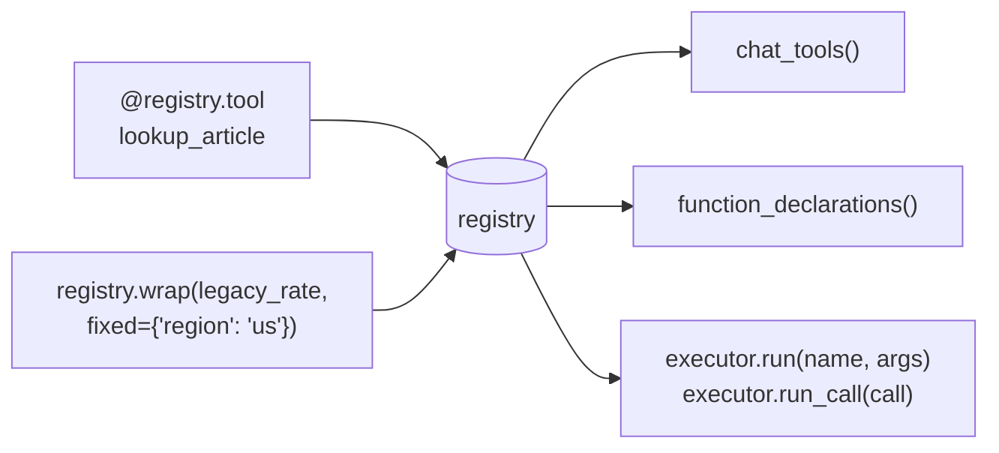

# Quickstart

Start with one function and one call. Then define two tools, render them for two
providers, and run them through an executor of your own. Five minutes.

## 0. Hello world

This is `examples/hello.py`. The test suite runs it.

```python
--8<-- "examples/hello.py"
```

| Line | Effect |
|---|---|
| `@aa.tool` | registers `add` on the default registry; the function is unchanged |
| `aa.call(add, a=1, b=2)` | runs it through the default executor: validation, hooks, approval, guards; prints `3` |

`aa.call` is for sync code; `await aa.acall(add, a=1, b=2)` is its async twin. Both use
the default executor. Set its options once with `aa.configure(...)`, which takes the
[`Executor`](../concepts/executor.md) arguments and returns the executor;
`reset_default_executor()` (from `agent_adapter.exec`) drops it, for example between
tests. A function that is not registered is refused (`ToolUsageError`); it never runs
unchecked.

## 1. The whole program

This is `examples/quickstart.py`. The test suite runs it, so it stays correct.

```python
--8<-- "examples/quickstart.py"
```

## 2. What each part does



| Line | Effect |
|---|---|
| `Registry()` | an empty set of tools |
| `@registry.tool(kind="retrieval", parallel_safe=True)` | builds the schema from the signature and docstring; the function is unchanged |
| `ctx: ToolContext | None = None` | injected at call time; never in the schema |
| `registry.wrap(legacy_rate, name="shipping_rate", fixed={"region": "us"})` | exposes existing code; `region` is bound and hidden |
| `chat_tools(registry)` | OpenAI Chat Completions tool dicts (strict) |
| `function_declarations(registry)` | Gemini function declaration dicts |
| `Executor(registry, approval=AutoDeny())` | one per process; holds approval, budgets, guards, cache and the ledger. No reviewer here, so a `confirm` tool is denied |
| `executor.run("lookup_article", {"article": "returns"})` | validates the arguments, applies the policies, calls the function, returns the value or raises |
| `executor.run_call(ToolCall(...))` | the same for a model's tool call; returns a `ToolResult`, with failures in `result.error` |

Renderers are imported by name from `agent_adapter.integrations.<provider>`, so the SDK
names `openai` and `google` stay free.

The executor acts on `kind` and `parallel_safe` (per-kind caps, the run lock).

## 3. Run it

```bash
python examples/quickstart.py
```

You get the OpenAI tools as JSON, the Gemini declarations as JSON, then:

```text
Article returns (en)
18.0
```

`lang` was not sent, so its default `en` applied. `region` came from `fixed=`.

## 4. Send it to a real model

Pass the rendered list as `tools=` to your SDK client. Run each tool call the model sends
through the one executor, never with `spec.invoke`:

```python
--8<-- "examples/quickstart.py:model-call"
```

`spec.invoke` only validates and calls. It skips approval, budgets, run guards, the cache
and the ledger, so a `confirm=True` tool would run unapproved. Keep it for
[tests](../how-to/testing-tools.md). To let the adapter drive the whole model loop, use
[`run_tool_loop`](../concepts/tool-loop.md).

Each provider page shows the exact shapes:

- [OpenAI](../integrations/openai.md)
- [Gemini](../integrations/gemini.md)
- [Anthropic](../integrations/anthropic.md)

## Next

- [Wrap existing code](wrap-existing-code.md): methods, partials, rename, hide.
- [Tools](../concepts/tools.md): every option.
