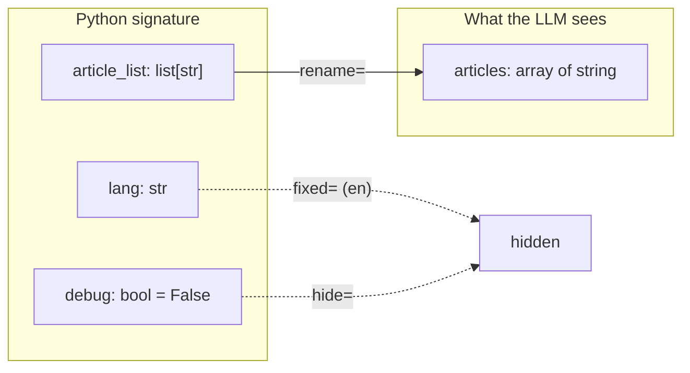

# Wrap existing code

Use `registry.wrap()` for code you cannot or will not edit. The code stays as it is.
All options go at the call site.

## 1. The existing code

```python
--8<-- "examples/wrap_existing.py:legacy"
```

## 2. Wrap it

```python
--8<-- "examples/wrap_existing.py:wrap"
```



| Option | Effect | Rule |
|---|---|---|
| `fixed={"lang": "en"}` | bound value, hidden from the LLM | the name must be a parameter |
| `hide="debug"` (or a list) | hidden; the default applies | needs a plain default, not `Field()` |
| `rename={"article_list": "articles"}` | the LLM sees `articles` | cannot rename a fixed or hidden parameter |
| `result=fn` | transforms the return value | turns off `result_schema()` |
| `name=`, `description=` | override the function name and docstring | `name` matches `[A-Za-z_][A-Za-z0-9_]*`, max 64 |
| policy options | `kind`, `tags`, `parallel_safe`, ... | type-checked at build time; enforced by the executor |

## 3. Call it

```python
--8<-- "examples/wrap_existing.py:call"
```

The model sends `articles`. The function receives `article_list`, plus `lang="en"` and
`debug=False`. `spec.llm_to_python` holds the reverse map. Run every call through the
executor, as here: `spec.invoke` skips approval, budgets and guards, so keep it for tests.

## Methods, classes and blocking code

Register the **bound** method: `registry.wrap(RateService("us").lookup)`. A whole legacy
class, its blocking sync calls and its own exceptions are on
[Wrap a legacy class](../how-to/wrap-legacy-code.md).

## Partials

A `functools.partial` takes its name and docstring from the wrapped function. Its
keyword bindings act like `fixed=`: hidden and never overridable.

- Passing `fixed=` for a name the partial already binds raises `ToolDefinitionError`.
- A partial must not bind the `ToolContext` parameter. The context is injected at call
  time.

## Callable objects

An object with `__call__` works too. It has no `__name__`, so pass `name=`. Its
description comes from the class or `__call__` docstring.

This page's code is `examples/wrap_existing.py`. The test suite runs it.
