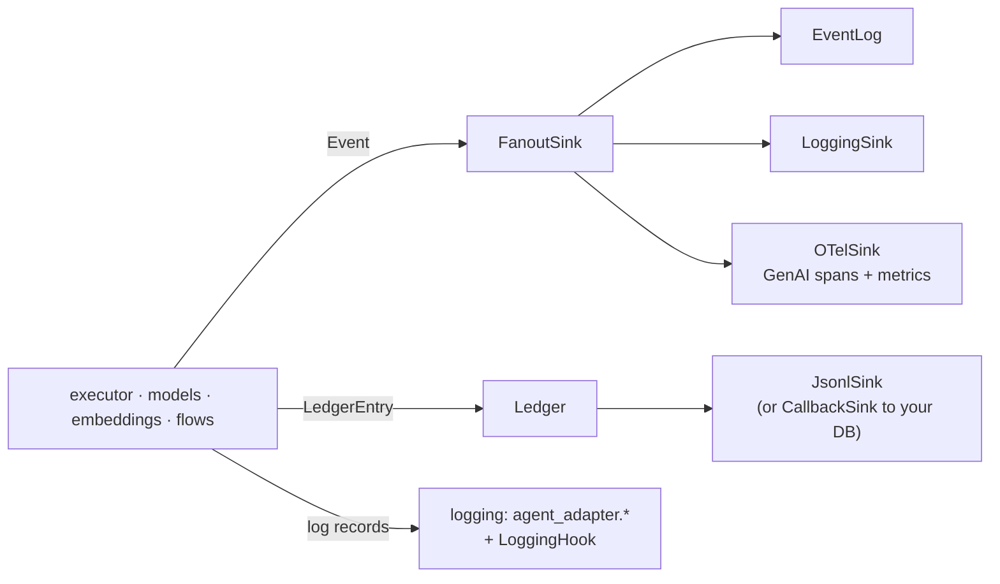

# Observability

See what a run did, what it cost, and why it failed, without leaking its data. Three
streams leave the adapter: events, ledger entries and log lines. All three carry the
run id.



## Wire it

```python
--8<-- "examples/guide_observability.py:otel"
```

```python
--8<-- "examples/guide_observability.py:wire"
```

| Component | Where data goes | Holds content? |
|---|---|---|
| `EventLog` | memory, newest `max_events` | event data only (ids, counts, kinds) |
| `LoggingSink` | standard logging, `DEBUG` by default | no: `arguments`, `result`, messages are left out unless `capture_content=True` at `DEBUG` |
| `OTelSink` | your OTel providers (extra `otel`) | no, unless `capture_content=True` |
| `Ledger` + `JsonlSink` | memory (latest 1 000 runs) and a JSONL file | no: tokens, units, cost, latency, cache hits |
| `LoggingHook` | one line per tool / model / node start, finish and error | redacted arguments; never results or messages |

## Run

```python
--8<-- "examples/guide_observability.py:run"
```

```text
['run.started', 'tool.started', 'tool.finished', 'embedding.started', 'embedding.finished', 'llm.started', 'llm.finished', 'run.finished']
tool lookup $0.000000 run_obs
api embed $0.004000 run_obs
llm answer $0.001200 run_obs
otel spans: False
```

The last line is `True` when `opentelemetry-api` is installed.

## Events

| Family | Types |
|---|---|
| runs | `run.started`, `run.finished` |
| tools | `tool.started`, `.finished`, `.failed`, `.retry`, `.cached`, `.pending` |
| approval | `approval.requested`, `approval.decided` |
| models | `llm.started`, `.finished`, `.cached`, `.failed`, `.fallback` |
| embeddings | `embedding.started`, `.finished`, `.failed` (a text count, never the texts) |
| memory | `memory.added`, `.searched`, `.deleted`, `.exported` (counts, never the texts) |
| retrieval | `retrieval.searched`, `.failed` (document ids and counts, never the texts) |
| sandbox | `sandbox.started`, `.finished`, `.failed` (sizes, exit codes, never the code or output) |
| flows | `flow.started`, `flow.finished`, `node.started`, `.finished`, `.failed`, `.paused`, `.cached`; `checkpoint.saved`, `run.recovered` |
| budget | `budget.warning`, `.reserved`, `.exceeded` |
| yours | `custom.<name>` via `ctx.emit("name", ...)` |

Required data keys per type: `REQUIRED_DATA` in `agent_adapter.tracing`. A sink is sync,
quick and never raises; a failing sink is logged at `WARNING` and the call goes on.

## OTel spans

| Events | Span |
|---|---|
| `llm.*` | `chat {model}` (`generate_content {model}` for Gemini) |
| `embedding.*` | `embeddings {model}`: input tokens and duration metrics; a call served fully from the cache records none |
| `tool.*` | `execute_tool {tool}`; retries, cache hits and approvals are span events |
| `flow.*`, `node.*` | `invoke_workflow {flow}`, `node {flow}.{node}` |

`gen_ai.conversation.id` is the run id. Attribute names follow the GenAI semantic
conventions; the full table is on [Tracing](../concepts/tracing.md).

## Correlate

| Id | On | Use it to |
|---|---|---|
| `run_id` | events, ledger entries, log lines, span `gen_ai.conversation.id` | join all three streams for one request |
| `call_id` / `parent_id` | events, ledger entries | nest a tool's model calls under the tool |
| `thread_id` | ledger entries | sum a conversation's cost |
| `approval_id` | `tool.pending`, `approval.*` | find a parked call in the store |

## What to alert on

| Signal | From |
|---|---|
| `tool.failed` rate per tool, by `error_kind` | events or `tool.error` log lines |
| `budget.warning`, `budget-exceeded` | events, ledger `error_kind` |
| approvals pending longer than N minutes | `store.list(status="pending")` and each record's `request.created_at` |
| `llm.fallback`, `model-rate-limited` | events |
| cache hit rate dropping | `ledger.summary().tool_cache_hit_rate`, `response_cache_hit_rate` |

## Log hygiene

The adapter logs through `logging.getLogger("agent_adapter.<module>")` and never adds
handlers. A failure is logged with the exception **type** at `WARNING` or `ERROR`; its
**text and traceback only at `DEBUG`** (exception text can carry arguments, results or
credentials). One internal helper (`log_failure`) does this everywhere, and a test scans
the source so no loud log call carries exception text.

| Do in your app | Why |
|---|---|
| Keep `agent_adapter` at `INFO` in production | `DEBUG` may hold exception text |
| Follow the same rule in your tools: type at `WARNING`, text at `DEBUG` | logs are copied to places your data must not go |
| Use `LoggingHook(redact=...)` for your own sensitive key names | default patterns cover keys, tokens, secrets, passwords, auth, cookies |
| Send `ErrorInfo` (`result.error`) to users, not `str(exc)` | it never holds input values; a crash shows only its class |

## Files

| File | Does |
|---|---|
| `examples/guide_observability.py` | sinks, a JSONL ledger, a tool, an embedding and a model call in one run |
| `tests/docs/test_guides.py` | runs it offline and checks the output |
