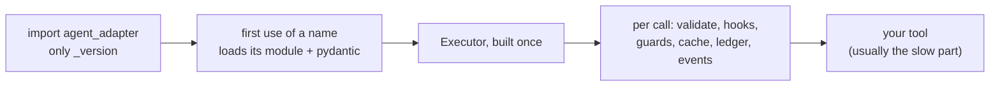

# Performance

Where time goes, and the knobs that change it. Measure on your own machine: the example
prints its numbers with `--measure`.



## Import cost

```python
--8<-- "examples/guide_performance.py:import"
```

```text
pydantic loaded: False | adapter modules: ['agent_adapter', 'agent_adapter._version']
```

| Rule | Effect |
|---|---|
| `import agent_adapter` loads only `_version` | a CLI or a web app that imports it but never calls it pays almost nothing |
| a top-level name loads its module on first access (PEP 562) | the first `Executor` or `Registry` access pays for pydantic and the core |
| integrations import their framework when first used | an extra you never call costs nothing |

Pay the cost at start-up, not in the first request: build the registry and the executor
at import time. Check with `python -X importtime -c "import agent_adapter; agent_adapter.Executor"`.

## Parallelism and caps

```python
--8<-- "examples/guide_performance.py:tools"
```

```python
--8<-- "examples/guide_performance.py:executor"
```

```python
--8<-- "examples/guide_performance.py:caps"
```

```text
peak search calls: 2
cache: False True 0
```

| Knob | Does |
|---|---|
| `parallel_safe=True` on a tool | lets it share the run with other calls; without it the call takes the run's exclusive lock |
| `run_many(..., concurrency=n)` | at most `n` calls of this batch at once |
| `RunLimits(max_concurrency=)` | the default batch concurrency when a batch passes none (8) |
| `RunLimits(per_kind={"search": 2})` | a cap per tool kind and run: protects a rate-limited backend |
| `RateLimitHook` | calls per second, not concurrency |
| sync tools | run in `asyncio.to_thread`, so they never block the loop; they share the default thread pool |

## Caching

| Cache | Turn on with | A hit costs |
|---|---|---|
| tool results | `cache_ttl=` on the tool, `cache=` on the executor | no tool run, `attempts=0`, $0 |
| model responses | `executor.model(port, cache_ttl=)` with an executor cache | no model call, $0 |
| embeddings | `CallableEmbedder(..., cache=)` | per text, not per batch |
| provider prefix cache | `PromptLayout` and a provider plug-in | a provider discount, still a call |

See [Caching](../how-to/caching.md) and [Cache model answers across workers](../cookbook/cache-llm.md).

## Per-call overhead

`python scripts/bench_overhead.py` times a tool and a model that do nothing, directly and
through the executor, with each feature on, in interleaved rounds, with INFO logging
formatted as a service would. One run (agent_adapter 1.1.0, Python 3.12.8, Windows Server
2022, 4 CPUs, 10,000 calls each; **your numbers will differ**: run it on your hardware):

| Scenario | Median (µs) | p95 (µs) |
|---|---:|---:|
| tool: direct `await echo()` (baseline) | 0.4 | 0.7 |
| tool: `executor.run`, nothing on | 155 | 286 |
| tool: + hooks (`LoggingHook`, `PIIGuard`) | 449 | 650 |
| tool: + approval (`AutoApprove`, confirm tool) | 202 | 352 |
| tool: + cache (every call a hit) | 206 | 354 |
| tool: + policy (allow rule, PII guard) | 253 | 417 |
| tool: + ledger | 199 | 343 |
| tool: hooks, approval, cache, ledger | 513 | 806 |
| tool: a sync tool, nothing on (worker thread) | 450 | 605 |
| model: direct `generate` (baseline) | 3.6 | 6.8 |
| model: `executor.model(...)`, nothing on | 74 | 123 |
| model: + hooks and ledger | 247 | 415 |
| model: + response cache (every call a hit) | 106 | 218 |

Each `executor.run` here starts a new run. Most of the hooks figure is `LoggingHook`
writing its INFO lines. A model call takes hundreds of milliseconds, so the adapter's share
is well under 1%. Sync tools pay a thread hop: make hot tools `async`.

## Sync callers: `run_sync` or `LoopRunner`

| Call | Cost per call | Use when |
|---|---|---|
| `await executor.run(...)` | none extra | you are in async code (FastAPI, async Django) |
| `run_sync(work, timeout=)` | a new event loop per call; `LoopLocal` clients are made and closed each time | WSGI views, Celery tasks, scripts: correct everywhere |
| `run_sync` inside a running loop | plus a one-shot worker thread | notebooks, sync callbacks inside async code |
| `runner.run(work, timeout=)` on one `LoopRunner` | none extra after the first call: one loop in a daemon thread, `LoopLocal` clients stay warm | a warm process with sync callers: Lambda, Cloud Run functions, gRPC sync servicers, Streamlit |

```python
--8<-- "examples/guide_performance.py:sync"
```

```text
run_sync clients: [1, 2, 3] | LoopRunner clients: [4, 4, 4]
```

Three `run_sync` calls built three clients; three `LoopRunner` calls shared one.

| `LoopRunner` rule | Detail |
|---|---|
| prefer it over `run_sync` | a process that stays warm and calls from sync code many times; keep `run_sync` for one-off scripts, cron, tests and Celery prefork tasks |
| one per process | at module level; the loop starts in a daemon thread on the first `run()`, never at import |
| warm clients | `LoopLocal` values (httpx, Redis) live as long as the loop, so TLS and pools are reused |
| fork | a forked child (gunicorn `--preload`, Celery prefork) drops the parent's loop and starts its own on its first `run()` |
| `close(timeout=30)` | lets in-flight work finish, cancels the rest (their callers get `ToolUsageError`), closes `LoopLocal` values, stops the loop; also runs at interpreter exit and at the end of a `with` block |
| inside its own loop | `run()` or `close()` there raises `ToolUsageError` (it would deadlock): `await` instead |

Details: [Runtime](../concepts/runtime.md); process models and probes: [Deploy](../backends/deploy.md).

## Anti-patterns

| Anti-pattern | Cost | Do instead |
|---|---|---|
| an `Executor` per request | rebuilds settings; run guards do not span requests | one per process; `executor.replace(...)` for variants |
| a `Registry` per request | rebuilds every schema | build once; `subset()` views for tenants |
| one `run_sync` per call in a warm process | a new event loop and new clients each time | one `LoopRunner`, or one `run_sync(batch)` running `run_many` |
| module-global async clients | break across loops, then get recreated | `LoopLocal` |
| `spec.invoke` to "save overhead" | skips approval, budgets, guards, cache and ledger | the executor; it is the product |
| `capture_content=True` in production sinks | large span attributes, PII | leave it off |

## Files

| File | Does |
|---|---|
| `examples/guide_performance.py` | import check, a capped search, a cache hit, an overhead timer, `run_sync` vs `LoopRunner` |
| `scripts/bench_overhead.py` | the overhead table above (`--iterations N`) |
| `tests/docs/test_guides.py` | runs the example offline and checks the output |
