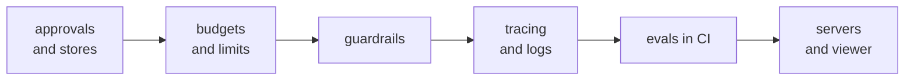

# Production checklist

Go through this list before an agent built on the adapter takes real traffic. Each line is
one thing to check, with the page that shows how. The defaults are safe: most lines ask you
to keep them, or to add the shared store a multi-process deployment needs.

## Approvals and stores

- [ ] Every tool with a side effect (payments, emails, deletes, writes) is marked
  `confirm=True`. See [Human in the loop](../how-to/human-in-the-loop.md).
- [ ] The approval port is set on purpose. Without one, `confirm` tools are denied; never
  ship `AutoApprove` outside tests. See [Approval ports](../concepts/approval.md#ports).
- [ ] Several processes or hosts share one store: SQLite on one host, Redis, SQLAlchemy or
  DynamoDB across hosts. A memory store works in one process only. See
  [Which store to use](../concepts/approval-stores.md#which-store-to-use).
- [ ] The store's file or database is readable only by your app, and its errors deny. See
  [Access and permissions](../concepts/approval-stores.md#access-and-permissions) and
  [Failing closed](../concepts/approval-stores.md#failing-closed).
- [ ] Paused runs resume with `executor.resume(approval_id)`, and someone is alerted when
  approvals wait too long. See [Resume after approval](../concepts/approval-resume.md) and
  [What to alert on](observability.md#what-to-alert-on).

## Budgets and limits

- [ ] The ledger has prices for every model you call, and a `BudgetHook` caps spend per run
  or per conversation. See [Budgets](../how-to/budgets.md).
- [ ] Paid APIs inside tools report their cost to the ledger. See
  [Paid APIs inside a tool](../how-to/budgets.md#5-paid-apis-inside-a-tool).
- [ ] Spend per user or team per day is capped in a store every worker shares. See
  [Team budgets](../how-to/team-budgets.md).
- [ ] `RunLimits(max_calls=, per_kind=)` and `once_per_run` stop runaway loops; the tool
  loop has a `max_steps` you chose. See
  [Runs and guards](../concepts/executor-policies.md#runs-and-guards).
- [ ] Every tool that calls a network service has a `timeout`, and retries only where a
  repeat is safe. See [Retry, timeout and control flow](../concepts/executor-policies.md#retry-timeout-and-control-flow).

## Guardrails

- [ ] A `GuardrailHook` with `PIIGuard` (or Presidio, NeMo or your own `CallableGuard`)
  checks tool arguments, tool results and model replies. See
  [Guardrails](../concepts/guardrails.md).
- [ ] Flagged tool arguments ask for approval or block; flagged results and replies are
  redacted. See [Actions](../concepts/guardrails.md#actions).
- [ ] You rely on guards failing closed: a guard that errors blocks. See
  [Safe by default](../concepts/guardrails.md#safe-by-default).

## Tracing and logs

- [ ] Events go to a sink you keep (a JSONL `EventLog`, logging, OpenTelemetry). See
  [Observability](observability.md).
- [ ] Spans reach your tracing tool: Langfuse, Phoenix or OpenLLMetry. See
  [Send traces](../how-to/send-traces.md).
- [ ] Prompt and result capture is off unless you need it and may keep that data
  (`capture_content=False` is the default). See [Tracing](../concepts/tracing.md).
- [ ] Alerts are set on failures, budget warnings, model fallbacks and cache hit rate. See
  [What to alert on](observability.md#what-to-alert-on).
- [ ] The signed audit log is on in production with strict mode,
  `audit(executor, folder=..., key=..., fail_closed=True)`: a lost record stops the next call
  instead of letting it run unaudited. The key lives in your secret store, and
  `agent-adapter audit verify` runs on a schedule. See [Audit log](../concepts/audit.md).

## Secrets in logs

- [ ] `agent_adapter` logs at `INFO` in production; `DEBUG` may hold exception text. See
  [Log hygiene](observability.md#log-hygiene).
- [ ] Your own tools log the exception type, never its text or their arguments, and send
  users `result.error`, never `str(exc)`. See [Log hygiene](observability.md#log-hygiene).
- [ ] Sensitive key names of your own are added to `LoggingHook(redact=...)`, and results
  that carry secrets are masked. See [Redact arguments and results](../cookbook/redact.md).

## Evals in CI

- [ ] A case file covers the main tasks and the known failures; cases saved from the chat
  page load unchanged. See [Cases](../how-to/evaluate-your-agent.md#cases).
- [ ] CI runs `agent-adapter eval app:agent cases.jsonl --min-score 0.9 --junit evals.xml`
  and fails the build below the score, on any case error, or on a regression against
  `--baseline`. See [In CI](../how-to/evaluate-your-agent.md#in-ci).
- [ ] Reports are saved with `--save` and compared in the viewer's Evals tab before a
  release. See [See your evals](../how-to/see-your-evals.md).
- [ ] Saved eval reports (`--save`, `save_to=`, `--json`) keep up to 4,000 characters of each
  case's input, expected value and output, even when runs are recorded with
  `capture_content=False`. Use `--no-content` (`run_eval(capture_content=False)`) when cases
  hold personal data. Pair an LLM judge with deterministic graders through `all_of`.

## Caching

- [ ] Each cached tool has the right `cache_scope`: `"global"` only for data that is the
  same for every caller. See [Choose a scope per tool](../how-to/caching.md#1-choose-a-scope-per-tool).
- [ ] Tools with side effects are never cached, and fresh data has a short `cache_ttl`. See
  [When not to cache](../how-to/caching.md#when-not-to-cache).
- [ ] Several workers share one cache backend when hits must be shared. See
  [Caching](../how-to/caching.md).

## Memory retention

- [ ] Memory is scoped by the signed-in user (`ctx.user_id`, set by your host, never the
  model), has `retention_days` set, and you can export and erase a user
  (`export(scope)`, `delete(scope=MemoryScope(user_id=...))`). See
  [Retention and privacy](../concepts/memory.md#retention-and-privacy).
- [ ] Chat sessions and uploads live in the chat folder: see
  [Security and storage](../how-to/chat-with-your-agent.md#security-and-storage).

## The viewer and the chat page

- [ ] The viewer runs on a developer machine, never as a public service: it binds
  `127.0.0.1` only. See [Security](../how-to/see-your-runs.md#security).
- [ ] The printed address is kept private: it holds the access token. Stop the viewer when
  you are done.
- [ ] Recording keeps `capture_content=False` where prompts or results hold personal data,
  and the runs and evals folders are as private as that data.
- [ ] Chat is on only when you start it with `--agent` or `--model`: it runs your agent and
  its tools in that process, and anyone with the link decides approvals as the reviewer.
  See [Security and storage](../how-to/chat-with-your-agent.md#security-and-storage).

## HTTP server auth

- [ ] The server has an authenticator. Anonymous mode serves loopback callers only unless
  you opt in. See [Security rules](../cross-language/http-server.md#security-rules).
- [ ] A public host sets `allowed_hosts`, and a reverse proxy adds TLS, timeouts and rate
  limits. See [Production settings](../cross-language/http-server.md#production-settings).
- [ ] Several workers share the approval store and an idempotency store; run ids are left to
  the server. See [Production settings](../cross-language/http-server.md#production-settings).
- [ ] Who may decide approvals is set: the run's owner, a scope, or your own rule. See
  [HTTP server](security.md#http-server).

## Deploy

- [ ] Probes, the image and per-process state follow
  [Deploy: Docker, Kubernetes and probes](../backends/deploy.md).
- [ ] You pinned the version and read the upgrade notes. See [Versioning](versioning.md).
