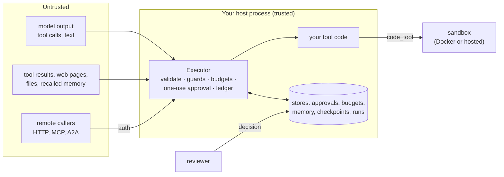

# Threat model

What an agent built on the adapter has to protect, where the trust boundaries are, what the
adapter enforces on its own, and what stays your job. The short version of the controls is
in [Security](security.md); this page is the map for a security review.

## Assets

| Asset | Why it matters |
|---|---|
| Side effects of tools | refunds, emails, deletes, payments: they cannot be taken back |
| Approval decisions | a forged or replayed "yes" runs a risky call |
| Money spent on models and paid APIs | a loop or an abusive user burns the budget |
| Personal data and secrets | in prompts, tool arguments, results, memory, logs and traces |
| Per-user memory and retrieval scopes | one user must never read another's notes or documents |
| Durable run state | a forged checkpoint could replay or skip a step |
| Run records and the audit trail | who did what, who approved it, what it cost |

## Trust boundaries

Everything the model writes is untrusted, and so is everything a tool reads from outside.

## What the adapter protects

| Control | Guarantee | Details |
|---|---|---|
| Validation | every call is checked against the tool's schema before any code runs; bad values are not echoed | [Security](security.md) |
| One-use approvals | a `confirm` call runs only after the executor's port approves; a decision is bound to the run, call id, tool and argument digest and is used once; no port, a stop, a timeout or an error denies | [Approval](../concepts/approval.md) |
| Framework approval never counts alone | a framework's "approved" only adds a gate; bridges pass a one-use token the adapter issued after its own port approved | [Framework approvals](security.md#framework-approvals) |
| HTTP server auth | no authenticator is a startup error unless anonymous mode is explicit; ids are scoped to the caller; one owner per run; hooks fail closed | [Security model](../cross-language/http-server.md#security-model) |
| Viewer and chat page | `127.0.0.1` only, a new token per start, `Host`, `Origin` and CSRF checks on POSTs, a strict CSP, data shown as text; chat is off unless you pass an agent | [See your runs](../how-to/see-your-runs.md#security), [Chat](../how-to/chat-with-your-agent.md#security-and-storage) |
| Guardrails | `PIIGuard` and your guards block, redact or ask for approval on arguments, results, requests and replies; a failing guard blocks | [Guardrails](../concepts/guardrails.md) |
| Budgets | `BudgetHook` refuses a model call before it is made, on an estimate; shared stores count every worker; a store error fails the call | [Team budgets](../how-to/team-budgets.md) |
| Sandbox | `code_tool` needs approval for every run; inputs, file names, output size and time are checked even if a backend ignores them | [Sandboxed code](../concepts/sandbox.md#security) |
| Memory isolation | the host sets the scope from `ctx.user_id`, never the model; every backend's output is re-checked against the scope; recalled notes are fenced as untrusted | [Memory](../concepts/memory.md#scopes), [Chat memory](../how-to/chat-memory.md#security-memories-are-untrusted) |
| Policy file | one file sets access, approvals, guards, budgets and limits per tool, team and environment; it only adds approvals, fails closed at load, and stays on the executor through `replace(...)` | [Policy file](../concepts/policy.md) |
| Retrieval scope | filters come from the host; results that do not match are dropped | [Retrieval](../concepts/retrieval.md#scope-and-tenant-isolation) |
| Checkpoint signing | every checkpoint and every logged call is signed (HMAC) and numbered; a changed or forged record, or a gap in the numbers, is `CheckpointStoreCorrupt`; deleting the newest records or checkpoint is not detected, so protect the store; calls in doubt need a decision | [Crash-safe runs](../concepts/durable-runs.md) |
| Audit trail | approval records keep the tool, the argument digest, the decision and `decided_by`; `approval.*`, `budget.*`, `memory.*` and `checkpoint.saved` events go to your sinks and the recorder; the audit log keeps a signed, hash-chained record you can verify and export | [Observability](observability.md), [Audit log](../concepts/audit.md) |
| Log hygiene | logs carry exception types, not their text; `LoggingHook` never logs `confirm` arguments and redacts secret-looking keys; content stays out of sinks unless `capture_content=True` | [Observability](observability.md) |

## What it does not protect

| Not covered | Why | Mitigate with |
|---|---|---|
| Model behaviour | the adapter checks calls, not judgement: a valid call can still be the wrong one | `confirm=` on risky tools, evals in CI, small tool sets per surface |
| Prompt injection in general | text from tools, files, pages or memory can steer the model; guards catch patterns, not intent | treat results as data, approvals on side effects, `GuardrailHook` with your classifier |
| Bugs in your tool code | a tool runs with your process's rights | least-privilege credentials, input checks in the tool, tests |
| A compromised host | stores, keys and the process itself are inside the boundary | OS hardening, a vault for keys, file permissions on stores |
| Shared caches | the LLM response cache keys on the request, not the caller; tool and node caches with `scope="global"` share results with every caller | run or thread scopes for per-user data; no response cache where answers depend on who asks ([Caching](../how-to/caching.md)) |
| Side effects already in flight | a call cut off mid-way may or may not have happened; no adapter can fence the outside world | idempotent tools, idempotency keys at the remote system, `RecoveryNeedsDecision` checks |
| Local code on the same machine | anyone who can read the runs or chat folders, or the viewer link, sees that data | keep links private, folder permissions, `capture_content=False` |
| Network edge | no TLS, CORS or general rate limiting in the HTTP server | a reverse proxy |

## What you must do

- Mark every tool with a side effect `confirm=True`, and give the executor a real approval
  port with a durable store ([Approval stores](../concepts/approval-stores.md)).
- Authenticate callers and set `ctx.user_id` from the authenticated user, never from the
  model or a request field the user controls.
- Keep reviewers real: map users to reviewer roles; four-eyes where it matters.
- Set budgets per user or team with a shared store, and prices for your models.
- Run guardrails on arguments and outputs; add your own classifier for content rules.
- Run model-written code only through `code_tool` on Docker (gVisor or a VM for hostile
  code) or a hosted sandbox.
- Keep `checkpoint_key`, bearer tokens and API keys in a vault. Use the same checkpoint key
  on every worker; checkpoints signed with another key read as `CheckpointStoreCorrupt`.
- Protect the stores (approvals, budgets, memory, checkpoints, runs) like audit tables:
  permissions, backups, retention.
- Gate releases on evals, and review the [Production checklist](production-checklist.md).

The [golden path](../tutorials/golden-path.md) wires most of these into one small service.
