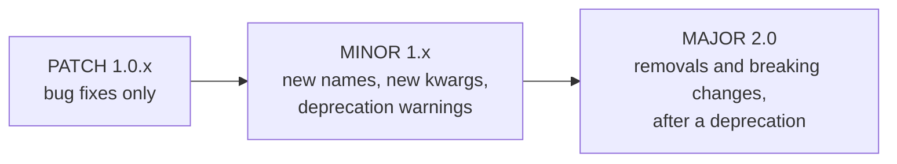

# Versioning and compatibility

Agent Adapter follows [Semantic Versioning 2.0](https://semver.org/spec/v2.0.0.html).
This page says what counts as public API, what each kind of release may change, and how
a name is retired. This policy was approved on 2026-10-30.



## What is public

| Public (covered by semver) | Where |
|---|---|
| the names in `agent_adapter.__all__` | the front door: tools, running, approval, hooks, cost, cache, flows, messages, five errors |
| the names in each documented home's `__all__` | `agent_adapter.errors`, `.exec`, `.approval`, `.hooks`, `.cost`, `.cache`, `.cache.providers`, `.flow`, `.tracing`, `.embeddings`, `.models`, `.runtime`, `.server`, `.optimiser`, `.integrations.<framework>` |
| error `kind` ids and `retryable` flags | `agent_adapter.errors`; HTTP problem types `urn:agent-adapter:error:<kind>` |
| event type names and their required data keys | `EventType`, `REQUIRED_DATA` in `agent_adapter.tracing` |
| the HTTP routes and JSON payloads | [HTTP server](../cross-language/http-server.md) |
| rendered tool schemas for a given tool | OpenAI, Gemini, Anthropic, MCP renderers |
| extras names | `pip install "agent-adapter[<extra>]"` ([support matrix](../support-matrix.md)) |

| Not public (may change in any release) | Example |
|---|---|
| any module or name starting with `_` | `agent_adapter.exec._journal` |
| `agent_adapter.core.*` | `agent_adapter.core.errors.log_failure` |
| names imported into a module but not in its `__all__` | |
| log message text | assert on `kind`, not on text |
| OTel GenAI attribute names | they follow the upstream conventions, still in Development |
| the default price table's numbers | prices change; the table is versioned (`price_version` on each entry) |

## Check a name

```python
--8<-- "examples/guide_versioning.py:public"
```

```python
--8<-- "examples/guide_versioning.py:check"
```

```text
55 top-level names
True True
False
ToolNotFound moved: from agent_adapter.errors import ToolNotFound
ShortCircuit moved: from agent_adapter.hooks import ShortCircuit
```

Names that left the top level in 1.0 raise an error that says where they live now.
`tests/docs/test_canonical_imports.py` keeps every example and docs page on these paths.

## What each release may change

| Release | May | May not |
|---|---|---|
| patch `1.0.x` | fix bugs, tighten a check that let unsafe input through, update prices | add or remove public names |
| minor `1.x` | add names, keyword arguments with defaults, extras, events, error kinds; deprecate | remove or rename a public name; change a `kind`; change a default in a way that breaks callers |
| major `2.0` | remove deprecated names; change behaviour | remove a name that was never deprecated |

A security fix may tighten behaviour in any release, even if code that relied on the
unsafe behaviour breaks. It is called out in the changelog.

## Deprecation process

1. The old name keeps working and emits a `DeprecationWarning` that names the new one.
2. The changelog lists it under **Deprecated**, with the release that removes it.
3. It stays for at least one minor release; it goes in the next major.
4. After removal, the old name raises an error that says where to go (as moved names do now).

Run your tests with warnings as errors (`filterwarnings = ["error"]` in pytest) to see
deprecations the day you upgrade.

## Supported versions

| Dependency | Range | Tested |
|---|---|---|
| Python | `>=3.11` | 3.11, 3.12, 3.13 |
| pydantic | `>=2.12,<3` | 2.12.x (`core-floor` session) and the newest 2.x (`core`) |
| frameworks | the extra's range | [support matrix](../support-matrix.md) |

The latest minor release gets fixes. The previous minor also gets fixes for 3 months after
the next minor ships. Pin `agent-adapter>=1.0,<2` in your app.

## Files

| File | Does |
|---|---|
| `examples/guide_versioning.py` | checks a name's home and shows the moved-name message |
| `tests/docs/test_guides.py` | runs it offline and checks the output |
