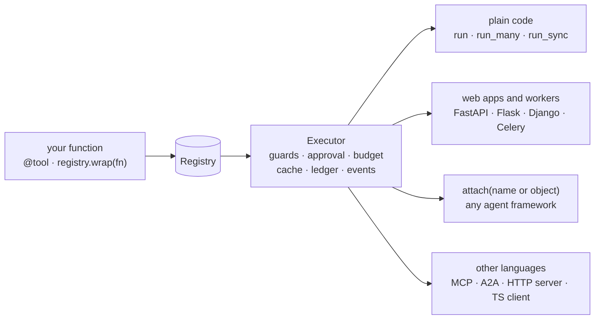

# Attach anywhere

Write a tool once. Call it from plain Python, a web app, a worker, any agent framework,
or another language. Every surface goes through the same `Executor`, so the same safety
rules apply everywhere.

## One call: `attach()`

`attach` gives a framework its native tools. Name the framework, or pass one of its objects.

```python
--8<-- "examples/attach_any.py:attach"
```

| You pass | `attach` does |
|---|---|
| a name: `"langgraph"`, `"openai-agents"`, `"pydantic_ai"` | finds the integration by entry point; case, `-` and `_` do not matter; the extra's name works too |
| an object, class or module: an `agents.Agent`, a `StateGraph`, `import agents` | finds the framework that owns its class, or a base class |
| `registry=None` | uses `default_registry`, the one `@tool` fills |
| `executor=None` | uses the process-wide default executor; pass yours for your hooks and ports |

It returns the integration's `export_tools(registry, executor=...)`: the native tools for
every tool exported to that target (`FunctionTool`s, tool dicts, one `ToolNode` per tool
for LangGraph). Discovery is by entry point, so a new integration, or your own plugin,
works with no change here.

**`attach` never takes an approval.** `approval=True`, `requires_approval=`, `confirm=`
and similar raise `ToolUsageError`. Approval belongs to the `Executor`. A framework's own
"approved" never counts alone; a bridge passes only a one-use token the adapter issued.

```python
--8<-- "examples/attach_any.py:errors"
```

An unknown name suggests the closest one and lists every integration: installed, or with
its `pip install "agent-adapter[extra]"` line. A known framework whose extra is missing
raises `MissingDependency` with that line. `agent-adapter doctor` prints the same list, and
`agent-adapter init` writes a starter project ([CLI](../reference/cli.md)).



## Pick your entry point

`attach` covers the tools. A framework's module adds its approval resolver or flow compiler.

| Your situation | Entry point | Page |
|---|---|---|
| A plain function or script | `@registry.tool` or `registry.wrap(fn)`, then `Executor.run` / `run_many` | [Minimal path](#the-minimal-path-for-non-agent-code) |
| An existing service or class | `registry.wrap(obj.method)`, one per method | [Wrap a legacy class](wrap-legacy-code.md) |
| FastAPI or another async app | `await executor.run(...)` | [Sync code and backends](sync-backends.md) |
| Flask, Django (WSGI), Celery, cron | `run_sync(executor.run(...))` | [Sync code and backends](sync-backends.md) |
| A queue, a Lambda or a data pipeline | `handle_envelope`, `tool_handler`, `run_many` | [Queues](../backends/queues.md), [Serverless](../backends/serverless.md), [Pipelines](../backends/pipelines.md) |
| OpenAI (Chat, Responses) raw API | `chat_tools(registry)`, `responses_tools(registry)`; each tool call via `executor.run_call` | [OpenAI](../integrations/openai.md) |
| Anthropic raw API | `anthropic_tools(registry)`, `executor.run_many(calls)`, `tool_result_blocks(results)` | [Anthropic](../integrations/anthropic.md) |
| Gemini / `google-genai` | `function_declarations`, `afc_callables`, `run_function_calls` | [Gemini](../integrations/gemini.md) |
| LangGraph | `tool_node(registry)`, `compile_flow(flow)` | [LangGraph](../integrations/langgraph.md) |
| Google ADK | `adk_tools(registry)`, `resolve_confirmations` | [ADK](../integrations/adk.md) |
| OpenAI Agents SDK | `function_tools(registry)`, `resolve_interruptions` | [OpenAI Agents SDK](../integrations/openai-agents.md) |
| Pydantic AI | `pydantic_ai_tools(registry)`, `resolve_deferred` | [Pydantic AI](../integrations/pydantic-ai.md) |
| Microsoft Agent Framework | `agent_framework_tools(registry)`, `resolve_approvals` | [Agent Framework](../integrations/agent-framework.md) |
| Agno | `agno_functions(registry)`, `resolve_requirements` | [Agno](../integrations/agno.md) |
| Strands Agents | `strands_tools(registry)`, `strands_approval_hook` | [Strands](../integrations/strands.md) |
| Haystack | `haystack_tools(registry)`, `confirmation_hook` | [Haystack](../integrations/haystack.md) |
| Claude Agent SDK | `claude_sdk_bridge(registry, port)` | [Claude Agent SDK](../integrations/claude-agent.md) |
| Semantic Kernel | `kernel_plugin(registry)`, `approval_filter` | [Semantic Kernel](../integrations/semantic-kernel.md) |
| AG2 | `ag2_tools(registry)`; `ag2_tool(spec, approval=port)` for a gate | [AG2](../integrations/ag2.md) |
| Tools only: LangChain, LlamaIndex, CrewAI, DSPy, smolagents, AutoGen 0.7, CAMEL-AI | `attach("<name>")`, or the module's `*_tools(registry)` | [LangChain](../integrations/langchain.md), [LlamaIndex](../integrations/llamaindex.md), [CrewAI](../integrations/crewai.md), [DSPy](../integrations/dspy.md), [smolagents](../integrations/smolagents.md), [AutoGen](../integrations/autogen.md), [CAMEL-AI](../integrations/camel.md) |
| A UI speaking AG-UI | `agui_endpoint(AGUIBridge(...), agent)` | [AG-UI](../integrations/ag-ui.md) |
| A REST service with an OpenAPI spec | `import_openapi(registry, spec, base_url=...)` | [OpenAPI](../integrations/openapi.md) |
| A framework not listed here | the `Integration` protocol and its entry point; then `attach` finds it | [Writing an integration](../contributing/writing-an-integration.md) |
| Another agent, over A2A | `a2a_app(registry, url=...)`; `import_a2a` for a remote agent's skills | [A2A](../integrations/a2a.md) |
| Another language, or an MCP client | `streamable_http_app(registry)` at `/mcp` | [MCP](../cross-language/mcp.md) |
| Another language over HTTP, with reviews | `create_app(registry)`, the TypeScript client | [HTTP server](../cross-language/http-server.md), [TypeScript client](../cross-language/typescript-client.md) |
| A non-Python framework or a hosted agent | MCP or REST, per stack | [Connect anywhere](../connect/index.md) |

## The minimal path for non-agent code

No model and no framework. Three steps.

**1. Define or wrap the tool.** New code gets the decorator; existing code is wrapped
unchanged.

```python
--8<-- "examples/howto_attach.py:define"
```

**2. Build one executor.** It holds the policies. Make it once per process.

```python
--8<-- "examples/howto_attach.py:executor"
```

The adapter never configures log handlers. Call `logging.basicConfig(level=logging.INFO)`
(or your app's logging setup) to see the `LoggingHook` lines.

**3. Run.** `run` returns the value or raises; `run_many` runs a batch concurrently and
keeps input order. From sync code, wrap the call in `run_sync`.

```python
--8<-- "examples/howto_attach.py:run"
```

```python
--8<-- "examples/howto_attach.py:sync"
```

The same spec renders for any model API. Nothing is redefined:

```python
--8<-- "examples/howto_attach.py:surfaces"
```

## Safety you get everywhere

The executor applies these on every call, from every surface above.

| Safety | What you set | What happens | Page |
|---|---|---|---|
| Approval | `confirm=True` or a rule, plus an `ApprovalPort` | The port approves, denies, edits or defers. No port: denied (fails closed). A framework's own "approved" signal never counts alone: a bridge passes an approval only as a one-use token the adapter issued after its own port approved, bound to the run, the native call id, the tool and a digest of the arguments. A bridge cannot issue a token for a call with no native call id; such a call is denied by the bridge or decided by the executor's port. One opt-in exception: an MCP server built with `client_approval=True` makes the MCP client's user the approver instead of the port ([MCP approval](../integrations/mcp.md#approval)); leave it off where a server-side reviewer is the control | [Approval](../concepts/approval.md), [HITL how-to](human-in-the-loop.md) |
| Budgets | `BudgetHook(max_usd, scope="run" \| "thread" \| "global")` | Stops (or warns) before a tool or model call once spend reaches the cap | [Hooks](../concepts/hooks.md#budgethook), [Budgets how-to](budgets.md) |
| Run guards | `once_per_run=True`, `RunLimits(max_calls=...)` | Extra calls fail with `RunLimitExceeded`; a replay of the same call is not a new call | [Executor policies](../concepts/executor-policies.md#runs-and-guards) |
| Concurrency caps | `parallel_safe`, `RunLimits(per_kind={...})` | Exclusive tools run alone; each kind has a slot cap per run | [Executor policies](../concepts/executor-policies.md#runs-and-guards) |
| Rate limits | `RateLimitHook({"search": Rate(5, 1.0)})` | Calls wait for a token; they never fail | [Hooks](../concepts/hooks.md#ratelimithook) |
| Timeouts, retries | `timeout=`, `retries=` | Each attempt is timed; retryable errors back off | [Executor policies](../concepts/executor-policies.md#retry-timeout-and-control-flow) |
| Cost ledger | `Executor(ledger=Ledger())` | One `LedgerEntry` per tool call and per model call made through `executor.model(port)`, priced from the table | [Cost](../concepts/cost.md) |
| Tracing | `Executor(sink=EventLog())`, `OTelSink` | `run.*`, `tool.*`, `approval.*`, `llm.*` events; GenAI spans | [Tracing](../concepts/tracing.md) |
| No secrets in logs | `LoggingHook()` | Secret-looking keys redacted; `confirm` tool arguments, results and exception text never logged | [Hooks](../concepts/hooks.md#logginghook) |
| Safe errors | raise `ToolError` for the model | Foreign exceptions reach the model as `tool-failed` with no message text | [Errors](../concepts/errors.md) |

Over HTTP the server adds run ownership: call ids are scoped to the caller, the first
principal to use a run owns it, and other principals get 403 on its invokes, events, cost
and `?run_id=` approval listings, and 404 on its approval records. By default only the owner or a holder of the `approvals:decide` scope can
decide an approval. See the [security model](../cross-language/http-server.md#security-model).

## Files

| File | Does |
|---|---|
| `examples/attach_any.py` | `attach()` by name, and its two first errors |
| `examples/howto_attach.py` | this page's code: one registry, one executor, every call style |
| `tests/docs/test_attach_examples.py`, `tests/integrations/test_attach.py` | run `attach` offline: names, objects, errors, no approval option |
| `tests/docs/test_howto_examples.py` | runs `howto_attach.py` offline and checks the output |
