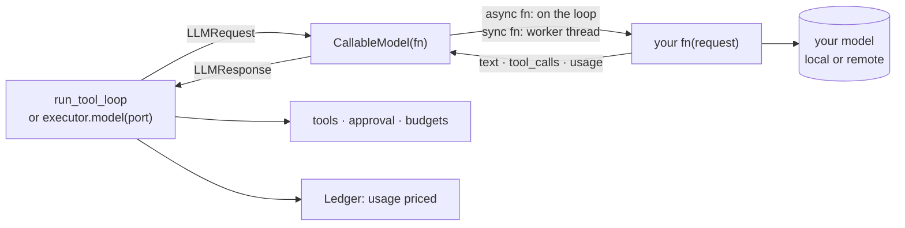

# Bring your own model

The adapter does not care which model runs. You define the model in your own code: a
local llama.cpp or transformers call, any HTTP API, or an OpenAI-compatible server. The
adapter wraps it and adds tool calling, approval, budgets, the ledger, the cache and
tracing. No provider class is needed.



## 1. A local model in your process

```python
--8<-- "examples/howto_byom.py:local"
```

`fn` takes one `LLMRequest` and returns one of:

| Return | Becomes |
|---|---|
| `str` | the reply text |
| a mapping of `LLMResponse` fields | `text`, `tool_calls`, `finish_reason`, `usage` …; `provider`, `model` and `message` are filled in |
| `LLMResponse` | used as is |

| `fn` is | Runs |
|---|---|
| `async def` (or an object with an async `__call__`) | on the event loop |
| a plain function or callable object | in a worker thread (`asyncio.to_thread`), so blocking work never stalls the loop; context variables are copied in |

Concurrent calls of a sync `fn` run in parallel threads. A model object that is not
thread-safe (one llama.cpp context, one transformers pipeline) needs a lock, as above.
Exceptions from `fn` propagate unchanged.

`build_chat_request` and `parse_chat_completion` (from `agent_adapter.models.openai`) turn
a request into Chat Completions kwargs and an OpenAI-shaped reply back into text, tool
calls and usage. They need no SDK, so any OpenAI-shaped library can reuse them.

## 2. Any HTTP API

```python
--8<-- "examples/howto_byom.py:http"
```

Use any client: `requests` or `urllib` in a sync `fn`, `httpx.AsyncClient` in an async
one. Your function owns keys, retries and timeouts.

## 3. Usage reaches the ledger

`usage` is a `Usage` or a mapping with its field names: `input_tokens` (uncached),
`cached_input_tokens`, `cache_write_input_tokens`, `output_tokens`, `reasoning_tokens`,
`units`. Other keys raise `ModelOutputInvalid`, so a provider-shaped dict such as
`{"prompt_tokens": …}` never bills $0 by accident. Convert one with
`normalise_usage("openai", raw, api="chat")` from `agent_adapter.models`.

## 4. Run the tool loop on your model

```python
--8<-- "examples/howto_byom.py:loop"
```

Price your own models by name or pattern in the table you load
([Cost](../concepts/cost.md#your-own-models)). Mark a local model `"free": true` so it costs
0 and never warns; a model with no price costs `None` and logs one `WARNING`. `executor.model(port)` gives any
port the executor's hooks, response cache, ledger and events.

## 5. An OpenAI-compatible server

```python
--8<-- "examples/howto_byom.py:servers"
```

`client_kwargs` go straight to `openai.AsyncOpenAI(...)`: `base_url`, `api_key`,
`timeout`, `max_retries`, `default_headers`, `http_client`. The SDK needs a key (or
`OPENAI_API_KEY`), so pass any string to a server that checks none. Needs
`pip install "agent-adapter[openai]"`.

| Server | Base URL | Tool calls need |
|---|---|---|
| Ollama | `http://localhost:11434/v1` | a tool-capable model |
| vLLM | `http://localhost:8000/v1` | `--enable-auto-tool-choice --tool-call-parser <name>` |
| LM Studio | `http://localhost:1234/v1` | a tool-capable model |
| llama.cpp `llama-server` | `http://localhost:8080/v1` | `--jinja` |

TEI (Text Embeddings Inference) serves embeddings, not chat; plug it in as an embedder
([Embeddings](../concepts/embeddings.md)).

### `strict_tools`

| `strict_tools` | Tool schema sent |
|---|---|
| `True` (default) | OpenAI strict mode: `"strict": true`, every property required, optional ones nullable, no extra properties |
| `False` | your schema as written, with `"strict": false` |

Most local servers do not enforce strict schemas. With `True` the model sees optional
arguments as required ones. Use `strict_tools=False` and `api="chat"` for local servers.

## Output

```text
stop 2 The rate is 0.92.
[('llm', 'qwen2.5-7b', 180, 0.0), ('tool', 'exchange_rate', 0, 0.0), ('llm', 'qwen2.5-7b', 180, 0.0)]
echo: What is the USD rate? house-13b 0.0000090
llama3.1:8b chat False
```

The last line prints only when the `openai` SDK is installed.

## Notes

| Note | Detail |
|---|---|
| Streaming | pass `stream_fn=` (async events ending in `StreamDone`); without it `stream()` replays the full reply |
| Response cache key | provider, model, the request and the function's qualified name; give each model its own `model=` |
| Cancellation | a cancelled call stops waiting; a sync `fn` already in its thread runs to the end |
| Fallback | `FallbackModel([own, other])` works with any ports ([Models](../concepts/models.md)) |

## Files

| File | Does |
|---|---|
| `agent_adapter/models/callable.py` | `CallableModel`: your function as a model port |
| `examples/howto_byom.py` | a local model, an HTTP API, a tool loop, local servers |
| `tests/docs/test_howto_byom.py` | runs the example offline and checks the output |
