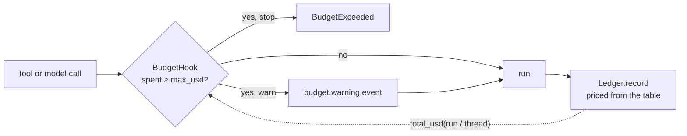

# Budgets

Cap what a run or a conversation may spend, and how many calls it may make. The ledger
prices every model and paid-API call; `BudgetHook` reads it before each call.



## 1. Prices

```python
--8<-- "examples/howto_budgets.py:prices"
```

`Prices.default()` ships OpenAI and Gemini list prices; add your own with `merged()` or
`load()` ([Cost](../concepts/cost.md)). An unknown model costs `None` (counted as 0) and
logs one `WARNING`, so a missing price never blocks a call, but it also never counts
toward a budget.

## 2. Wire the ledger and the hook

```python
--8<-- "examples/howto_budgets.py:executor"
```

`executor.model(port)` wraps any model port with the executor's hooks, ledger and events,
so each model call is one priced `LedgerEntry(kind="llm")`.

## 3. Per run

```python
--8<-- "examples/howto_budgets.py:per_run"
```

The hook checks **before** each call, so a run can end slightly over the cap: here three
calls of $0.20 run, the fourth is stopped at $0.60. The stopped call is recorded as a
failed entry at $0. Set `max_usd` below the hard limit by one call's cost if you must
never cross it.

## 4. Per conversation

```python
--8<-- "examples/howto_budgets.py:per_thread"
```

| `scope` | Reads | Use for |
|---|---|---|
| `"run"` (default) | `total_usd(ctx.run_id)` | one agent turn or job |
| `"thread"` | `total_usd(thread_id=ctx.thread_id)` | a chat across turns; an empty `thread_id` falls back to `run` |
| `"global"` | `total_usd()` | everything this ledger holds (one process) |

| `on_exceed` | At or over the cap |
|---|---|
| `"stop"` (default) | raises `BudgetExceeded(limit_usd, spent_usd, scope=, run_id=)` |
| `"warn"` | logs once per run and emits `budget.warning`; the call runs |

Several hooks may stack: `[BudgetHook(0.50), BudgetHook(5.00, scope="thread")]`.

## 5. Paid APIs inside a tool

```python
--8<-- "examples/howto_budgets.py:paid_tool"
```

| Field | Rule |
|---|---|
| `kind="api"`, `provider`, `model`, `units` | priced as `units["provider:model"].per_unit × units` |
| `entry_id` | give it its own id: the executor already records the tool's entry under the call id, and the same `(run_id, entry_id)` replaces an entry |
| `thread_id=ctx.thread_id` | without it a thread budget does not see the cost |

## 6. Call-count caps

```python
--8<-- "examples/howto_budgets.py:caps"
```

`once_per_run` and `RunLimits(max_calls=)` count a call only once it will execute (valid
arguments, approval granted). A replay of the same call id, tool and arguments is not a
new call. Both raise `RunLimitExceeded` (kind `run-limit-exceeded`).

## Output

```text
3 run 0.5 0.6
0.6 4 1
0.5 1
sent
run-limit-exceeded
max_calls reached after 9 geocodes
```

## Notes

| Note | Detail |
|---|---|
| No ledger, no budget | `BudgetHook` without a ledger does nothing and warns once |
| Cache hits are free | a response- or tool-cache hit is recorded at $0 ([Caching](caching.md)) |
| Several processes, users, teams, days | the in-memory `Ledger` counts one process; for caps per user or team, per day or month, shared by every worker, see [Team budgets](team-budgets.md) |
| Reports | `ledger.summary(run_id)`: totals by stage and kind, cache hit rates, parallelism |

## Files

| File | Does |
|---|---|
| `examples/howto_budgets.py` | prices, a paid tool, per-run and per-thread caps, call caps |
| `tests/docs/test_howto_examples.py` | runs it offline and checks the output |
