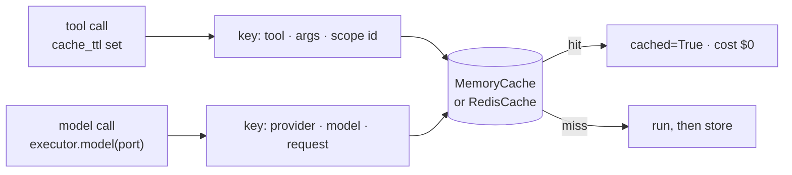

# Caching

Skip repeat work. The tool cache answers a repeated tool call; the LLM response cache
answers a repeated model request. Both live in one `CachePort` you give the executor, and
a hit is recorded in the ledger at $0.



## 1. Choose a scope per tool

```python
--8<-- "examples/howto_caching.py:tools"
```

| `cache_scope` | Shared by | Use for |
|---|---|---|
| `"run"` (default) | calls in one run | repeated lookups inside one agent turn |
| `"thread"` | runs with the same `thread_id` | per-user or per-conversation data |
| `"global"` | every caller of this cache | public data that is the same for everyone |

A run- or thread-scoped call without that id is not cached. Never use `"global"` for data
that depends on who is asking.

## 2. Give the executor a cache

```python
--8<-- "examples/howto_caching.py:executor"
```

| Backend | Use |
|---|---|
| `MemoryCache(max_entries=...)` | one process; LRU with TTLs |
| `RedisCache(url, prefix=...)` | shared across processes (extra `redis`); errors are misses |

A context can carry its own cache (`ctx.cache`); it wins over the executor's.

## 3. Tool results

```python
--8<-- "examples/howto_caching.py:tool_cache"
```

| Rule | Detail |
|---|---|
| Stored | only ok, JSON-encodable results from a real run |
| Key | tool name, arguments (after approval edits) and the scope id; global keys also include a digest of the tool's schema, so a changed tool misses |
| Hit | `ToolResult(cached=True, attempts=0)`, a `tool.cached` event |
| Hooks | the stored value is the tool's own result, before `after_tool` hooks: a redacting hook does not redact the cache |
| Backend errors | logged at `WARNING`, treated as misses |

## 4. Model responses

```python
--8<-- "examples/howto_caching.py:llm_cache"
```

| Rule | Detail |
|---|---|
| Turned on by | any executor cache, through `executor.model(port, cache_ttl=...)`; no expiry unless `cache_ttl` |
| Key | provider, model, the request (minus `stream`, `stage`, `response_cache`, `metadata`) and the port's own key fields |
| Opt out | `LLMRequest(response_cache=False)`: neither read nor stored |
| Not stored | error replies, replies that are already hits, streams |
| Hit | `LLMResponse(cached=True, latency_ms=0)`, an `llm.cached` event, a ledger entry at $0 |

## Output

```text
False True 0 1
2
0.4
False True False 2
0.33
```

`tool_cache_hit_rate` and `response_cache_hit_rate` come from `ledger.summary()`.

## The provider's own prefix cache

Separate from these caches, providers discount a repeated prompt prefix. Keep the stable
part first with `PromptLayout` and let a plug-in (`OpenAIPromptCache`,
`AnthropicPromptCache`, `GeminiExplicitCache`) set the request options. See
[Cache](../concepts/cache.md#prompt-layout).

## When not to cache

| Case | Why |
|---|---|
| Tools with side effects (writes, emails, payments) | a hit skips the effect |
| Results that must be fresh | pick a `cache_ttl` shorter than the data's lifetime, or none |
| Results with secrets or personal data under `"global"` | every caller of the cache can read them |

## Files

| File | Does |
|---|---|
| `examples/howto_caching.py` | scoped tool caches, the response cache, opt-out, hit rates |
| `tests/docs/test_howto_examples.py` | runs it offline and checks the output |
