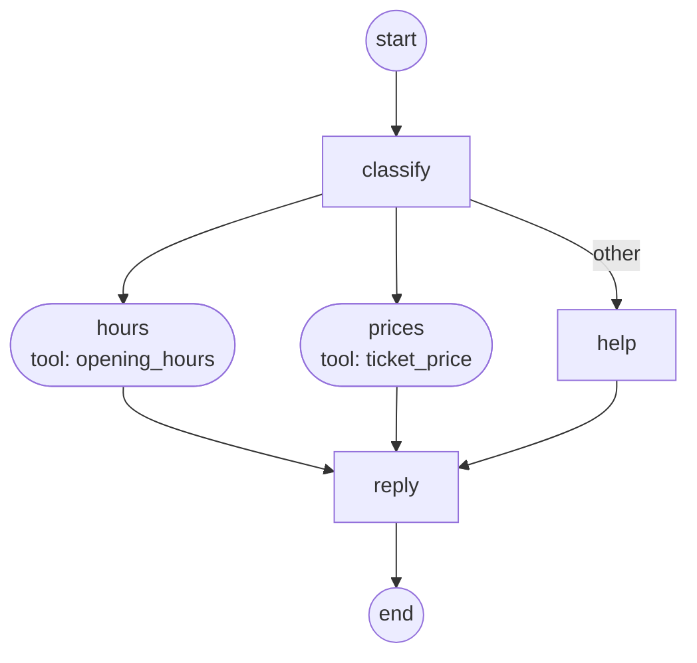
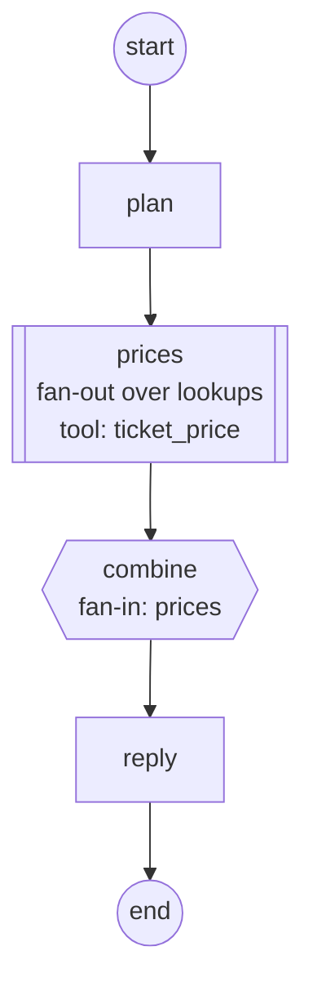
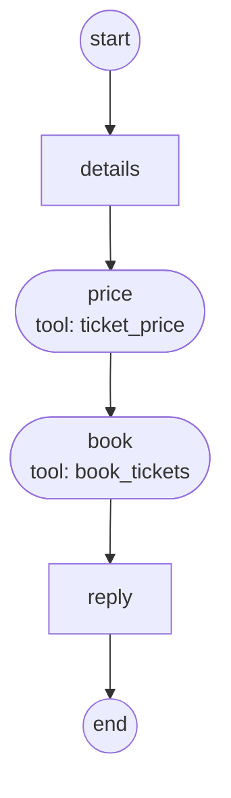
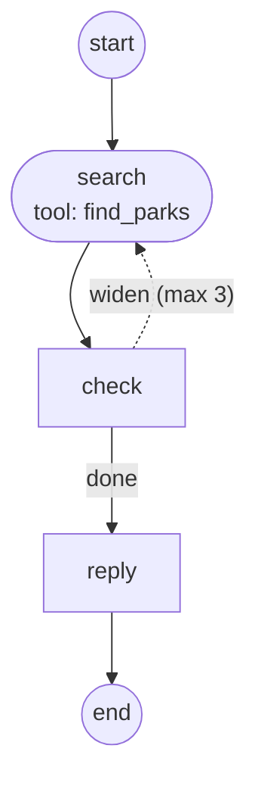
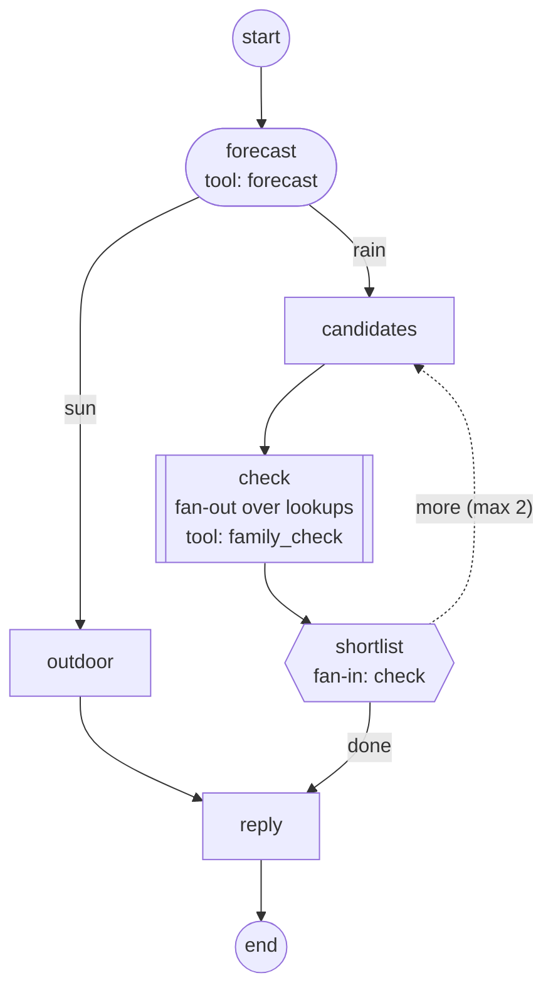

---
search:
  boost: 2
---

# Chat flows by example

`examples/chat_flows.py` is a scripted city help desk (no model, no API key): one agent picks
a `Flow` per question, one per pattern. Run `python examples/chat_flows.py`, or replay it here.

<iframe class="aa-demo" src="../../assets/demo/chat-demo.html" title="Agent Adapter chat: a recorded demo of a city help desk" width="100%" height="760" loading="lazy" sandbox="allow-scripts allow-downloads" allow="clipboard-write"></iframe>

[Open the demo full screen](../assets/demo/chat-demo.html). The Graph lights up node by node.

## The agent

`chat` runs the picked flow in the turn's run, so tool calls show as cards; `session.state`
keeps the museum for later turns. Each flow ends in `reply`, where a stand-in model writes the
answer, so the Cost tab has tokens and dollars.

```python
--8<-- "examples/chat_flows.py:agent"
--8<-- "examples/chat_flows.py:writer"
```

## 1. Router: "Is the City Museum open on Monday?"

`classify` reads the question. A `Route` sends it to one branch: hours, prices or help.



```python
--8<-- "examples/chat_flows.py:router"
```

## 2. Fan-out, fan-in: "Compare ticket prices at three museums"

`prices` is a `Map`: three `ticket_price` calls run at once. `combine` is a `Join` that waits
for them all, then sorts the prices into a table.



```python
--8<-- "examples/chat_flows.py:fanout"
```

## 3. Approval: "Book two tickets for Saturday"

`book_tickets` has `confirm=True`, so the call waits for Approve or Deny in its card. A
decision is used once. In the recording the demo approves it; a denial fails the turn.



```python
--8<-- "examples/chat_flows.py:approval"
```

## 4. Loop: "Find a park with a playground near the river"

`search` looks within 0.5 km. `check` doubles the distance when no park has a playground,
and the route goes back to `search`, at most 3 times. Here it widens twice.



```python
--8<-- "examples/chat_flows.py:loop"
```

## 5. All together: "Plan a rainy day for a family"

The forecast routes to indoor plans. `check` fans out over two museums and `shortlist` joins
them. With fewer than two family picks, it loops back for the next two.



```python
--8<-- "examples/chat_flows.py:combined"
```

`--check` runs all five questions offline and prints the answers. See also [Chat with your
agent](chat-with-your-agent.md) and [Navigate the graph](navigate-the-graph.md).
