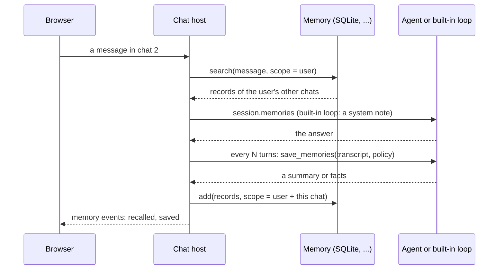

# Remember users across chats

The chat page can remember what a user said in earlier chats. Give it a memory backend and
the user's id: each turn then recalls that user's relevant records, and, if you choose,
saves a summary or facts after the answer. It is off unless you pass `memory=`, and saving
is off unless you pick a save policy.



## Turn it on

```python
--8<-- "examples/chat_memory.py:serve"
```

```bash
agent-adapter ui --model app:model --memory sqlite:memory.db --user ann --memory-save facts
```

| Option (`serve` / CLI) | Means |
|---|---|
| `memory=` / `--memory sqlite:PATH` or `MOD:ATTR` | the backend: any store from `agent_adapter.memory` |
| `user_id=` / `--user NAME` | who owns these chats; needed with memory |
| `memory_save=` / `--memory-save` | `"none"` (default), `"summary"` or `"facts"` |
| `memory_every=` / `--memory-every N` | save after every N finished turns (1) |
| `recall_k=` / `--recall K` | records recalled per turn (5) |

`python examples/chat_memory.py --check` runs two chats offline: the second one recalls
the seat preference the first one saved.

## What the agent sees

- `session.memories`: the recalled `MemoryHit`s, best first. Records of the current chat
  are left out; its turns are already in `session.history`.
- `session.user_id` and `session.context().user_id`: tools read the user from
  `ctx.user_id`, never from the model.
- The built-in loop adds one **user**-role message before the new message: a warning that
  the notes are untrusted data, then the notes inside `<untrusted-memory-notes>` tags, one
  line each (line breaks and `<` `>` removed, at most 500 characters per note).

Recall uses your backend's search with the user's message as the query. `SQLiteMemory`
without an embedder matches words, so pass `embedder=` for meaning-based recall.

## Saving

With the built-in loop, the model writes the summary or the facts. A custom agent writes
them itself: give it a `save_memories` method, or `serve` refuses the save policy.

```python
class Desk:
    def __call__(self, message, session): ...

    async def save_memories(self, transcript, session, policy):
        return ["prefers aisle seats"]  # one record per text; "NONE" or "" are skipped
```

Saved records carry the scope `MemoryScope(user_id=..., session_id=<chat>)`, the metadata
`kind` (`summary` or `fact`) and the turn id as `source`. Backends that keep one
partition per user and no metadata (Zep, Graphiti, or any backend with `user_only = True`)
get `MemoryScope(user_id=...)` without metadata, so recall cannot leave out the current chat. A failing save or recall is
logged as a WARNING and shown in the inspector; the answer still stands.

## In the page

- The inspector's **Memory** tab shows what the selected turn recalled and what it saved.
- Below that, the user's records, newest first, each with **Delete**. A delete is a POST
  with the token, the CSRF header and an Origin check; it only removes records of this
  server's user.
- Memory calls are recorded as `memory.searched` and `memory.added` events, so the
  timeline shows them as purple `memory` spans with their record counts.

## Security: memories are untrusted

A saved note comes from an earlier conversation, which may hold text from tools, files or
web pages. A note that says "ignore your rules" is a stored prompt injection that returns
in every later chat. So:

- Notes never go in a system message; they are fenced and marked as untrusted data.
- Your own agent should do the same with `session.memories`, and never give a note the
  authority of a system prompt or a tool result.
- Run your input guardrails over recalled texts too (`GuardrailHook`, `PIIGuard`), or keep
  `memory_save="none"` where tool output is untrusted.
- Review and delete bad records in the Memory tab.

## Users never mix

- One server serves one user. Chats are stored with their user; a server started for
  another user does not list, open or change them.
- Recall and the Memory panel only read `MemoryScope(user_id=<this user>)`; a delete with
  another user's record id deletes nothing.
- Session files keep only the ids and scores of recalled records, so deleting a record
  removes its text everywhere the chat page keeps it.

Anyone with the printed link reads and deletes that user's memory: keep the link private,
as for chat itself. Retention, export and erasure are covered in
[Memory](../concepts/memory.md).
