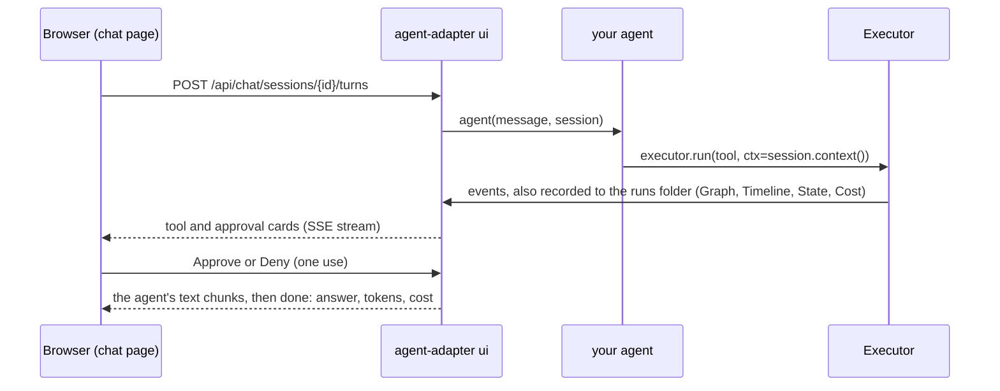
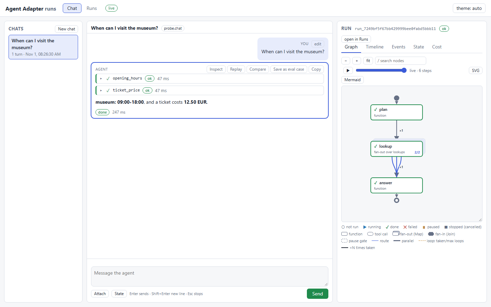

---
search:
  boost: 2
---

# Chat with your agent

Chat with any agent in the local Agent Adapter page, and watch it work: streamed text, tool
calls, approvals, the flow graph, a timeline, state and cost for every turn. It works with
any framework or none, offline, on 127.0.0.1 only.

## Try it here

This is the real chat page, replaying recorded turns of `examples/chat_flows.py`. Pick a
question: its tool cards, approval and answer play out while the graph, timeline, events,
state and cost fill in. Nothing runs here; run `python examples/chat_flows.py` to chat live.

<iframe class="aa-demo" src="../../assets/demo/chat-demo.html" title="Agent Adapter chat: a recorded demo of a city help desk" width="100%" height="760" loading="lazy" sandbox="allow-scripts allow-downloads" allow="clipboard-write"></iframe>

[Open the demo full screen](../assets/demo/chat-demo.html). Its five flows, one per agent
pattern, are explained in [Chat flows by example](chat-flows.md).



## Start it: `agent-adapter ui` or `serve()`

The smallest agent is one function. Save it as `app.py` and run `python app.py`, or start
the page with `agent-adapter ui --agent app:chat`:

```python
--8<-- "examples/chat_minimal.py:minimal"
```

```bash
agent-adapter ui --agent app:chat                        # chat with any agent
agent-adapter ui --agent app:chat --tools app:registry   # ...whose session.executor runs these tools
agent-adapter ui --model app:model --tools app:registry  # the built-in tool loop
```

Targets are `module.path:attribute`, imported from the current folder. Options:
`--executor app:executor`, `--system TEXT` and `--max-steps 8` (built-in loop),
`--turn-timeout 300`, `--approval-timeout 600`, `--reviewer local`, `--chat-dir DIR`
(default `.agent_adapter/chats`). Without `--agent` or `--model`, the Chat tab says how to
add one. `serve(...)` takes the same options (`registry=` is `--tools`; also `folder=`, `port=8780`,
`open_browser=True`, `stream=True`), prints the link and blocks until Ctrl+C.

## The agent contract

`agent(message, session)` may be async or sync (a sync one runs in a thread). It returns
the answer as a `str`, or an async iterator of text chunks, which stream.

| Name | Holds |
|---|---|
| `message.text`, `message.attachments` | the user's text; `Attachment(name, media_type, size, path)` with `read_bytes()`, `read_text()` |
| `session.id`, `session.history` | the chat id; earlier finished turns as `Message`s |
| `session.state` | a dict the page shows and can edit before a turn; changes are kept |
| `session.executor`, `session.context()` | the host's executor; pass `ctx=session.context()` so tool calls join this turn's run and show as cards |
| `session.run_id` | this turn's run in the Runs view |

An exception ends the turn as `failed`: an `AdapterError` shows its kind and message, any
other only its type name. A turn cut off by a server stop ends `stopped` with the kind
`interrupted`. A fuller agent (`examples/chat_any_agent.py`) runs a flow in the turn, with
`FlowRunner(trace_state=True)` so the State tab shows values, and streams:

```python
--8<-- "examples/chat_any_agent.py:plain"
--8<-- "examples/chat_any_agent.py:serve"
```

LangGraph, ADK, CrewAI or an HTTP backend: [Wrap a framework for chat](chat-wrappers.md).

## The built-in tool loop

`--model` and `--tools` run `run_tool_loop` over your model and registry, streaming when
the model can; `serve(stream=False)` calls `generate` instead, so a response cache applies.
The host's executor allows 50 tool calls per turn unless you pass your own. Text files
(UTF-8, up to 64 KB) are added to the message; other files need `--agent`.

```python
--8<-- "examples/chat_builtin.py:serve"
```

## Using the page

The demo above is this page. Chats sit on the left, the conversation in the middle, and the
selected turn's run on the right, with the Runs view's tabs; the Events tab filters by node,
tool, kind or text. `python examples/chat_builtin.py` runs the built-in loop live:



| Part | Does |
|---|---|
| Conversation | streamed Markdown (code blocks with copy, lists, tables, links); tool and approval cards |
| Composer | **Enter** sends, **Shift+Enter** adds a line, **Esc** stops the turn; Attach or drop files; State edits `session.state` (JSON) before the next turn |
| Turn menu | Inspect, Replay, Compare, Save as eval case, Copy; **edit** on your message resends it in a new branch |
| Inspector | Graph, Timeline, Events, State and Cost of the selected turn's run, live; "open in Runs" shows the full run |

- **Approvals.** A `confirm=True` call waits for Approve or Deny in its card, decided as
  `--reviewer`; a decision is used once. Stop, the turn timeout or `--approval-timeout`
  deny it. An `--executor` with its own approval port keeps that port.
- **Files.** Up to 10 MB each and 50 MB per chat: text, JSON, PNG, JPEG, GIF, WebP, PDF.
  The server checks the bytes, not the name; the page checks sizes before sending.
- **Replay** runs the same input, and **edit** your edited text, on the same earlier
  history in a new branch. **Compare** shows answer, tool calls, tokens, cost, duration and
  steps of two turns. **Eval cases** append `{id, input, expected, tags}` to
  `<chat-dir>/eval_cases.jsonl` for `optimiser.cases.load_cases` ([Optimise your
  agent](optimise-your-agent.md)). Graph controls: [Navigate the graph](navigate-the-graph.md).

## Security and storage

Chat runs your agent and its tools inside the `ui` process, so it is off unless you pass
`--agent` or `--model`, and start-up logs a WARNING. Every tool call goes through the
executor (validation, approvals, limits, ledger). The token, Origin, CSRF and loopback rules
of [See your runs](see-your-runs.md#security) apply to every request.

- Anyone with the printed link can chat and decide approvals as `--reviewer`: keep it private.
- `serve(open_browser=True)` opens a one-use launch link, valid for 60 seconds. On a shared
  machine another local user could read it from the browser's command line before the
  browser uses it; if your own browser then shows the link as expired, restart the viewer
  (the server logs a WARNING).
- Chats are stored unmasked in the chat folder: messages, answers, uploads and session
  state (the page shows secret-named state keys as `***`). Treat the folder as data.
  Turns are recorded to the runs folder with `capture_content=False`.
- A sync agent that blocks past `--turn-timeout` ends the turn, but its worker thread runs
  on until the call returns. Prefer async agents or give your calls their own timeouts.

## Files

| File | Does |
|---|---|
| `examples/chat_minimal.py`, `chat_builtin.py`, `chat_any_agent.py`, `chat_flows.py`, `chat_wrappers.py` | the smallest agent; a scripted model with a tool to approve (`--check` runs one turn offline); a plain agent running a flow; the demo's help desk, one flow per pattern; framework wrappers || `agent_adapter/viewer/serving.py`, `launch.py` | `serve(...)`; one-use launch links |
| `agent_adapter/viewer/chat/` | contract, built-in agent, turn host, sessions, files, approvals, routes |
| `agent_adapter/viewer/static/chat*.js`, `markdown.js`, `inspector.js` | the page: conversation, stream reader, safe Markdown, inspector |
