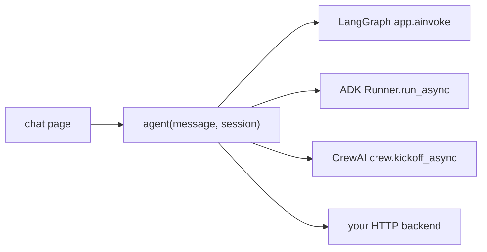

# Wrap a framework for chat

The Agent Adapter chat page talks to one function: `agent(message, session)`, returning
text or an async iterator of text chunks ([Chat with your agent](chat-with-your-agent.md)).
Each wrapper below turns a framework's own entry point into that function, in a few lines.



Tool calls show as cards when they run through `session.executor` (with
`ctx=session.context()`); a framework that runs its tools itself shows only its answer.
A framework's own "approved" never counts: only the page's one-use decision does.

## LangGraph

A compiled graph with a messages state. Earlier turns go in as `(role, text)` pairs.

```python
--8<-- "examples/chat_wrappers.py:langgraph"
```

## ADK

Each chat is one ADK session, made on first use; ADK keeps the history itself. An edit or
Replay branch has a new `session.id`, so ADK starts a fresh session there without the
earlier turns (seed it from `session.history` if the agent needs them).

```python
--8<-- "examples/chat_wrappers.py:adk"
```

## CrewAI

The crew's task reads the user's text as `{question}`.

```python
--8<-- "examples/chat_wrappers.py:crewai"
```

## Your HTTP backend

A FastAPI (or any) service answering `POST {message, session_id}` with `{answer}`. The
function is sync, so it runs in a worker thread.

```python
--8<-- "examples/chat_wrappers.py:http"
```

## Run one

Pass the wrapped agent to `serve`, for example `serve(agent=langgraph_agent(app))`, or put
it in a module and start `agent-adapter ui --agent app:chat`. The wrappers are tested with
stand-ins for each framework; LangGraph also runs for real when it is installed.
