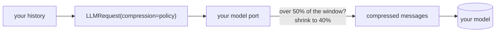

# Compress a long context

Your backend calls one model and the history keeps growing. Add a `CompressionPolicy` to
the call: the oldest or longest parts shrink before the model sees them. No agent
framework is needed. How it works: [Context compression](../concepts/context-compression.md).



## 1. A script or a FastAPI service

Your model, wrapped once ([Bring your own model](bring-your-own-model.md)):

```python
--8<-- "examples/compression_backend.py:model"
```

One call with compression on:

```python
--8<-- "examples/compression_backend.py:script"
```

The same in a FastAPI route. Never trust a client's `Message`s: take only user and
assistant text within size limits, drop `pinned` and `raw`, and add your own system prompt:

```python
--8<-- "examples/compression_backend.py:fastapi"
```

With the example's 14-message history, the model gets 10:

```text
14 messages, 8339 characters
10 messages, 5575 characters
```

The first run logs one WARNING: tokens are estimated as characters / 4. Pass
`count_tokens=` (your tokenizer, `list[Message] -> int`) for exact counts.

## 2. Pick what shrinks

Each policy below is used for one call:

```python
--8<-- "examples/compression_one_call.py:call"
```

| Policy | Free? | What the model gets |
|---|---|---|
| Trim only | yes | the system prompt and the newest turns |
| Cut only | yes | every message, long ones cut with a marker |
| Summarise only | one call to your summary model | a summary in place of the older turns |
| Combined | cheap steps first, the summary only if still needed | the smallest result |
| Most relevant | one call to your reranker | the turns that best match the question |

Trim only: drop the oldest turns, keep the last two.

```python
--8<-- "examples/compression_one_call.py:trim"
```

Cut only: keep every turn, cut each long one to 60 tokens.

```python
--8<-- "examples/compression_one_call.py:cut"
```

Summarise only, with your own (cheaper) model. A `cache=` on the policy (or on the step)
means the same turns are never summarised twice:

```python
--8<-- "examples/compression_one_call.py:summarise"
```

Combined, with a stronger fallback used once if the provider still says "too long":

```python
--8<-- "examples/compression_one_call.py:combined"
```

Keep only the most relevant turns, scored by your reranker. Return a `RerankResult` with
`usage`, and each call is a priced `stage="compress"` ledger entry:

```python
--8<-- "examples/compression_one_call.py:rerank"
```

What the example prints for its 10-message history:

```text
before: 10 messages, 5493 characters
trim: 4 messages, 1407 characters
cut: 10 messages, 1833 characters
summarise: 4 messages, 914 characters
combined: 6 messages, 1385 characters
relevant: 4 messages, 1407 characters
```

## 3. Big system prompt?

The system message is never removed. By default no step shortens it either.

**Option 1 (recommended): split it.** Keep only your rules in the system message. Send
long reference text (documents, product data) as its own message, which steps may cut or
summarise like any other:

```python
--8<-- "examples/compression_one_call.py:split"
```

**Option 2: mark the reference part.** Put it in `<reference>...</reference>`. With
`include_system_prompt=True`, `SummarizeLongMessage` summarises only those blocks and
checks every other line stays word for word. Without a block it leaves the prompt alone:

```python
--8<-- "examples/compression_one_call.py:system"
```

`CutLongMessages` and `MyOwnStep` also take `include_system_prompt=True`, but shorten the
text blindly, rules included: use them only for text you trust.

## 4. Your own agent loop

The adapter can be the agent framework itself: `run_tool_loop` with your model is the
loop, and it compresses before every model call.

```python
--8<-- "examples/compression_backend.py:loop"
```

## Checklist

- A model outside the packaged price table needs `model_max_tokens` or a `context_window` cap.
- Pass `count_tokens=` for exact counts.
- Add `if_still_too_long=` so a provider overflow is retried once with a stronger policy.
- Pin what must never change: `Message(role="user", content=..., pinned=True)`.
- Watch `context.compressed` events and the `compress` stage in the ledger.

Using a framework? See [Compression by framework](../integrations/compression-by-framework.md).
