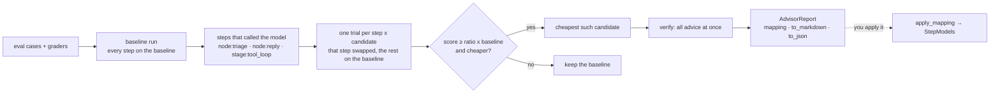

# Cut model costs per step

Not every step of an agent needs your best model. A triage step may do as well on a small
model, while the reply step needs a bigger one. The cost advisor finds out from your evals:
it runs them on your baseline model, then tries each cheaper model in one step at a time,
and keeps the advice only where the score holds. Costs and latency come from the ledger.

You bring the candidate models and their prices. Nothing is hard-coded and nothing is
applied for you: the advisor returns a mapping you review and apply yourself.



## Run the advisor

```python
--8<-- "examples/evals_cost_advisor.py:advise"
```

`target_factory(model)` builds your eval target around the model it is given. Pass that
model on: `FlowTarget(flow, model=model)`, `ToolLoopTarget(model, registry)`, or your own
target. `advise` is async; `advise_sync` suits scripts.

| Option | Meaning |
|---|---|
| `candidates` | `{name: model port}`: `CallableModel`s or provider ports, the baseline included |
| `baseline` | the candidate name your agent uses today |
| `min_score_ratio` | a candidate must keep `score ≥ ratio x baseline score` (default 0.98) and add no errors |
| `per_step` | `True`: one step at a time; `False`: a candidate replaces every step (`"*"`) |
| `prices` | a `Prices` or a price table mapping; default: the executor ledger's, else the built-in table |
| `max_spend` | a USD cap on every model call, judges included; the advisor stops early instead of passing it |
| `max_output_tokens` | the output limit of each call under `max_spend` (default 4096) |
| `executor` | your executor (hooks, approvals, tools); each trial gets a fresh ledger and no cache |
| `verify` | rerun the evals with every recommended step at once (default `True`) |

## What a step is

A step is where the model was called:

- `node:<name>`: any call made inside a flow node, through `node_model(ctx)`, a tool loop or
  a tool. The ledger entry carries the node (`metadata["node"]`); a sub-flow's node counts
  as its own.
- `stage:<stage>`: anything else, by its request stage: `stage:tool_loop`, `stage:agent.<name>`,
  or the `stage=` you set on an `LLMRequest`.

Calls of other models, such as an `LLMJudge` grader, are not steps: only calls that went
through the model the advisor handed your target count.

## Read the report

```text
| Step         | Calls | Baseline $ | Advice | Score | Step $ delta | Latency delta s |
| node:reply   | 2     | 0.008000   | medium | 1.000 | -0.006400    | -0.002          |
| node:triage  | 2     | 0.008000   | small  | 1.000 | -0.007840    | -0.001          |
Mapping: {'node:reply': 'medium', 'node:triage': 'small'}
```

- `report.mapping`: what to apply, `{step: candidate name}`. It is filled only when the
  advice ran all together and kept the score (`report.verified`). Otherwise it is empty,
  and `report.note` says why: the combined run lost the score, `verify=False`, or the cap
  stopped first. A step left out keeps the baseline.
- `report.advised`: the advice per step on its own, verified or not. Check it yourself
  before you apply any of it.
- `report.steps`: per step, the baseline's calls, cost and latency, the advice, and why.
- `report.trials`: every run, with its score, errors and costs. `cost_usd` is every priced
  ledger entry of the run (models, paid tools and APIs). `model_cost_usd` is only the
  steps' model calls. A candidate is advised only when the whole run costs less.
- `report.combined`: the run with all advice at once (for one step, that step's trial).
- `to_markdown()` for a pull request, `to_json()` (and `AdvisorReport.from_json`) to keep.

A step gets no advice when the baseline scores 0, when model or API calls have no price, or
when no cheaper candidate keeps the score.

## Apply the advice yourself

```python
--8<-- "examples/evals_cost_advisor.py:apply"
```

`apply_mapping(baseline, mapping, candidates)` returns a `StepModels`: one model port that
answers each step with its mapped model and every other step with the baseline. Use it
wherever the model went: `FlowRunner(model=...)`, `run_tool_loop(model, ...)`, or a target.
You can also build one by hand: `StepModels(baseline, {"node:triage": small})`. The key
`"*"` covers every step not listed.

## Spend cap

`max_spend` caps every model call the advisor makes: the candidates and your `LLMJudge`
graders, also inside `all_of`. Every one of those models needs a token price, or the
advisor refuses to start. It works like a team budget's hold and settle:

1. Before a call, it holds the call's worst case. Input: every byte of the serialised
   request as a token, plus 2048 tokens for what a provider adds on its side, at the
   dearest input rate. Output: the limit. The call is sent with `max_output_tokens` at most
   the advisor's `max_output_tokens` (default 4096).
2. A call whose hold does not fit what is left is refused. The run stops early with
   `report.stopped == "budget"`; trials it cut short are `complete=False` and never advised.
3. After the call, the hold is replaced by the reply's priced usage. A call that fails, and
   a reply that reports no usage, keep the whole hold.

The spend counted this way never passes the cap. What it cannot see:

- Retries inside a provider SDK run under one hold and are billed as one reply. Set the
  SDK's retries to 0 (for example `client_kwargs={"max_retries": 0}`) for a strict cap.
- Input a provider adds beyond the 2048-token margin.
- Models called from your own code, such as inside a `code_check`. Call them through an
  `LLMJudge` instead.
- Paid tools and APIs. They are counted in the run cost, not held by the cap.

## Tips

- Use cases that cover each step's hard inputs: the advice is only as good as the evals.
- Use `concurrency=1` for a tight cap: parallel cases each hold a worst case, so it stops sooner.
- The candidates are tried cheapest list price first, so a cap spends on the likely wins.

See also: [Evaluate your agent](evaluate-your-agent.md) · [Budgets](budgets.md) ·
[Bring your own model](bring-your-own-model.md).
