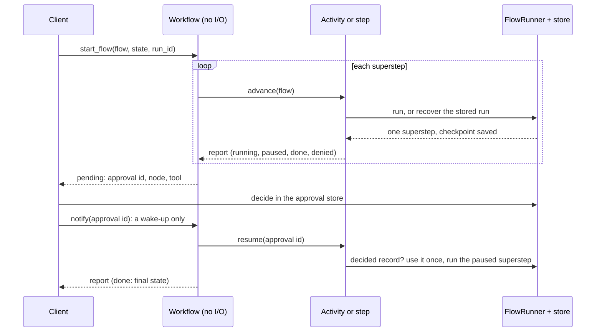

# Run flows on Temporal or DBOS

A `Flow` can run as a Temporal workflow or a DBOS workflow. Each superstep runs as one
activity (Temporal) or one step (DBOS), and every tool call still goes through your
executor: approvals, hooks, budgets, cache, ledger and events all apply.

The engine keeps the run going across restarts. Your checkpoint store
([Durable runs](../concepts/durable-runs.md)) makes each step safe to retry: a step cut
short by a crash runs again, and the tool calls it had finished replay instead of running
twice.



Install one engine: `pip install "agent-adapter[temporal]"` or `"agent-adapter[dbos]"`.

## Set up the flow and runner

Build the runner as for any durable run: a shared checkpoint store and the same
`checkpoint_key` on every worker. `DurableFlows(runner, flows)` names the flows a worker
can run.

```python
--8<-- "examples/durable_temporal.py:flow"
```

## Temporal

```python
--8<-- "examples/durable_temporal.py:worker"
```

```python
--8<-- "examples/durable_temporal.py:decide"
```

| Name | Does |
|---|---|
| `flow_worker(client, flows, task_queue=...)` | a `Worker` with the flow workflow and its two activities; extra options go to `Worker` |
| `start_flow(client, flow, state, run_id=, task_queue=)` | starts the workflow; its id is the run id |
| `pending(handle)` | the approval the run waits for, or `None` (a query) |
| `notify(handle, approval_id)` | after you decided in the store: an update, refused unless the run waits for that approval; `wait=False` sends a signal |
| `result(handle)` | the final `FlowStepReport` |
| `flow_workflow()`, `flow_activities(flows)` | the workflow class and activities, to register on your own worker |

Options on `start_flow`: `approval_timeout_s` (a timeout denies), `activity_timeout_s`
(default 600) and `max_attempts` (0 retries forever, Temporal's default).

The workflow does no I/O, so it stays deterministic. It runs unsandboxed because
`temporalio` is imported lazily. For tests, `WorkflowEnvironment.start_local()` runs a
local server without Docker.

## DBOS

```python
--8<-- "examples/durable_dbos.py:setup"
```

```python
--8<-- "examples/durable_dbos.py:run"
```

| Name | Does |
|---|---|
| `DbosFlows(flows, max_attempts=5, interval_s=1.0)` | registers the workflow and its two steps; build it once, before `DBOS.launch()` |
| `start(flow, state, run_id=)` | starts the workflow; its id is the run id, so starting it again is a no-op |
| `pending(run_id, timeout_s=0)` | the approval the run waits for, or `None` (a DBOS event) |
| `notify(run_id, approval_id)` | after you decided in the store: a DBOS message; one for another approval is dropped |
| `result(handle)` | the final `FlowStepReport` |

DBOS runs on SQLite (`system_database_url="sqlite:///..."`) or Postgres. A step that hits
a passing error (a store or network blip) is retried up to `max_attempts`.

## Approvals

A pause becomes a wait in the workflow. The report names the approval id, the node and
the tool, but never the tool's arguments, so engine history does not hold them. A
reviewer reads the full request with `flows.pending_request(flow, run_id)`.

The decision lives in your approval store, never in the engine. Engine approvals need a
`DeferredApproval` port (the runner's for gates, the executor's for tools); without a
store the resume fails closed. Decide with `store.decide(approval_id, decision)`, the HTTP
server or your review screen, then call `notify`. The notice carries no verdict.

| Rule | Effect |
|---|---|
| A notice never approves | the run re-checks the store; with no decided record (a forged or early notice) it keeps waiting |
| It wakes one approval | a notice for another id, or with any other field, is refused (update) or dropped (signal, message) |
| Used once | the runner consumes the store record when it resumes; a record already used is refused (`ApprovalAlreadyDecided`) |
| A timeout denies in the store | with `approval_timeout_s`, a still-pending record is decided as denied (`decided_by="timeout"`); a reviewer who decided first wins |
| A retry is safe | a resume retried after the decision was used continues the stored run |

Your store's access control decides who approves. A notice can only wake a run early
(each one restarts the timeout wait). Read `pending(...)` first: an update sent before the
workflow saw the pause is refused; a signal is kept for the next pause (dropped if its id differs).

## Who the run acts for

`start_flow(..., identity=RunIdentity(user_id=, thread_id=, principal=))` (and
`DbosFlows.start`) seals the user, thread and principal into the run. Every step runs
with them, so per-user memory and per-principal budgets and approvals apply. A step
with another identity is refused.

## Failures

| Failure | What happens |
|---|---|
| a worker dies in a step | the engine runs the step again; finished tool calls replay |
| a call may have run (not `idempotent=True`) | the run stops with `recovery-needs-decision`; mark safe tools `idempotent=True` |
| a call still running on a cut-off worker | it cannot be stopped; pass `idempotency_key()` (from `agent_adapter.exec.checkpoints`) to payment and mail APIs, so a rerun is not applied twice |
| a node fails | the run is stored as failed and the workflow fails for good |
| the run id belongs to another flow | the step fails for good |
| the store or network blips | the step is retried |

Errors in engine history carry the error type and kind, never the message text.

## Limits

- Set `activity_timeout_s` above your slowest superstep. There is no heartbeat, so a
  longer step is retried while the first may still run, and its call ends in doubt.
- A run id is used once: starting it again returns the stored report.
- A DBOS step that runs out of retries leaves the workflow in error while the store says
  running. Continue it with `DBOS.resume_workflow(run_id)` once the cause is fixed.
- Run guards held in worker memory (`RunLimits`, `once_per_run`) count per worker
  process. A step that moves to another worker starts their counts again.
- Tool loops (`run_tool_loop`) are not engine workflows yet; recover them on your own
  worker with `recover_tool_loop`.

This page's code is `examples/durable_temporal.py` and `examples/durable_dbos.py`. The
test suite runs them.
