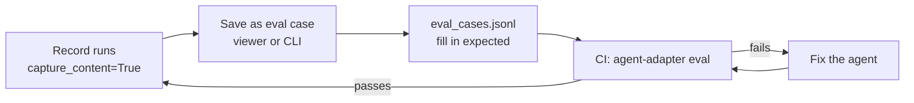

# Evals from production

Turn recorded runs into eval cases, so a failure seen in production becomes a regression
case that CI runs on every change.



## 1. Record with content

A case needs the run's input, so the run must be recorded with its content:
`viewer.record(executor, capture_content=True)`. Only a sink that sets
`wants_content = True` (the recorder does under `capture_content`) gets tool arguments and
results, model messages, and a flow's input and final state. Every other sink (logging,
OpenTelemetry, AG-UI, your own) gets none, and content is not even built when no sink asks.

- Content is taken after the guards: a payload a guard blocks is never stored, and a
  redacted result or reply is stored redacted. Tool arguments ride on `tool.finished`,
  model messages on `llm.finished`.
- Secret-named keys are masked, and so are secrets and personal data inside text (the
  `PIIGuard` patterns: keys, tokens, emails, phones, cards, IBANs).
- A `confirm` tool's arguments are never stored; its result only with
  `record(..., capture_content=True, capture_confirm_content=True)`. Its reply to the model
  is blanked in later messages, so it is never stored twice.
- Model messages name tool calls without their arguments.

Runs imported from another app's OpenTelemetry export (`agent-adapter ui --import
traces.json`) keep content when that app captured it. A run without content gives no case:
it is listed as skipped, with the reason. No input is ever made up.

What a case takes from a run:

| Field | From |
|---|---|
| `input` | the first flow's input, else the last user message of the first top-level model call, else the first tool call's arguments |
| `expected` | an ok run's flow output, the last answer of its top-level calls at that stage, or that tool's result; empty for a failed run |
| `tags` | the run's tags, `status:<status>`, `flow:<name>`, `tool:<name>`, `masked` when a value was masked |
| `source_run` | the run id, so the Evals view can link back |

A run still running is skipped. So is one whose input the recorder cut (over 2,000
characters): a cut input is not the real input.

## 2. Save cases

**In the viewer.** Open a run in the Runs view and press *Save as eval case*. Pick the id,
whether the recorded output is the expected value, an expected value of your own, and tags.
A failed run also shows *Turn into regression case*: one click saves it with the
`regression` tag and no expected value. Both append to the same `eval_cases.jsonl` the chat
page writes (in `--chat-dir`, `.agent_adapter/chats` by default, also with chat off). Ids
stay unique; a request may be up to 256 KB; the file stops taking cases at 16 MB.

**From the command line.**

```bash
agent-adapter eval cases-from-runs .agent_adapter/runs --out eval_cases.jsonl --status failed
```

`--status` (ok, failed, paused, unfinished), `--tag` and `--run KEY` filter the runs;
`--expected-from none` leaves every `expected` empty. The file is appended to, and ids it
already holds are kept as they are, so running it again is safe. It prints each skipped run
and its reason, and exits 1 when no case was made.

**From Python.**

```python
from agent_adapter.evals import cases_from_runs, write_cases

found = cases_from_runs(".agent_adapter/runs", status="failed", tags=["vip"])
write_cases("eval_cases.jsonl", found.cases)
for skipped in found.skipped:
    print(skipped.run_key, skipped.reason)
```

## 3. Fill in what is expected

A failed run has no good answer to copy. Open `eval_cases.jsonl` and write the `expected`
value a correct agent gives. Cases with an empty `expected` are skipped by graders that
compare with it (`exact`, `contains`, `regex`); other graders still run.

## 4. Run them in CI

```bash
agent-adapter eval app.chat:agent eval_cases.jsonl --min-pass-rate 1.0 --junit evals.xml
```

The whole loop, offline (imported runs, then the old and the fixed agent):

--8<-- "examples/evals_from_production.py:loop"

## Safe by default

- Only content the recorder kept is used; secret-named values stay masked.
- The viewer route needs the access token, the CSRF header, this viewer's Origin and a JSON
  body, like every other POST. The page shows saved text as text, never as HTML.
- The cases file is only appended to.

## Files

| File | Does |
|---|---|
| `tracing/_content.py`, `hooks/builtin/_content.py` | content only for sinks that ask; masking |
| `exec/_call_content.py` | a tool call's content after the guards; confirm tools withheld |
| `evals/from_runs.py` | `cases_from_runs`, `case_from_run`, `write_cases`, `RunCase`, `SkippedRun` |
| `evals/_run_files.py` | reads run files and tag sidecars (read-only) |
| `evals/_run_content.py` | finds the input and output in a run's events |
| `viewer/_case_routes.py` | `POST /api/runs/KEY/eval-case` |
| `viewer/static/runcases.js` | the two buttons and the dialog in the Runs view |
| `cli/eval.py` | `agent-adapter eval cases-from-runs` |
