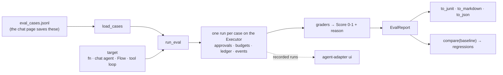

# Evaluate your agent

Evals run a set of cases on your agent, grade each answer, and report. Run them in a script,
in CI with `agent-adapter eval`, or as pytest tests. Any agent works: a plain function, a
chat-page agent, a `Flow`, or the built-in tool loop. Graders use only what you give them,
so an LLM judge runs on your own model.



## Cases

One JSON object per line, such as `{"id": "a", "input": "Where is order 1042?", "expected":
"shipped", "tags": ["orders"]}`: `id` and `input` are required, other fields optional. The
chat page's *Save as eval case* writes this format; `load_cases` also reads `.json` and `.csv`.

## Run an eval

--8<-- "examples/evals_quickstart.py:run"

`run_eval` is the async form; `run_eval_sync` suits scripts. Each case is its own run on the
executor, so its hooks, approvals, budgets, ledger and sinks apply. `concurrency=` caps cases
at once (default 4); `timeout_s=` caps each case (default 300 s). A timeout cannot stop a
sync target's worker thread, which may go on calling tools: prefer async targets.

| Target | Runs |
|---|---|
| `fn(input)` or `fn(input, ctx=ctx)` | your function, sync or async; take `ctx` so its tool calls join the case's run |
| `fn(message, session)` | a chat-page agent; each case is a fresh one-turn chat |
| `ToolLoopTarget(model, registry, system=)` | `run_tool_loop`; the answer text (or parsed output) |
| `FlowTarget(flow, initial_state=, output=)` | `FlowRunner`; `output(state)` is the answer |

A callable with two arguments is a chat agent; it gets the chat page's own `ChatSession`.

## Graders

Each grader returns a `Score`: `value` from 0 to 1, `passed`, and `notes` (the reason).
A grader never raises; when it cannot grade, the case fails ("not graded").

| Grader (`agent_adapter.evals.graders`) | Passes when |
|---|---|
| `exact()`, `contains()` | the output equals, or contains, `expected` (or one of a list) |
| `regex()` / `regex(pattern)` | the expected pattern, or `pattern`, matches |
| `json_schema(schema)` | the output (JSON text, dict or model) fits the schema |
| `tools_called(*names, forbid=, only=)` | those tools ran (from the run's events) |
| `max_cost(usd)`, `max_latency(seconds)` | the case stayed within the limit (ledger, events, wall time) |
| `LLMJudge(model, rubric)` | your model scores the answer at `value >= pass_at` |
| `code_check(fn)`, `all_of(*graders, weights=)` | your check; a mix that fails if any part fails or does not grade |

Pass graders as a list, or as a dict to name them in the report; a sync `fn(case, run)` works
too. A case passes only when it ran and every grader passed (fail closed). A grader that gives
only a value passes at `value >= pass_at` (default 1.0).

Cost and tool graders need an observed run: an agent that works outside the case's run
(its own executor, no `ctx`) leaves them "not graded", so the case fails.

An LLM judge reads agent text, which can carry injected instructions: data is escaped and its
own `passed` ignored (`trust_passed=True` keeps it). Pair it with deterministic graders.

## Read the report

`EvalReport` holds every `CaseResult` (score, grades, cost, latency, tools called, error, and
the `run_id`) plus totals: `mean_score`, `pass_rate`, `n_errors`, `cost_usd`, `by_tag` and
`by_grader`. A case's score is the mean of all its grades: an ungraded grade counts 0 and a
failed one at most `pass_at`; an errored case counts 0.

--8<-- "examples/evals_quickstart.py:compare"

`compare(baseline)` lists cases that stopped passing or lost score (`tolerance=` allows some
noise), the ones that improved, and added or removed cases; a removed case also counts as a
regression. Save a report with `to_json()` and read it back with `EvalReport.from_json(text)`.

Reports keep up to 4,000 characters of each case's input, expected value and output, even when
runs are recorded with `capture_content=False`. Pass `capture_content=False` to `run_eval`
(`--no-content` on the CLI) to keep none of them, nor the judge's notes.

## In CI

```bash
agent-adapter eval app.chat:agent eval_cases.jsonl --grader contains --grader max-cost=0.02 \
  --min-score 0.9 --junit evals.xml --markdown evals.md --baseline last-eval.json
```

| Option | Does |
|---|---|
| `--grader SPEC` | `exact`, `contains`, `regex[=PATTERN]`, `json-schema=PATH`, `tools=a,b`, `max-cost=USD`, `max-latency=S`, or `module:attr` for your own (an `LLMJudge`) |
| `--min-score 0.9`, `--min-pass-rate 0.9` | exit 1 when the mean score or the share of passing cases is lower (both 1.0) |
| `--junit`, `--markdown`, `--json` | write the reports; `--json` prints JSON to stdout |
| `--baseline PATH` | exit 1 on a regression or a missing case against an earlier `--json` report |
| `--no-content` | keep no case text or judge notes in the reports |
| `--executor module:attr` | run on your executor (approvals, budgets, prices) |
| `--concurrency N`, `--timeout S` | cases at once; seconds per case |
| `--no-record` | skip recording; by default runs go to `.agent_adapter/runs` |

The exit code is 1 when no case passed, a bar is missed, any case errors, or the baseline
shows a regression; 2 for a bad option or file. The JUnit file follows the Ant/Surefire
schema: the run id and score are in each test case's `system-out`.

## In pytest

The plugin is opt-in: run `pytest -p agent_adapter.evals.pytest_plugin`, or put
`pytest_plugins = ["agent_adapter.evals.pytest_plugin"]` in your root `conftest.py`. Mark a
test with the case file (relative to the test file); it runs once per case:

```python
import pytest

from agent_adapter.evals import assert_eval
from agent_adapter.evals.graders import contains


@pytest.mark.eval_cases("eval_cases.jsonl", tags=["orders"])
def test_support_agent(eval_case):
    assert_eval(answer, eval_case, [contains()])
```

`assert_eval` raises `AssertionError` with each failing grader's reason and the run id.

## See the case runs

Each case is a run with its own `run_id`. Record the executor (`viewer.record(executor)`; the
CLI does it), then `agent-adapter ui` shows each case run; it ends with a `custom.eval.case`
event (eval name, case id, verdict, score).
Save reports with `--save` (or `save_to=`) to browse and compare them: [See your evals](see-your-evals.md). Turn recorded runs into cases: [Evals from production](evals-from-production.md).

## Safe by default

The default executor has an empty registry and a fresh ledger. With no approval port,
`confirm` tools are denied; a pending approval, a timeout, an unfinished loop or flow, or an
exception makes the case an error, and errors fail CI.

## Files

| File | Does |
|---|---|
| `evals/cases.py`, `model.py`, `targets.py` | `load_cases`; `EvalCase`, `Score`, `EvalRun`; the four targets |
| `evals/graders.py`, `judge.py` | graders; `LLMJudge` |
| `evals/runner.py`, `report.py` | `run_eval`, `assert_eval`; `EvalReport`, `compare`, JUnit, Markdown, JSON |
| `evals/pytest_plugin.py` | the `eval_cases` marker and the `eval_case` fixture |
| `cli/eval.py` | `agent-adapter eval` |
