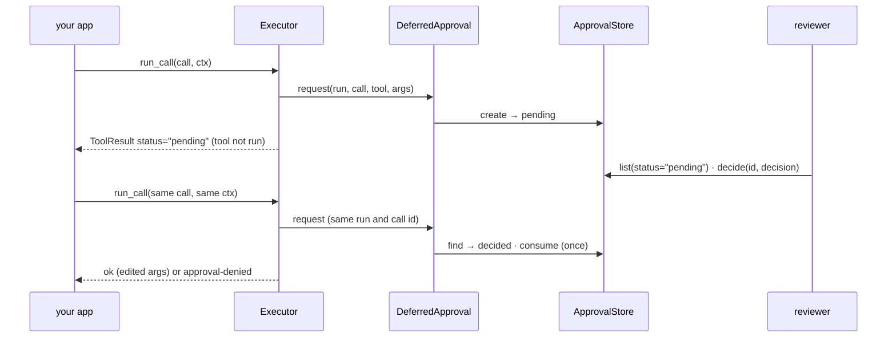

# Human in the loop

Pause a risky call until a person reviews it, then resume it: approved, edited or denied.
Each decision runs at most one call, once.



## 1. Mark the risky tool

```python
--8<-- "examples/howto_hitl.py:tool"
```

`confirm=True` reviews every call. A rule `(call, ctx) -> bool` (sync or async) reviews
only some: here refunds over 100.

## 2. Pick a port

| Port | Use when |
|---|---|
| `AutoDeny(reason=...)` | no reviewer exists (read-only mode, batch jobs) |
| `CallbackApproval(fn)` | the decision is made in-process, now (a CLI prompt, a policy check) |
| `DeferredApproval(store)` | a person decides later, elsewhere (a web UI, a queue, a ticket) |
| none | every `confirm` call is denied: `"no approval port configured"` |

```python
--8<-- "examples/howto_hitl.py:setup"
```

Keep the `run_id`: the resume must use the same run and the same call id.

## 3. Pause

```python
--8<-- "examples/howto_hitl.py:pause"
```

`run_call` never raises for a pending call: it returns `status="pending"` with
`error.details["approval_id"]`. `run` raises `ApprovalPending` (with `.approval_id`)
instead. Nothing ran, and no ledger entry is written.

## 4. Review

```python
--8<-- "examples/howto_hitl.py:review"
```

A reviewer sees the tool and its arguments. `edited_args` replaces the arguments; they
are validated again before the call. The first `decide` wins; a second raises
`ApprovalAlreadyDecided`.

## 5. Resume

```python
--8<-- "examples/howto_hitl.py:resume"
```

## 6. Deny

```python
--8<-- "examples/howto_hitl.py:deny"
```

The reason reaches the caller in `ApprovalDenied` (kind `approval-denied`); the model
sees it too.

## The one-use rule

```python
--8<-- "examples/howto_hitl.py:one_use"
```

| Rule | Effect |
|---|---|
| A decision is consumed by the call it answers | replaying the same call opens a new review; it never runs twice on one approval |
| A record matches only its own call | same run, same call id, same tool and a digest of the original arguments; anything else fails closed with `ToolUsageError` |
| Two resumes race for one decision | one gets it; the other is denied (`"approval already used by a concurrent request"`) |
| A framework says "approved" | never counts alone: a bridge passes approval only as a one-use token the adapter issued after its own port approved, bound to the run, native call id, tool and argument digest. A bridge cannot issue a token for a call with no native call id; such a call is denied by the bridge or decided by the executor's port |
| An MCP server with `client_approval=True` | opt-in: the MCP client's user approves instead of the port ([MCP approval](../integrations/mcp.md#approval)); leave it off where a server-side reviewer is the control |
| You set `ctx.approval` yourself | it must be your own trusted decision, or an adapter-issued one-use token; it covers one call of `run` / `run_spec` / `run_call`, never nested or loop calls |

## Output

```text
refunded 20.0 on o-1
pending approval-pending
refund {'order_id': 'o-7', 'amount': 500.0}
first decision wins
ok refunded 450.0 on o-7
True
pending True
error approval denied for tool 'refund': refund policy: max 500
[20.0, 450.0]
```

## In production

| Need | Do |
|---|---|
| Several processes | a database-backed `ApprovalStore` (atomic `create` and `consume`; SQL recipe on [Approval stores](../concepts/approval-stores.md#your-own-database)) |
| Reviews over HTTP | the [HTTP server](../cross-language/http-server.md): `GET /approvals`, `POST /approvals/{id}/decide` (with `edited_arguments`). By default only the run's owner or a principal with the `approvals:decide` scope may decide; pass your own `authorize_decision` rule for four-eyes review |
| An agent loop | `run_tool_loop` returns `finish="pending"`; decide, then call it again with the returned messages and the same `ctx` ([Tool loop](../concepts/tool-loop.md)) |
| A flow step | `pause` gates in a flow ([Flow pause and resume](../concepts/flow-resume.md)) |
| Reviews in Slack or email | [Approval over Slack or email](../cookbook/approval-notify.md) |
| A framework's own pause | its bridge: `resolve_interruptions`, `resolve_deferred`, `resolve_approvals`, `resolve_confirmations` ([Approval batches](../concepts/approval-batches.md)) |

## Files

| File | Does |
|---|---|
| `examples/howto_hitl.py` | the rule, the store, pause, review, resume, deny, one use |
| `tests/docs/test_howto_examples.py` | runs it offline and checks the output |
