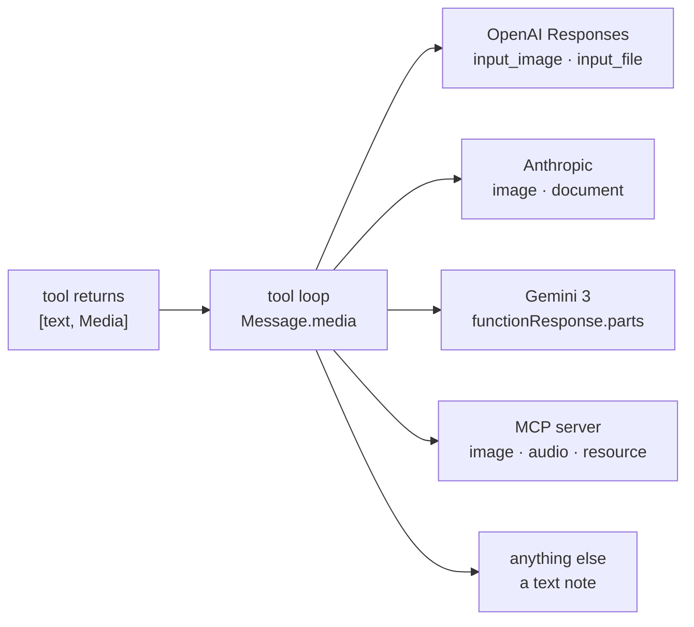

# Media in tool results

Let a tool return a screenshot, a chart, a PDF or an audio clip, and the model gets it in
the shape its API takes. Media that an API cannot take is never lost silently. The model
gets a note that says what was left out and why, and the adapter logs a warning.



## 1. Return media from a tool

```python
--8<-- "examples/howto_media.py:tool"
```

A tool may return a `Media` alone, or a list that mixes media with text and JSON values.
Give it bytes (`data=`), a file (`Media.from_file(path)`) or a web URL (`url=`). When you
leave out `mime_type`, it is sniffed from the bytes (PNG, JPEG, GIF, WebP, PDF, WAV, MP3,
Ogg, FLAC, MP4, WebM, SVG), else guessed from the name or URL.

A tool whose return type holds `Media` has no result schema, so base64 never ends up in an
MCP `outputSchema`. Cached results keep their media: a hit gives back `Media`, not a dict.

## 2. Run the loop as usual

```python
--8<-- "examples/howto_media.py:loop"
```

`run_tool_loop` puts the text in `Message.content` and the media in `Message.media`. Each
model port rewrites them for its API.

## 3. What each provider gets

| API | Takes in a tool result | Limit |
|---|---|---|
| OpenAI Responses (`OpenAIModel`, default) | images (PNG, JPEG, GIF, WebP) as `input_image`, PDF as `input_file`; web URLs | 20 MB |
| OpenAI Chat Completions (`api="chat"`, Ollama, vLLM) | text only: every item becomes a note | none |
| Anthropic | images as `image`, PDF and plain text as `document`; web URLs for images and PDF | 5 MB |
| Gemini 3 and later | PNG, JPEG, WebP and PDF as `functionResponse.parts`, named by `{"$ref": ...}`; Files API and `gs://` URIs | 20 MB |
| Gemini 2.x and older | text only: every item becomes a note | none |
| MCP server | `image`, `audio`, `resource_link` for URLs, embedded `resource` for the rest | 20 MB |

```python
--8<-- "examples/howto_media.py:rewrites"
```

```text
['input_text', 'input_image']
['image']
done
[image not shown: image/png 'page.png' (2 KB); OpenAI Chat Completions cannot take media in tool results; use the Responses API (api='responses')]
```

The MP3 above is not an `input_*` item: the Responses API cannot take audio back, so the
`input_text` item holds its note instead. One unsupported file never breaks the chat.

## 4. Media over MCP

Our MCP server sends media as content blocks, next to `structuredContent` when the tool
also returned data:

| Tool returns | `content` | `structuredContent` |
|---|---|---|
| `Media` | the media block | none |
| `[data, Media, ...]` | the data as JSON text, then the media blocks | the data |
| anything else | the value as text | the value |

`import_mcp` keeps media from remote tools too. Image, audio, embedded resources and
resource links come back as `Media`, even when the remote tool also sent
`structuredContent`. The model then sees them through its own port's rules above.

## 5. Limits

- `Media` holds at most 20 MB (`agent_adapter.core.media.MAX_MEDIA_BYTES`).
  `Media.from_file(path, max_bytes=...)` checks the size before it reads the file.
- Each API's own limit applies when the request is built. A bigger item becomes a note.
- Framework exports (LangChain, OpenAI Agents SDK and others) still send a tool's media as
  JSON text with base64. Use the model ports or MCP to send it as media.
