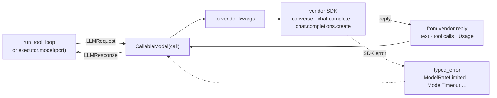

# Model recipes: Bedrock, Azure OpenAI, Mistral, Groq, OpenRouter

Each recipe wraps the vendor's own SDK in a `CallableModel`. The adapter adds no
dependency: you install the SDK, and the recipe imports it only when you build the model.
Every recipe turns the vendor's usage into `Usage`, so the ledger prices it from your
`Prices` table, and turns SDK errors into typed model errors.



| Vendor | SDK | Recipe | Shape |
|---|---|---|---|
| Amazon Bedrock | `boto3` | `examples/models_bedrock.py` | Converse API, own converter |
| Azure OpenAI | `openai` | `examples/models_openai_compatible.py` | Chat Completions |
| Groq | `groq` | `examples/models_openai_compatible.py` | Chat Completions |
| OpenRouter | `openai` | `examples/models_openai_compatible.py` | Chat Completions |
| Mistral | `mistralai` | `examples/models_mistral.py` | Chat Completions with Mistral's names |

## Amazon Bedrock (Converse)

```python
--8<-- "examples/models_bedrock.py:model"
```

The converter keeps the system prompt apart, sends tool results as one user turn, and
maps `stopReason` to a finish reason:

```python
--8<-- "examples/models_bedrock.py:convert"
```

Converse has no `tool_choice="none"`, so the recipe sends no tools then. Credentials come
from the default AWS chain (environment, profile or role).

## Azure OpenAI, Groq and OpenRouter

All three speak Chat Completions, so one function covers them. It reuses
`build_chat_request` and `parse_chat_completion` from `agent_adapter.models.openai`:

```python
--8<-- "examples/models_openai_compatible.py:chat"
```

```python
--8<-- "examples/models_openai_compatible.py:azure"
--8<-- "examples/models_openai_compatible.py:groq"
--8<-- "examples/models_openai_compatible.py:openrouter"
```

| Vendor | Notes |
|---|---|
| Azure OpenAI | `model` is your deployment name; use the API version your resource supports |
| Groq | tool schemas go without the OpenAI-only `strict` flag |
| OpenRouter | ids are `vendor/model`; one pattern row (`"openai/*"`) prices a whole vendor |

Azure also works with the built-in port: `OpenAIModel("shop-gpt", client=AsyncAzureOpenAI(...))`.

## Mistral

```python
--8<-- "examples/models_mistral.py:model"
```

Mistral calls the output limit `max_tokens` and the seed `random_seed`, and `"any"`
forces a tool. It may send content as a list of chunks and arguments as an object:

```python
--8<-- "examples/models_mistral.py:convert"
```

## Prices

Each recipe loads its own rows. The rates in the examples are placeholders: copy yours
from the vendor's price page.

```python
--8<-- "examples/models_openai_compatible.py:prices"
```

## Errors

```python
--8<-- "examples/models_common.py:errors"
```

| SDK error | Becomes |
|---|---|
| a status code (`status_code`, or botocore's `ResponseMetadata`) | `ModelRateLimited` (429), `ModelAuthError` (401, 403), `ModelTimeout` (408), `ModelUnavailable` (5xx), `ModelBadRequest` (4xx) or `ModelContextOverflow` |
| a timeout or connection error | `ModelTimeout`, `ModelUnavailable` |
| anything else | propagates unchanged |

`FallbackModel` falls over on rate limits, outages and timeouts, so the typed errors make
a second vendor a one-line change ([Models](../concepts/models.md)).

## Output

Each example runs offline on a fake SDK client:

```text
bedrock stop 2 Ticket T-1: waiting for parts.
amazon.nova-pro-v1:0 ['0.000800', '0.000800']
```

The line under each answer is the price of each model call from the ledger.

## Files

| File | Does |
|---|---|
| `examples/models_bedrock.py` | Bedrock Converse: converter, model port, prices |
| `examples/models_openai_compatible.py` | Azure OpenAI, Groq, OpenRouter over one Chat Completions port |
| `examples/models_mistral.py` | Mistral: converter, model port, prices |
| `examples/models_common.py` | `typed_error` and the shared demo run |
| `tests/docs/test_model_recipes.py` | runs each recipe on fake SDK modules |

More on wrapping a model: [Bring your own model](bring-your-own-model.md).
