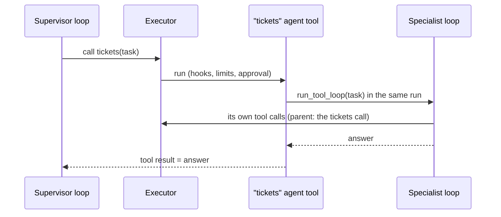

# Multi-agent: agents as tools, handoffs and routing

Any agent can be a tool of another. A supervisor's model picks a specialist, the
specialist runs its own loop, and its answer comes back as the tool result. Everything
runs in the supervisor's run, through one executor. `examples/multi_agent.py` runs all of
it offline with scripted models.



## Turn an agent into a tool

```python
--8<-- "examples/multi_agent.py:specialists"
```

`agent_tool(agent, name=, description=)` returns a `ToolSpec` of kind `agent` with one
argument, `task`. `agent` is one of:

| Agent | Write it as |
|---|---|
| a tool loop | `LoopAgent(model, registry, instructions=, max_steps=)` and `executor=` |
| any function | `fn(task, ctx) -> str`, sync or async |
| a chat agent | `chat_agent_task(chat_agent, executor)` from `agent_adapter.viewer.chat` |

A `LoopAgent` needs `executor=`, the caller's executor, so its tool calls pass the same
hooks, guardrails and approval port. Without it, `agent_tool` raises `ConfigError`.

```python
--8<-- "examples/multi_agent.py:supervisor"
```

## What rolls up to the parent run

The sub-agent uses the calling tool's context, so it is part of the same run:

- **Cost.** Its model and tool calls are ledger entries of the parent run. Its model
  stage is `agent.<name>`.
- **Budgets and limits.** `BudgetHook` and `RunLimits(max_calls=)` count its calls.
- **Approvals.** A sub-agent tool waiting for approval makes the agent call `pending`, so
  the parent loop pauses too. Decide it, then run the parent loop again with the same
  `ctx`, so the agent call keeps its call id. The call resumes the sub-agent from where
  it stopped, in this process. With `confirm=` on the agent tool, the reviewer is asked
  once: the resumed call with the same task is not asked again.
- **Events.** Its calls carry the agent call as `parent_id`, so the run viewer's spans
  link them to it. `custom.agent.started` opens each run, and `custom.agent.finished`
  closes it with `status` `ok`, `error` or `pending`. A call over the depth limit sends
  `custom.agent.refused`.

## Handoffs

A handoff passes the conversation to another agent and ends the loop with its answer.
Make the tool with `handoff(...)` and wrap the model in `HandoffModel`:

```python
--8<-- "examples/multi_agent.py:handoff"
```

Once a handoff tool answers, `HandoffModel` returns that answer as the final reply
instead of calling the model again. That closing turn costs nothing. A failed handoff
does not end the loop: the model sees the error and goes on.

## Route in a flow

To pick the specialist in code instead of by model, register the agent tools and route a
`Flow` to a `Call` node:

```python
--8<-- "examples/multi_agent.py:flow"
```

## Recursion guard

Agents may call agents, but only `max_depth` deep (default 3). A deeper call fails with
`AgentDepthExceeded` (a `RunLimitExceeded`, kind `agent-depth-exceeded`), which the
calling model sees as a tool error. `agent_depth()` tells a tool how deep it runs.

## Things to know

- A sub-agent's answer must be a `str`; anything else is a `ToolUsageError`.
- A `LoopAgent` that stops on `max_steps`, `length` or `content_filter` fails the call
  with a `ToolError` naming the reason.
- A paused history stays in memory for an hour, up to 256 per agent tool, and may hold
  personal data. A call with a new call id (`executor.run(...)` makes one each time)
  starts the task again instead of resuming.
- After a process restart the sub-agent starts the task again and calls its tools again.
  Give it only idempotent tools, or call it from a flow node: a resumed node returns the
  recorded results of the calls it already finished.
- Add `timeout=` or `confirm=` on `agent_tool` like on any tool.

See also: [Tool loop](../concepts/tool-loop.md), [Flows](../concepts/flows.md),
[Approval](../concepts/approval.md), [See your runs](see-your-runs.md).
