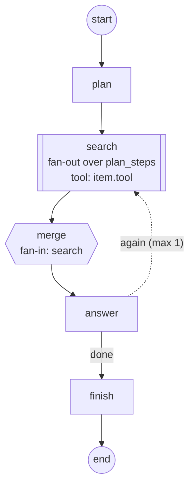

---
search:
  boost: 2
---

# Navigate the graph

The Agent Adapter run viewer draws the `Flow` a `FlowRunner` ran and paints each node's
live status on it. You can zoom, pan, step through the run, open any node, and jump from a
node to its calls, events and state. The same graph shows in the Runs view and in the chat
inspector ([Chat with your agent](chat-with-your-agent.md)).
To watch it light up node by node as a chat turn runs, try the [chat demo](chat-flows.md).

## Try it here

This is the real viewer on a recorded run of the sample flow below: pick a run, click a
node, drag and zoom the graph, open Timeline, Events and State, and press ▶ to replay.

<iframe class="aa-demo" src="../../assets/demo/sample-run.html#run=run_00000000000000000000000000000001" title="Agent Adapter run viewer: a recorded run of the help-center search" width="100%" height="760" loading="lazy" sandbox="allow-scripts allow-downloads" allow="clipboard-write"></iframe>

[Open the demo full screen](../assets/demo/sample-run.html#run=run_00000000000000000000000000000001).
It is one offline file, as `agent-adapter ui --export` writes it, of a run of the flow below.

## The sample flow

`examples/viewer_fan_out.py` searches a help center: `plan` writes three search steps,
`search` fans out over them (a `Map`), `merge` joins them, `answer` may loop back once,
and `finish` ends the run. This is its `flow.to_mermaid()`:



Record it and open the viewer:

```bash
python examples/viewer_fan_out.py
agent-adapter ui .agent_adapter/runs --approvals .agent_adapter/approvals.db --reviewer you
```

### State values: `trace_state=True`

The example runs its flow with `FlowRunner(..., trace_state=True)`, so the State tab and
the node panel show the values each node set, not only the field names.

## Controls

| Do | Mouse or touch | Keys |
|---|---|---|
| zoom | wheel over the graph (zooms at the pointer); pinch with two fingers; the − and + buttons | `-`, `+` or `=` |
| fit the whole graph | the fit button | `0` |
| pan | drag the background with the mouse or one finger | |
| move the view | click or drag in the minimap (shown only when part of the graph is off screen) | |
| move between nodes | | ↓ nearest successor, ↑ nearest predecessor, ← / → nearest node in the same layer (the first press focuses the start node) |
| open a node | click or tap it (the panel scrolls into view on narrow screens) | Enter on the focused node |
| close the node panel | its close button | Esc |
| find a node | type in the search box: other nodes dim | `/` focuses the search; Enter opens the first match; Esc clears it |
| see a node's paths | hover it: incoming and outgoing paths light up (loop edges left out) | |
| replay the run | ▶ / ⏸ and the step slider; the slider's right end is live | |
| save | SVG downloads the graph in the current theme; Mermaid copies `Flow.to_mermaid()` text (or shows it to copy by hand when the clipboard is refused) | |

The tabs (Timeline, Events, State, Compare, and the chat inspector's) move with ← / → and
Home / End.

## What you see

| Status | Icon and colour |
|---|---|
| not run | ○ grey |
| running | ▶ blue, pulsing (no pulse with reduced motion) |
| done | ✓ green |
| failed | ✕ red |
| paused | ⏸ amber |
| stopped | ■ grey, dashed border: still running when its flow or run ended (cancelled) |

Icons carry the status too, so the graph does not rely on colour alone.

| Shape or mark | Means |
|---|---|
| rectangle | a function node |
| pill | a tool-call node |
| stacked cards with `done/total` | a `Map` fan-out and its item progress, e.g. `3/3` |
| hexagon | a `Join` fan-in |
| dashed border and a "⏸ gate" tag | a pause gate |
| accent-coloured edge with a label | a route |
| thick edge | parallel edges from one node |
| dashed edge in its own lane, "label taken/max loops" | a loop with `max_loops` |
| `×N` on an edge | times that edge was taken; edges never taken are dimmed once the run started |

## The node panel

Opening a node shows its status, kind, visits, calls, errors, cost, Map items, the state
fields it changed (with values when traced) and the list of visits. Its buttons jump to
the same node in Timeline (calls under it), Events (filtered to it) or State (its last
step).

## Replay

The slider walks the run's node order step by step; ▶ plays it. Every node and edge shows
its status as of that step, and an open node panel follows. Move the slider to its right
end to go back to live.

## Export

`agent-adapter ui .agent_adapter/runs --export report.html` writes one offline file with
the same graph and controls (no chat), like the demo above. The SVG button saves just the
picture; the Mermaid button gives the text above, ready for any Markdown page.

## Files

| File | Does |
|---|---|
| `agent_adapter/viewer/layout.py` | layers, crossing reduction, x positions, edge bends |
| `agent_adapter/viewer/static/graph.js`, `graphbar.js` | drawing, toolbar, minimap, legend |
| `agent_adapter/viewer/static/graphnav.js`, `graphlive.js` | zoom and pan maths; live status, replay steps, search |
| `agent_adapter/flow/diagram.py` | `Flow.graph()` and `Flow.to_mermaid()` |
