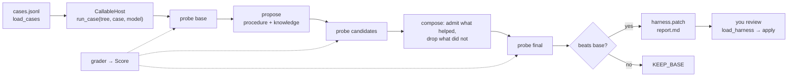

# Optimise your agent

The [optimiser](../optimiser.md) tunes the texts around any agent you can call: a plain
function, or a LangGraph, OpenAI Agents or Pydantic AI agent. It runs your eval cases, tries
edits, keeps what helped, and writes a patch for you to review.

**Tuned:** the texts you put on the surface (`prompt/system`, `prompt/layout/<section>`,
`tool/<name>/description`, `tool/<name>/prompt_hint`). **Never tuned:** your code, the
model or its settings, tool behaviour, guardrails.

## The loop



| Worked example (offline) | Does |
|---|---|
| `examples/harness_cases.jsonl` | 8 eval cases: a topic in, the help-center article id expected |
| `examples/harness_agent.py` | the agent being optimised: one tool, no framework |
| `examples/harness_fakes.py` | fake agent and proposer models; delete it and pass real ones |
| `examples/harness_optimise.py` | host, grader, run, then apply the chosen tree |
| `examples/harness_frameworks.py` | the same agent on LangGraph, OpenAI Agents, Pydantic AI |

## 1. Write your cases

One JSON object per line: `id` and `input` are required, `expected` and `tags` optional.

```json
--8<-- "examples/harness_cases.jsonl"
```

`load_cases(path)` reads `.jsonl`, `.json` (a list) or `.csv` (a header row). A missing
field, a duplicate id or bad JSON raises `ConfigError` naming the line.

## 2. Pick a grader

```python
--8<-- "examples/harness_optimise.py:grader"
```

| Grader (`agent_adapter.optimiser.graders`) | Passes when |
|---|---|
| `exact()` | the answer equals `expected` (case and spacing ignored) |
| `contains()` | `expected` appears in the answer |
| `regex()` | the pattern in `expected` matches the answer |
| `code_check(fn)` | `fn(case, run)` returns `True`, a float in [0, 1] or a `Score` |
| `llm_judge(model, rubric)` | your judge model scores the answer against the rubric |
| `all_of(a, b, weights=...)` | the weighted mean of the graders that graded |

`expected` may be a list. A grader never raises: an error logs a WARNING and leaves the
case ungraded. `llm_judge` scrubs `expected` from its notes, which the proposer reads.

## 3. Wrap your agent

Name the tunable texts with their base values, then write `run_case(tree, case, model)`,
which reads each tuned text from `tree.files`:

```python
--8<-- "examples/harness_agent.py:surface"
```

```python
--8<-- "examples/harness_agent.py:agent"
```

```python
--8<-- "examples/harness_optimise.py:host"
```

`run_case` returns the answer text, or a `CaseRun` with your own transcript and
metrics. If it raises, the case counts as failed and the run goes on. Only paths on the
surface can be edited; `required` paths can never be deleted or emptied.

## 4. Run offline first, then for real

```python
--8<-- "examples/harness_optimise.py:run"
```

`python examples/harness_optimise.py` prints:

```
base 0.25 -> agg1 1.00  (chosen: agg1)
kept    prompt/system
dropped tool/lookup_article/prompt_hint
--- a/prompt/system
You answer customer-support questions. Always call lookup_article first, then cite the article id.
```

For real, pass your models in place of the fakes, or run the CLI inside `examples/` (it imports `--host` from the current folder); then swap `--dry-run` for `--model openai:gpt-5`, which needs `pip install "agent-adapter[openai]"` and `OPENAI_API_KEY`:

```bash
cd examples
python -m agent_adapter.optimiser --host harness_optimise:build_host --dry-run
```

## 5. Read the decisions

The system-prompt edit was kept: it took the score from 2/8 to 8/8. The tool-hint edit
was dropped: the agent looked every topic up but never cited the article, so no case
improved. `report.md` in `out_dir` has the counts behind each line.

## 6. Apply what you accept

```python
--8<-- "examples/harness_optimise.py:apply"
```

| Your agent | Apply the tree with |
|---|---|
| your own `run_case` | pass `load_harness(out_dir)` as `tree` |
| a `Registry` | `apply_tree(registry, tree)` for descriptions and hints |
| a `PromptLayout` | `layout_from_tree(layout, tree)` for the prompt and sections |

## 7. Agents from other frameworks

The framework agent brings its own model, so pass `NullModel()` as `model` (CLI:
`--model none --proposer-model ...`). Rebuild the agent per case from the tree:

```python
# LangGraph
--8<-- "examples/harness_frameworks.py:langgraph"

# OpenAI Agents
--8<-- "examples/harness_frameworks.py:openai_agents"

# Pydantic AI
--8<-- "examples/harness_frameworks.py:pydantic_ai"
```

Tools run through the `Executor` (approval, hooks, ledger). Each `build_*_host` raises
`MissingDependency` when its SDK is not installed.

## 8. Budget and safety

- `OptimiserBudget(max_usd, max_case_runs, max_wall_s)` caps the run; with `k=1` and N cases
  it makes `4 × N` case runs and 2 proposer calls.
- Model calls through the `model` you are given are priced and counted. If your agent pays
  for its own model, return a `CaseRun` with `metrics={"cost_usd": ...}`: it counts toward
  `max_usd`. Report the case's total: only the part the ledger did not see is added.
- `case_timeout_s` cancels a slow case (it counts as failed). Pass your confirm tools as
  `withhold=[...]`: transcripts then leave out their arguments.
- Candidates are text only; no candidate code ever runs. Nothing is applied for you.
