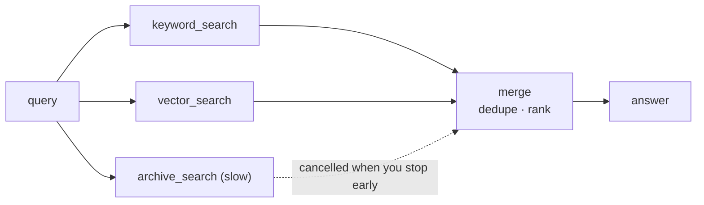

# Parallel retrieval

Ask several retrievers at once, merge what they return, and stop early when one answer is
enough. Every call still goes through the executor's guards, caps, timeouts and ledger.



## Pick a method

| Need | Method | Returns |
|---|---|---|
| Fan out, wait for all, merge | `run_many(calls, ctx, concurrency=, on_error=)` | `ToolResult`s in input order |
| Take results as they finish, stop early | `as_completed(calls, ctx, concurrency=)` | async iterator in completion order |
| Steps that depend on other steps | `run_plan(steps, ctx)` | `{step.id: ToolResult}` |
| Non-tool work (LLM, embeddings) | `parallel(*work, timeout=, retries=)` | values in input order |

## The retrievers

```python
--8<-- "examples/howto_parallel.py:tools"
```

Mark retrievers `parallel_safe=True`. A tool without it takes the run's exclusive lock,
so the batch runs it alone.

```python
--8<-- "examples/howto_parallel.py:executor"
```

`RunLimits(per_kind={"search": 2})` caps concurrent `search` calls per run, whatever
`concurrency` a batch asks for. Use it to protect a rate-limited backend. For a rate
(calls per second) add a `RateLimitHook` ([Hooks](../concepts/hooks.md#ratelimithook)).

## Fan out, fan in

```python
--8<-- "examples/howto_parallel.py:fan_out"
```

| `on_error` | A failing call |
|---|---|
| `"collect"` (default) | stays in its `ToolResult` (`status="error"`); the rest finish |
| `"fail_fast"` | cancels the siblings; the first error is raised as itself |

No batch raises an `ExceptionGroup`. A batch may not repeat a non-empty call id
(`ToolUsageError`).

## Stop at the first good answer

```python
--8<-- "examples/howto_parallel.py:as_completed"
```

Wrap the stream in `contextlib.aclosing`. Leaving the block cancels the calls still
running: here the 30-second `archive_search` stops at once. Without `aclosing`, a `break`
or `return` leaves them running until the iterator is closed.

## Retrieve, then rank

```python
--8<-- "examples/howto_parallel.py:plan"
```

The plan runs in waves: `kw` and `vec` together, then `best`. A callable `args` gets the
`ToolResult`s of its own dependencies. A step whose dependency failed does not run: its
error kind is `dependency-failed`. A bad plan (duplicate ids, unknown dependencies, a
cycle) raises one `PlanInvalid` before anything runs.

## Non-tool work

```python
--8<-- "examples/howto_parallel.py:parallel"
```

Pass coroutine functions (zero-argument callables) so `retries=` can start them again; a
bare awaitable cannot be retried. Bind loop variables (`lambda t=t: ...`). A timeout is
`ToolTimeout(tool="parallel[i]")`.

## Output

```text
['ok', 'ok', 'error']
['returns policy', 'returns label', 'returns similar']
keyword_search: returns policy
['returns label', 'returns policy']
[14, 13]
```

## Tips

| Tip | Why |
|---|---|
| Pass one `ctx` to related batches | guards (`max_calls`, `once_per_run`) and caps count per run; with no `ctx` each batch is a fresh run |
| Give each retriever a `timeout` | one slow backend cannot hold the merge forever |
| Cache retriever results | `cache_ttl=` plus an executor cache ([Caching](caching.md)) |
| Cap only leaf kinds in `per_kind` | nesting capped kinds both ways can deadlock ([Executor policies](../concepts/executor-policies.md#runs-and-guards)) |

## Files

| File | Does |
|---|---|
| `examples/howto_parallel.py` | the retrievers and the four patterns |
| `tests/docs/test_howto_examples.py` | runs it offline and checks the output |
